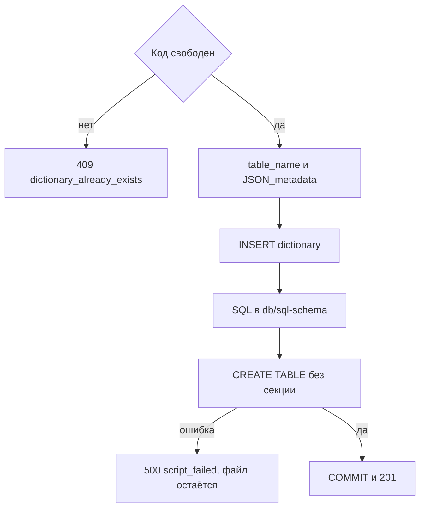

# [На главную](../../API.md)

# Описание

POST **/admin/passports**
Создать паспорт, описание полей, SQL метаданных и пустую таблицу. Версия не создаётся.

# Входные параметры

+ `dictionary_code`:
    + body
    + Обязательно
    + `^[A-Za-z][A-Za-z0-9_]{0,62}$`
    + Уникален без учёта регистра
    + После создания не меняется
+ `dictionary_name`:
    + body
    + Обязательно
    + От 1 до 200 символов
+ `owner`:
    + body
    + Не обязательно
    + До 200 символов, по умолчанию пусто
+ `fields`:
    + body
    + Не обязательно
    + До 50 дополнительных полей
    + Одинаковые `code` нельзя
+ `fields[].code`:
    + Обязательно, если элемент передан
    + `^[a-z][a-z0-9_]{0,62}$`
    + Не `version_id`, `value_code`, `name`
+ `fields[].name`:
    + Обязательно, если элемент передан
    + От 1 до 200 символов
+ `fields[].type`:
    + Обязательно, если элемент передан
    + `string`, `integer`, `bigint`, `date`, `uuid`
+ `fields[].length`:
    + Обязательно для `string`
    + От 1 до 4000, по умолчанию 500
    + У остальных типов нет
+ `fields[].nullable`:
    + Не обязательно
    + По умолчанию `true`

# Поля ответа

+ Паспорт со `status = active`
+ `table_name`
+ `schema_name` — пусто
+ `fields`
+ `versions` — пустой массив
+ `metadata_sql_path`

# Алгоритм работы

## Валидация

1. Проверить тело: шаблон `dictionary_code`, длины `dictionary_name` и `owner`, типы и длины элементов `fields`, шаблон `fields[].code`, уникальность `code` внутри переданного списка, запрет имён `version_id`, `value_code`, `name`, не больше 50 полей, неизвестных полей нет.
    + Нарушение:
        + Код: `invalid_request`
        + Статус: `400`

## Бизнес-логика

1. Проверить уникальность `dictionary_code` без учёта регистра.
    + Код занят:
        + Код: `dictionary_already_exists`
        + Статус: `409`
2. Построить `table_name` из `dictionary_code`: разделитель `_`, буквы строчные. Длина не больше 63.
    + `WallMaterial` → `wall_material`
3. Собрать `JSON_metadata`: `dictionary_code`, `table_name`, длина `value_code` 64, длина `name` 500, массив `fields` как в запросе.
4. Начать транзакцию.
5. Вставить строку в `dictionary`: новый `dictionary_id`, `status = active`, `JSON_metadata`. Отдельный JSON-файл не пишется.
6. Записать SQL в `db/sql-schema/{локальное время до секунды} - {table_name}.sql`.
    + Пример: `db/sql-schema/2026.10.23 16.00.00 - wall_material.sql`
    + UTF-8 без BOM
    + Если имя занято, добавить `-2`, `-3` и далее
    + В файле создание родительской таблицы без секции и без строк. Своих `BEGIN` и `COMMIT` нет
    + Колонки: `version_id integer NOT NULL`, `value_code varchar(64) NOT NULL`, `name varchar(500) NOT NULL`, затем дополнительные поля в порядке `fields`
    + `string` → `varchar(length)`, `integer` → `integer`, `bigint` → `bigint`, `date` → `date`, `uuid` → `uuid`
    + Первичный ключ `(version_id, value_code)`
    + `PARTITION BY LIST (version_id)`, без `DEFAULT`-секции
    + Имена таблиц и колонок в двойных кавычках
7. Выполнить файл в той же транзакции.
    + Ошибка выполнения:
        + Код: `script_failed`
        + Статус: `500`
        + Транзакция откатывается, уже записанный SQL-файл остаётся
8. Зафиксировать транзакцию. Вернуть статус `201` и `metadata_sql_path`.

`JSON_metadata` пишется в колонку `dictionary`, отдельного JSON-файла нет. SQL — родительская таблица без секции и без строк. Ошибка выполнения откатывает паспорт и таблицу, уже записанный файл остаётся.
