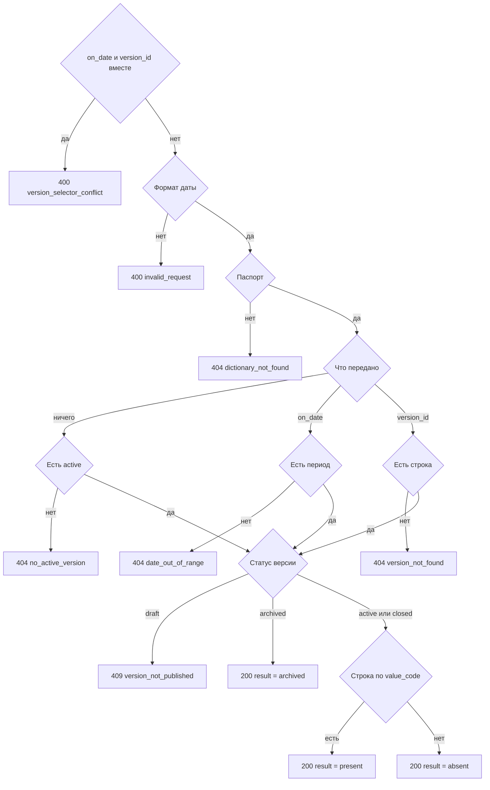

# [На главную](../../API.md)

# Описание

GET **/dictionaries/{dictionary_code}/values/{value_code}**
Код и подпись одной строки выбранной редакции.

# Входные параметры

+ `dictionary_code`:
    + path
    + Обязательно
+ `value_code`:
    + path
    + Обязательно
+ `on_date`:
    + query
    + Не обязательно
    + Дата `YYYY-MM-DD`
    + Вместе с `version_id` нельзя
+ `version_id`:
    + query
    + Не обязательно
    + Вместе с `on_date` нельзя

# Поля ответа

+ `dictionary_code`
+ `version_id`
+ `version_status`
+ `valid_from`
+ `valid_to`
+ `archived`
+ `result`:
    + `present` — код есть, `name` заполнен
    + `absent` — версии код нет, `name` пусто
    + `archived` — статус версии `archived`, `name` пусто
+ `value_code`
+ `name`

`absent` и `archived` возвращаются со статусом `200`.

# Алгоритм работы

1. Проверить селектор редакции.
    + Переданы и `on_date`, и `version_id`:
        + Код: `version_selector_conflict`
        + Статус: `400`
    + Дата не в виде `YYYY-MM-DD`:
        + Код: `invalid_request`
        + Статус: `400`
2. Найти паспорт по коду без учёта регистра.
    + Нет:
        + Код: `dictionary_not_found`
        + Статус: `404`
    + `inactive` чтению не мешает
3. Выбрать редакцию.
    + Ничего не передано — версия со `status = active`. Нет такой:
        + Код: `no_active_version`
        + Статус: `404`
    + Передан `on_date` — версия, где `valid_from <= дата` и (`valid_to` пуст или `valid_to >= дата`). Несколько строк — больший `version_id`. Нет периода:
        + Код: `date_out_of_range`
        + Статус: `404`
    + Передан `version_id` — эта версия. Нет строки:
        + Код: `version_not_found`
        + Статус: `404`
    + Выбранная версия в `draft`:
        + Код: `version_not_published`
        + Статус: `409`
    + Выбранная версия в `archived` — вернуть статус `200`, `archived: true`, `result = archived`, `name` пусто. Таблицу не читать
4. Иначе выбрать `value_code`, `name` из таблицы справочника по `version_id` и `value_code`.
    + Строка есть — `result = present`
    + Строки нет — `result = absent`, `name` пусто
5. Вернуть статус `200`.

Пустой селектор берёт действующую версию. `on_date` берёт период, куда дата входит включительно, среди `active`, `closed` и `archived`; черновик в период не входит. При нескольких строках берётся больший `version_id`. Статус `archived` отдаёт `result = archived` без чтения секции. `absent` и `archived` — успешный `200`.
