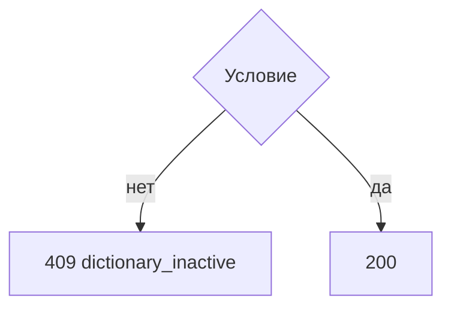
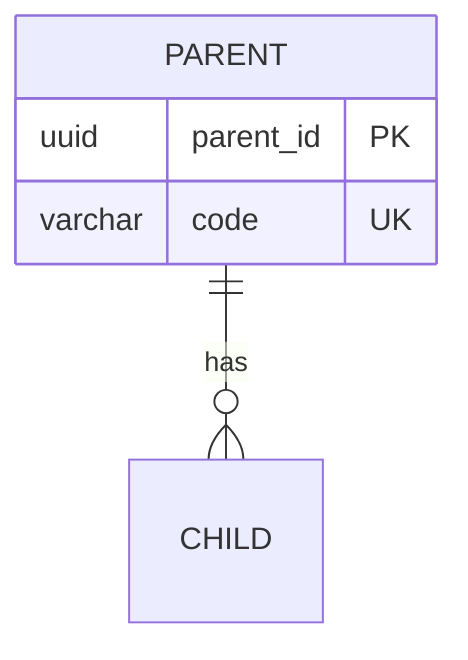

# Правила ведения спецификации

Когда в диалоге просят написать спецификацию, результат — набор файлов ниже. Образец заполнения: `docs/0. roles and rules/docs/templates/specification`. Из образца берётся структура, состав разделов и формат. Предмет образца (справочники, паспорта, версии, `WallMaterial`) в новую спецификацию не переносится.

Запрещено в спецификации писать то, чего НЕ делает функционал или его часть "чтобы были читающему лучше понимать границы". Следует писать только то, что происходит.

Папку называет запрос. Если папка не названа, спецификация пишется в `docs/1. functional/` в подпапку, которую указывает запрос.

Одни и те же факты совпадают в `API.md`, файлах методов, `DB.md` и `UI.md`.

## Состав

```
API.md
DB.md
UI.md
Broker.md
{project}.api/{Controller}/{verb}_{name}.md
```

`{project}.api` — `management.api` для проекта `admin` и `service.api` для проекта `service`. Имя файла метода — глагол и объект в нижнем регистре: `post_passports.md`, `get_version.md`, `patch_version.md`.

Файлы `API.md`, `DB.md`, `UI.md`, `Broker.md` есть всегда. Если части нет, файл состоит из одной фразы, как `Broker.md` в образце: «В текущей реализации использование брокера не планируется».

## `API.md`

Два раздела и ничего больше.
Описание одного метода живёт в своём файле.

```markdown
# Функционал

| Проект | Контроллер | Метод | Описание |
| --- | --- | --- | --- |
| admin | MetadataController | `POST /admin/passports` | [Короткая подпись](management.api/MetadataController/post_passports.md) |

# Коды ответов

|Код состояния (status)|Код ошибки (code)|Расшифровка|Описание|
|-|-|-|-|
|400|`invalid_request`|Некорректный запрос|-|
```

+ `Проект` — `admin` или `service`.
+ `Метод` — глагол и полный путь в обратных кавычках.
+ `Описание` — ссылка на файл метода. Текст ссылки — короткая подпись действия.
+ Строки сгруппированы по проекту, внутри проекта — по контроллеру.
+ В таблице кодов только ошибки. Успешные `200`, `201`, `204` туда не входят.
+ `code` — в обратных кавычках. Столбец «Описание» — `-`, если к расшифровке нечего добавить.
+ Каждый код, названный в алгоритме метода, есть в этой таблице.

## Файл метода

Порядок разделов фиксирован.

```markdown
# [На главную](../../API.md)

# Описание

POST **/admin/passports**
Одно или два предложения: что делает метод и чего он не делает.

# Входные параметры

+ `dictionary_code`:
    + path
    + Обязательно
    + ограничение

# Поля ответа

+ `version_id`
+ `status` = `draft`

# Алгоритм работы
```

+ Вызов в описании: глагол обычным текстом, путь жирным.
+ У параметра обязательны имя, место и обязательность. Место — одно из `path`, `query`, `body`, `form`. Дальше ограничения: тип, длина, шаблон, значение по умолчанию, взаимный запрет.
+ Если тела нет, под списком параметров строка «Тела нет.» То же для пустого ответа.
+ Поля ответа — имена полей успешного ответа. Вложенность через отступ `+`. Если набор полей зависит от ветки, перед списком стоит название ветки.
+ Ссылка на другой метод той же папки — коротким именем файла.

### Алгоритм `management.api`

Два подраздела.

~~~~markdown
## Валидация

1. Проверить тело.
    + Нарушение:
        + Код: `invalid_request`
        + Статус: `400`

## Бизнес-логика

1. Условие предметной ветки:
    + Код: `dictionary_inactive`
    + Статус: `409`
2. Записать результат. Вернуть статус `200`.



Одно предложение о том, что диаграмма не показывает: файлы, транзакция, что метод не меняет.
~~~~

+ `Валидация` — форма входных данных и существование объекта по переданному идентификатору. Сюда входят тип, регулярное выражение, длина, обязательное поле, лишнее поле, неразобранное тело, `404`, если строка по переданному идентификатору не найдена.
+ Несовместимость уже найденных данных с запрошенным действием — в `Бизнес-логике`.
+ Диаграмма есть только у бизнес-логики.
+ Если именованного кода нет, в ветке остаётся строка `Статус`. Код в этом случае не выдумывается.

### Алгоритм `service.api`

Разделов «Валидация» и «Бизнес-логика» нет. Один нумерованный список, затем диаграмма, затем одно поясняющее предложение. Ветки ошибок оформлены так же: `Код` и `Статус`.

### Диаграмма

+ `flowchart TD`.
+ Идентификатор узла без пробелов.
+ Подпись со спецсимволами — в кавычках.
+ На стрелке короткое условие. В узле ошибки — статус и код, если код есть.

## `DB.md`

~~~~markdown
# Схема БД для API {функционала}

## ER-диаграмма



## Таблица `parent`

Одно или два предложения: что хранит таблица.

| Поле | Тип | Ограничения | Назначение |
| --- | --- | --- | --- |
| `parent_id` | `uuid` | `PK` | Внутренний идентификатор |

Индексы и ограничения:

+ `ux_parent_code` на `lower(code)`

Правила работы:

+ какое действие строку создаёт, меняет или удаляет

## Связи между таблицами

+ `parent 1 -> N child`
~~~~

+ Имена сущностей на ER — в верхнем регистре. `PK`, `FK`, `UK` помечаются в диаграмме.
+ У каждой таблицы четыре блока: текст, поля, индексы и ограничения, правила работы.
+ В ограничениях поля: `PK`, `NOT NULL`, `NULL`, `FK -> таблица.поле`, значение по умолчанию.
+ Правила работы называют конкретные вызовы, если строка меняется методом API.
+ Раздела «Основные сценарии» нет.

## `UI.md`

Экраны. Путей, тел запросов и кодов ответов в файле нет.

Сначала заголовок и одно предложение, чьи это экраны. Затем блок `<style>` копируется из образца целиком: фон `.screen` — `#ececec`.

```markdown
## Общие правила

- Правило, которое видно на нескольких экранах.

## Экраны

### Экран «Название»

<div class="screen">
  <h1>Название</h1>
  ...данные, поля, кнопки...
</div>

- «Кнопка» — что делает на экране.
```

+ На макете есть все отображаемые данные, все поля ввода и все кнопки. Дизайн не добавляется.
+ Один макет — один `div.screen`. Пустое состояние, диалог и текст ошибки — внутри этого же макета классами `empty`, `dialog`, `error`.
+ Под макетом действия списком `-`. «Текст кнопки» — что происходит. Нумерованных разделов «Что отображается» и «Действия» нет.
+ Заголовки экранов: `Экран`, `Окно` или `Диалог`.
+ Даты на макете в виде `ДД.ММ.ГГГГ`. В полях `input type="date"` значение `YYYY-MM-DD`.
+ В таблицах и полях один конкретный пример данных этого функционала.
+ Фон макета слегка серый, чтобы окно не сливалось с фоном документа.

## `Broker.md`

Либо одна фраза, что брокер не планируется, либо такое же описание контракта, как у метода: что публикуется, поля сообщения, когда это происходит. Пока в образце брокера нет, новый брокер описывается только если запрос его задал.
