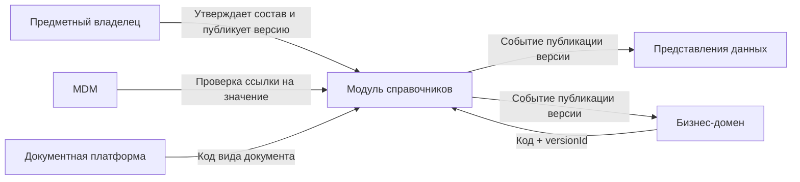

# Модуль справочников: назначение и границы

В обзорной схеме РЕОН 2 справочники названы частью MDM/НСИ. Этот документ разделяет две ответственности: эталонный объект и кодированный список.

## 1. Назначение

Модуль хранит и публикует общие кодированные списки РЕОН 2: значения, их версии и срок действия. Потребитель получает значение по коду, по версии или на дату и может проверить, что ссылка допустима.
Модуль — технический владелец записи справочника. Предметный владелец утверждает состав значений и правила. Модуль не подменяет этот состав «удобным» значением (MDM-F05).
Назначение здания, материал стен и тип перекрытий — значения справочника. Связка «вид объекта + назначение» — составное значение со своим кодом. Отбор «только жилые помещения для сценария нераспределённых помещений» — правило конкретного домена. Такие правила остаются у потребителя.

## 2. Что считается справочником

Запись принимается в модуль, когда одновременно верно следующее:

- значение выбирается из ограниченного списка и имеет устойчивый код;
- список меняется медленно и нужен больше чем одному потребителю либо обязателен как контролируемый словарь;
- назначен предметный владелец;
- потребителю нужно либо закреплённая версия, либо ответ «что действовало на дату».

Составное значение допустимо, если оно само является кодом списка и ссылается на другие коды. Так устроена связка вида объекта и назначения: это не карточка здания и не запись реестра помещений, а строка справочника.

## 3. Граница модуля

| Объект                                                                                 | Владелец                        | Что хранит модуль справочников                       |
| -------------------------------------------------------------------------------------- | ------------------------------- | ---------------------------------------------------- |
| Код, наименование, атрибуты значения, срок действия                                    | Модуль справочников             | Саму запись и её версии                              |
| Версия справочника (`versionId`, период действия)                                      | Модуль справочников             | Неизменяемую опубликованную версию                   |
| Синоним и исключение значения                                                          | Модуль справочников             | Правило сопоставления или скрытия внутри справочника |
| Ссылка «атрибут объекта → код значения»                                                | Владелец объекта                | Ничего, кроме самого значения по запросу             |
| Золотая запись («Здание» и другие мастер-сущности), `masterId`, происхождение атрибута | MDM                             | —                                                    |
| Заявление, реестр, решение, статус процесса                                            | Бизнес-домен или BPM            | —                                                    |
| Файл, карточка и версия документа                                                      | Документная платформа           | Коды видов документов, если это общий словарь        |
| Геометрия, слой, адресная нормализация ФИАС                                            | ГИС / отдельная адресная модель | Коды, которые не являются пространственным объектом  |
| Роли и полномочия                                                                      | Подсистема ИБ                   | —                                                    |
| Показатель, панель, печатная форма                                                     | Аналитика и отчётность          | —                                                    |
`ReferenceSet` из спецификации МДМ (код справочника, версия, значения, сроки, источник, владелец) переносится в этот модуль. В заявке MDM остаётся ссылка: код справочника, код значения, версия. Проверку ссылки выполняет модуль справочников.
Адрес и ФИАС в этот модуль целиком не входят: у адреса собственная модель и нормализация. Плоский код типа адресного объекта может быть справочником, сама адресная запись — нет.

## 4. Что модуль делает

- Ведёт паспорт справочника: код, наименование, владелец, источник, статус.
- Публикует версию.
- Отдаёт значение по коду, списку кодов, версии и дате.
- Хранит синонимы входящих написаний и исключения показа значений.
- Публикует событие о новой версии, чтобы потребители обновили локальные копии.
- Принимает загрузку версии от владельца или из согласованного источника. Прямая правка опубликованных строк в обход версии не допускается.

## 5. Что остаётся у других модулей

- **MDM** собирает эталон из источников, хранит историю выбора значения и ссылку на код. Список допустимых кодов он не ведёт.
- **Бизнес-домен** выбирает значение в операции и хранит у своей записи ссылку: код справочника, код значения, версия. Повторяющийся отбор списка для своего сценария домен задаёт у себя, в одном фасаде. Подробнее — в разделе 6.
- **BPM** ведёт ход процесса. Статус заявления — состояние процесса, даже если на экране он выглядит как список.
- **Представления данных** могут вложить наименование значения в модель чтения. Источник наименования — опубликованная версия справочника.
- **Поиск** индексирует разрешённые подписи. Исходная запись справочника остаётся в модуле.
- **Интеграционный слой** доставляет внешний файл или сообщение. Разбор в версию справочника делает модуль справочников по согласованному профилю загрузки.

## 6. Составные значения и предметные выборки

Составная строка «вид объекта + назначение» (например, «здание / многоквартирный дом») входит в модуль, если у неё есть собственный код и другая запись хранит этот код. Карточка помещения ссылается на код этой связки, поэтому она публикуется как значение справочника вместе с версией. Коды соединяются при публикации, а не при каждом чтении.
Индекс для быстрого чтения (`версия → вид объекта → назначение`) — внутренний кэш модуля. Отдельный справочник из него не создаётся. Если набор собран только ради скорости и ни одна запись не хранит его код, в модуль он не добавляется.
Повторяющийся предметный отбор («только жилые помещения», «материалы стен, допустимые для этого назначения», «значения, доступные на шаге услуги») задаётся один раз в фасаде подсистемы-клиента. Остальной код подсистемы вызывает фасад и не копирует одну и ту же цепочку условий.

- Короткий список фасад забирает целиком и отбирает у себя.
- Большой список фасад передаёт в запрос ограничения, которые модуль уже понимает: код связанного значения, дату, признак исключения. Смысл отбора остаётся в фасаде. Модуль не знает, что это правило конкретной услуги.

Новый справочник ради такого отбора не заводят.

## 7. Стыки

Потребитель закрепляет `versionId` в своей операции, если решение должно объясняться задним числом. Для экранов, где нужна текущая редакция, достаточно даты или признака актуальной версии.
Локальная копия у потребителя хранит код, версию и время актуальности. Изменение копии не меняет справочник: для этого публикуется новая версия.

## 8. Открытые решения

1. Первая поставка МДМ считает справочники частью эталона. После согласия с этой границей обзорную схему и спецификацию МДМ нужно поправить: `ReferenceSet` становится внешним контрактом, а не внутренней таблицей MDM.
2. Нужен критерий для коротких процессных списков вроде «способ поступления заявления»: общий справочник или локальный список домена. Пока порог такой — список общий, если им пользуются хотя бы два домена или его требует внешний формат.

