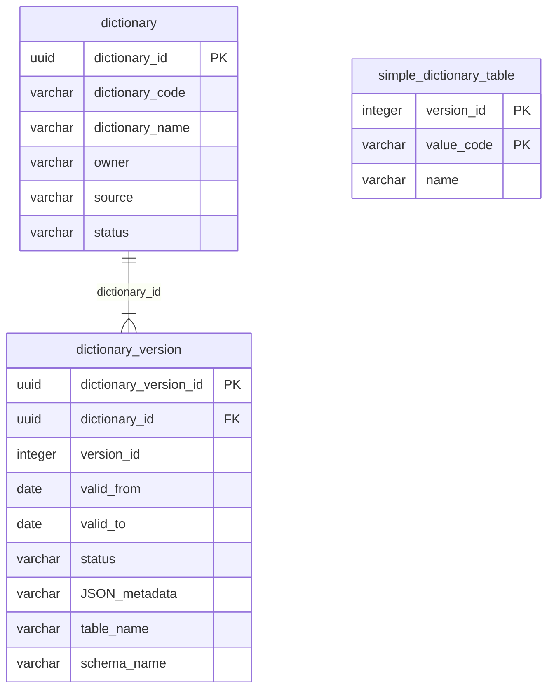

# Модуль справочников: модель данных

Синоним и исключение значения в эту редакцию модели не входят. К ним вернёмся отдельно.

## 1. Справочник — один список

Справочник — один кодированный список, а не пакет списков в одной поставке. «Материал стен» и «вид собственности» — два справочника. У каждого свой владелец, свой состав и своя публикация.
Пакет, в котором несколько списков обязаны сменять версию одновременно, не используем. Списков много, и обновляться они должны независимо.

## 2. Общий каталог и свои таблицы данных

Общие для модуля только две сущности каталога: паспорт справочника и его версии. Строки справочника в одну общую таблицу не складываются.

Одна таблица на все значения не подходит по двум причинам.

Не каждый справочник — пара «код — наименование». Часть справочников устроена как небольшой набор таблиц со своими колонками и внешними ключами. Так устроен ФИАС: обновление приходит пакетом файлов, и каждая сущность пакета — отдельная таблица. Чтобы положить такой пакет в общую таблицу значений, нужен конвертер, отдельное хранение исходных связей и переделка сторонних модулей, которые используют этот справочник в исходном виде его таблиц.

Вторая причина — объём. У справочников большая история. Общая таблица собрала бы её в одно место и усложнила бы хранение и поиск. История материала стен не должна лежать рядом с историей адресного набора.

Одна редакция справочника — одна строка версии.

У версии заполнено одно из полей размещения, и оно одно и то же для всех версий этого справочника.

- Простой список заполняет «Таблицу»: постоянное имя своей секционированной таблицы.
- Набор заполняет «Схему»: постоянное имя своей схемы. Состав таблиц внутри схемы задаёт источник, в каталоге их нет. Конвертер в пары «код — наименование» не делается.

`simple_dictionary_table` на схеме ниже — каркас, а не общая таблица модуля. У каждого простого списка своя таблица этого каркаса. Дополнительные колонки конкретного списка в каркас не входят.

Первичный ключ таблицы называется по имени таблицы. Единственный внешний ключ каталога — `dictionary_version.dictionary_id`. Номер `version_id` в строках данных с каталогом внешним ключом не связан.
### dictionary

| Тип | Наименование | Комментарий |
|---|---|---|
| uuid | dictionary_id | Первичный ключ |
| varchar | dictionary_code | Устойчивый код списка: `WallMaterial`, `OwnershipType` |
| varchar | dictionary_name | Название для человека |
| varchar | owner | Предметный владелец состава |
| varchar | source | Откуда поступает состав |
| varchar | status | `active` — список ведётся. `inactive` — новые версии не публикуются |
### dictionary_version

| Тип     | Наименование          | Комментарий                                                      |
| ------- | --------------------- | ---------------------------------------------------------------- |
| uuid    | dictionary_version_id | Первичный ключ                                                   |
| uuid    | dictionary_id         | Внешний ключ на `dictionary.dictionary_id`                       |
| integer | version_id            | Номер версии внутри этого справочника                            |
| date    | valid_from            | С какой даты редакция действует                                  |
| date    | valid_to              | По какую дату. Пусто, пока статус `active`                       |
| varchar | status                | `draft`, `active`, `closed`.                                     |
| varchar | JSON_metadata         | JSON схема справочника (создание схемы + валидации данных)       |
| varchar | table_name            | Имя таблицы простого списка. Пусто, если заполнена `schema_name` |
| varchar | schema_name           | Имя схемы набора таблиц. Пусто, если заполнена `table_name`      |
### simple_dictionary_table

| Тип | Наименование | Комментарий |
|---|---|---|
| integer | version_id | Часть первичного ключа. Номер версии из каталога |
| uuid | simple_dictionary_table_id | Часть первичного ключа. В конкретной таблице колонка называется по имени таблицы: у `wall_material` это `wall_material_id` |
| varchar | value_code | Устойчивый код строки. Вместе с `version_id` уникален внутри таблицы |
| varchar | name | Подпись строки для человека |

Код значения устойчив между версиями одного справочника. Новая версия может добавить строку, убрать её или изменить наименование. Тот же код в другой версии — та же смысловая строка в другой редакции. Срок действия задаёт версия в каталоге, а не строка.

## 3. Как клиент работает с версией

`version_id` не сквозной для всех справочников. Публикация одного списка не меняет номера остальных. Клиент эти счётчики не ведёт.

- Клиент передаёт код справочника и, когда нужна редакция на дату, одну дату. Номер версии назначает модуль. 
- Номер клиент сохраняет только вместе с выбранным значением. Этот номер возвращает модуль в ответе на чтение. 

## 4. Что остаётся у потребителя

Потребитель хранит ссылку на выбранную строку: код справочника, код значения, `version_id`. Сами таблицы списка остаются в модуле.

Документ, который должен читаться годы спустя, вместе со ссылкой хранит копию использованных значений: код, подпись и те атрибуты, которые вошли в документ. Сверка со старой секцией для чтения документа не нужна. Ссылка остаётся меткой редакции на случай, если секция ещё есть в архиве. В рабочей базе не держат все версии часто обновляемого набора за десятки лет.

Карточка здания и золотая запись MDM хранят ссылку на код в конкретной версии и не хранят перечень значений. Перечень материала стен остаётся в модуле справочников.
