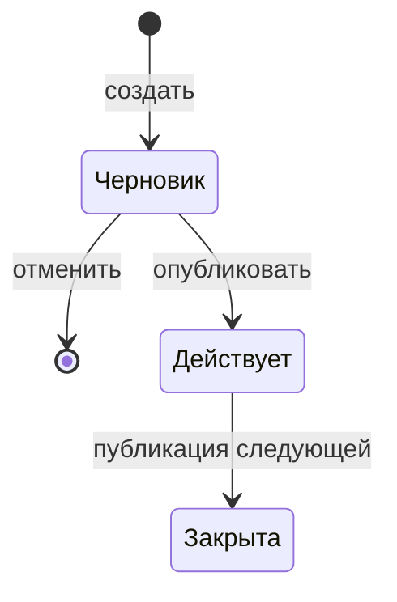

# Модуль справочников: жизненный цикл версии

## 1. Переходы

У справочника не больше одного черновика и одной действующей версии. Строки меняются только у черновика.

При создании черновика `version_id` — на единицу больше максимального номера этого справочника. В той же операции создаются пустые секции этого номера.
Отмена удаляет секции и строку каталога. События нет. Номер отменённого черновика может получить следующий.
Публикация выполняется одной транзакцией. Команду принимает модуль, полномочие владельца проверяет подсистема ИБ.

1. Блокирует паспорт справочника и проверяет условия.
2. Если действующая версия есть, ставит ей `closed` и `valid_to` на день раньше `valid_from` новой.
3. Ставит черновику `active`.
4. Пишет событие: код справочника, новый `version_id`, `valid_from` и номер предыдущей действующей версии, если она была.

Откат транзакции откатывает и событие. Закрыть действующую версию отдельной командой нельзя.
Условия публикации: версия — черновик этого справочника; простой список не пуст; у набора секции этого номера есть во всех таблицах схемы; `valid_from` заполнен, не позже дня публикации и, если действующая версия есть, строго позже её `valid_from`.

1 января 2024 публикуется версия 1. 20 октября 2026 публикуется версия 2 с `valid_from` 20 октября 2026: версия 1 закрыта по 19 октября. Если в тот же день публикуют версию 3 с `valid_from` 1 октября 2026, `valid_to` версии 2 становится 30 сентября, версия 1 не меняется.
## 2. Архив

Отсоединить можно только секцию закрытой версии. Строка каталога остаётся. Чтение по этому `version_id` сообщает, что редакция была, и строк не возвращает.
## 3. Чтение

Параметры:

- Без даты — действующая версия. Если её нет, текущей редакции нет.
- С датой — версия, в чей период дата попадает включительно. Пустой `valid_to` — открытый конец. Дата раньше первой редакции не переносится на более позднюю.
- С `version_id` — эта действующая или закрытая версия.

Проверка кода смотрит секцию переданного `version_id`.
