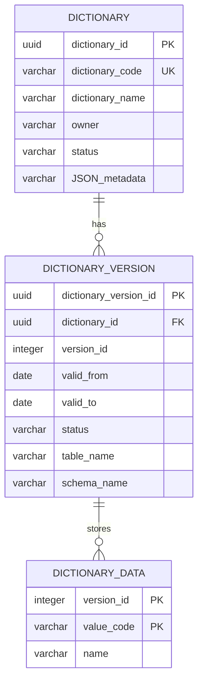

# Схема БД для API справочников

Пустая база поднимается скриптом [init.sql](db/init.sql): таблицы `dictionary` и `dictionary_version`, их ключи, проверки и индексы. Таблицы значений в этот скрипт не входят.

## ER-диаграмма

## Таблица `dictionary`

Реестр справочников.
Содержит метаданные справочника (код, название, владелец, состояние и схему структуры данных)

| Поле | Тип | Ограничения | Назначение |
| --- | --- | --- | --- |
| dictionary_id | uuid | PK | Внутренний идентификатор справочника |
| dictionary_code | varchar(63) | NOT NULL | Устойчивый код справочника |
| dictionary_name | varchar(200) | NOT NULL | Название для человека |
| owner | varchar(200) | NULL | Предметный владелец |
| status | varchar(16) | NOT NULL, по умолчанию active | active — паспорт принимает версии, inactive — нет |
| JSON_metadata | varchar | NOT NULL | Текущее описание полей, пока и после появления версий |

Индексы и ограничения:

+ `ux_dictionary_code` на `lower(dictionary_code)`
+ `dictionary_status_check`: `status` только `active` или `inactive`

## Таблица `dictionary_version`

Реестр версий справочников.
Содержит метаданные версий справочника (номер версии, интервал дат, на котором эта версия справочника была актуальной, текущий статус, название таблицы или схемы таблиц справочника)

| Поле | Тип | Ограничения | Назначение |
| --- | --- | --- | --- |
| dictionary_version_id | uuid | PK | Внутренний идентификатор версии |
| dictionary_id | uuid | NOT NULL, FK -> dictionary.dictionary_id | Паспорт справочника |
| version_id | integer | NOT NULL | Номер версии внутри справочника, с 1 |
| valid_from | date | NULL | Дата начала действия. Пустая только у черновика |
| valid_to | date | NULL | Дата окончания. Пустая у draft и active |
| status | varchar(16) | NOT NULL | draft, active, closed или archived |
| table_name | varchar(63) | NULL | Имя таблицы простого списка |
| schema_name | varchar(63) | NULL | Имя схемы набора таблиц. Для простого списка пусто |

Индексы и ограничения:

+ `dictionary_version_pk` на `(dictionary_id, version_id)`
+ `ux_dictionary_version_active` на `dictionary_id`, где `status = active`
+ `ux_dictionary_version_draft` на `dictionary_id`, где `status = draft`
+ `dictionary_version_status_check`: `draft`, `active`, `closed`, `archived`
+ у `active` поле `valid_to` пусто
+ у `closed` и `archived` поле `valid_to` заполнено
+ заполнено ровно одно из `table_name` и `schema_name`

Правила работы:

+ у справочника не больше одной версии `active` и не больше одной `draft`
+ `POST /admin/dictionaries/{dictionary_code}` создаёт строку `draft`, секцию и строки данных. Повтор при живом черновике не создаёт вторую строку
+ `PATCH` со `status = active` переводит этот черновик в `active` и в том же запросе закрывает прежнюю `active`: `valid_to` — день перед `valid_from` новой
+ `PATCH` со `status = closed` переводит текущую `active` в `closed` и записывает `valid_to` из запроса
+ `PATCH` со `status = archived` переводит `closed` в `archived` и в том же запросе отсоединяет секцию
+ `DELETE` удаляет строку только при `status = draft`, вместе с секцией и строками данных
+ `version_id` не сквозной между справочниками и внешним ключом со строками данных не связан

## Таблица данных справочника

Имя таблицы — `dictionary_version.table_name`, например `wall_material`. Таблица создаётся пустой при создании паспорта и секционируется `PARTITION BY LIST (version_id)`. Одна версия — секция `{table_name}_{version_id}`.

| Поле | Тип | Ограничения | Назначение |
| --- | --- | --- | --- |
| version_id | integer | NOT NULL, входит в PK | Номер версии, значение секции |
| value_code | varchar(64) | NOT NULL, входит в PK | Код значения внутри версии |
| name | varchar(500) | NOT NULL | Подпись значения |
| колонки из fields | по типу поля | NULL или NOT NULL | Дополнительные поля в порядке JSON_metadata.fields |

Индексы и ограничения:

+ первичный ключ `(version_id, value_code)`
+ секция `{table_name}_{version_id}` для `FOR VALUES IN (version_id)`
+ внешнего ключа на `dictionary_version` нет

Правила работы:

+ `string` хранится как `varchar(length)`, `integer` как `integer`, `bigint` как `bigint`, `date` как `date`, `uuid` как `uuid`
+ поиск строк версии читает секцию `draft`, `active` и `closed`. Для `archived` секции нет, строки не читаются
+ при удалении черновика секция удаляется. При архивации секция отсоединяется, строка `dictionary_version` остаётся

## Связи между таблицами

+ `dictionary 1 -> N dictionary_version`
+ `dictionary_version 1 -> N` строк своей секции в таблице `table_name`
