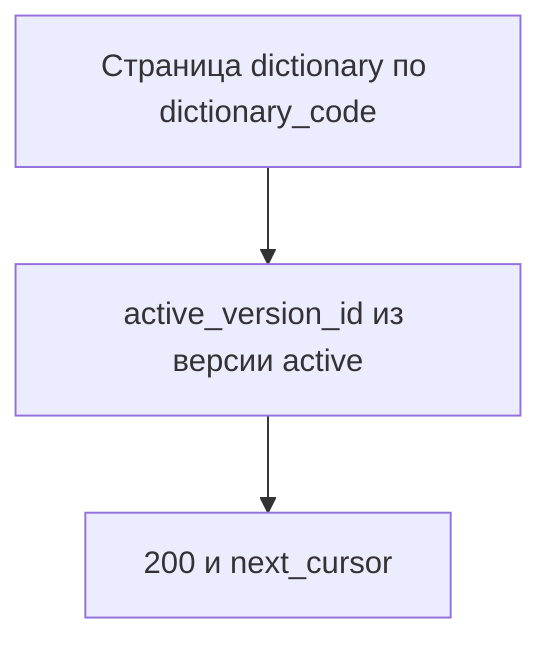

# [На главную](../../../API.md)

# Описание

GET **/admin/passports**
Страница паспортов. Строк значений нет.

# Входные параметры

+ `limit`:
    + query
    + Не обязательно
    + integer, от 1 до 1000, по умолчанию 100
+ `cursor`:
    + query
    + Не обязательно
    + Непрозрачная строка предыдущего ответа

# Поля ответа

+ `items`:
    + Массив
    + `dictionary_id`
    + `dictionary_code`
    + `dictionary_name`
    + `owner` — может быть пустым
    + `status`
    + `active_version_id` — номер версии со статусом `active` или пусто
+ `next_cursor` — пусто, если страниц больше нет

# Алгоритм работы

## Валидация

1. `limit`, если передан, — целое число от 1 до 1000.
    + Иначе:
        + Код: `invalid_request`
        + Статус: `400`
2. `cursor`, если передан, — строка предыдущего ответа, которая разбирается.
    + Не разбирается:
        + Код: `invalid_request`
        + Статус: `400`

## Бизнес-логика

1. Прочитать страницу `dictionary` в порядке `dictionary_code`.
2. Для каждой строки найти версию со `status = active`.
    + Есть — отдать её `version_id` как `active_version_id`
    + Нет — `active_version_id` пустой
3. Если страниц больше нет, `next_cursor` пустой.
4. Вернуть статус `200`.

`active_version_id` пустой, если действующей версии нет. Файлы метод не пишет.
