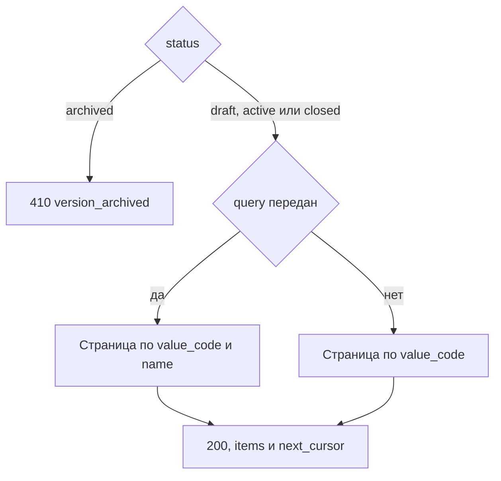

# [На главную](../../../API.md)

# Описание

GET **/admin/dictionaries/{dictionary_code}/versions/{version_id}**
Поиск строк версии. Черновик, действующая и закрытая ищутся одинаково. У `archived` строк нет.

# Входные параметры

+ `dictionary_code`:
    + path
    + Обязательно
+ `version_id`:
    + path
    + Обязательно
+ `query`:
    + query
    + Не обязательно
    + Подстрока поиска без учёта регистра
    + Пустое значение — без фильтра по тексту
+ `limit`:
    + query
    + Не обязательно
    + integer, от 1 до 1000, по умолчанию 100
+ `cursor`:
    + query
    + Не обязательно
    + Последний `value_code` предыдущей страницы

# Поля ответа

+ `dictionary_code`
+ `version_id`
+ `version_status`
+ `valid_from`
+ `valid_to`
+ `archived` — `true`, когда `status = archived`
+ `items`:
    + Массив, порядок по `value_code`
    + `value_code`
    + `name`
    + дополнительные поля строки
+ `next_cursor` — последний `value_code` страницы или пусто

# Алгоритм работы

## Валидация

1. Найти паспорт по переданному коду.
    + Нет:
        + Код: `dictionary_not_found`
        + Статус: `404`
2. Найти `dictionary_version` по `dictionary_id` и переданному `version_id`.
    + Нет строки:
        + Код: `version_not_found`
        + Статус: `404`
3. `limit`, если передан, — целое число от 1 до 1000. `cursor`, если передан, разбирается как `value_code` предыдущей страницы.
    + Иначе:
        + Код: `invalid_request`
        + Статус: `400`

## Бизнес-логика

1. `status = archived`:
    + Код: `version_archived`
    + Статус: `410`
    + Строки не читать
2. Прочитать секцию `WHERE version_id = {version_id}`.
    + `query` передан — оставить строки, где `value_code` или `name` содержит эту подстроку без учёта регистра
    + При курсоре `value_code` больше курсора
    + Сортировка по `value_code`, предел `limit`
3. Вернуть статус `200`. Ноль строк — пустой `items`. Если продолжать нечего, `next_cursor` пустой. Файл в `db/sql-data` не писать.

Без `query` возвращается страница всех строк версии. Черновик администратору доступен. `archived` означает, что секция отсоединена и искать нечего.
