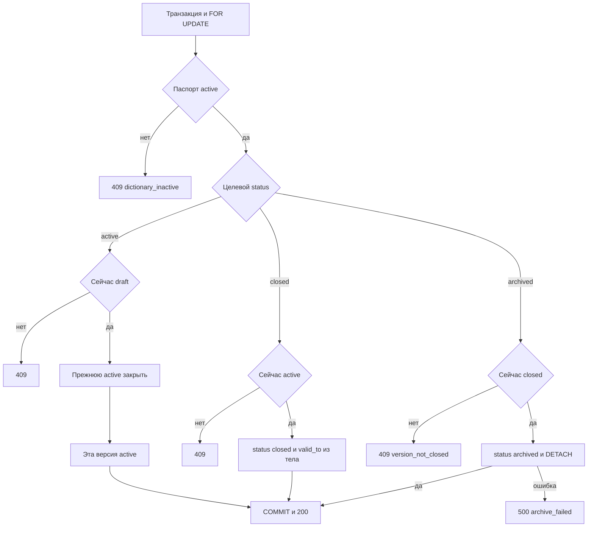

# [На главную](../../../API.md)

# Описание

PATCH **/admin/dictionaries/{dictionary_code}/versions/{version_id}**
Сменить статус версии. Переход `draft` → `active` публикует черновик и в той же транзакции закрывает прежнюю действующую версию. Переходы `active` → `closed` и `closed` → `archived` меняют одну версию.

# Входные параметры

+ `dictionary_code`:
    + path
    + Обязательно
+ `version_id`:
    + path
    + Обязательно
+ `status`:
    + body
    + Обязательно
    + `active`, `closed` или `archived`
+ `valid_to`:
    + body
    + Обязательно при `status = closed`
    + Дата `YYYY-MM-DD`
    + При `active` и `archived` не передаётся

# Поля ответа

Переход в `active`:

+ `version_id`
+ `status` = `active`
+ `valid_from`
+ `valid_to` — пусто
+ `closed_version_id` — пусто, если закрывать было нечего
+ `closed_valid_to` — пусто, если закрывать было нечего

Переход в `closed`:

+ `version_id`
+ `status` = `closed`
+ `valid_from`
+ `valid_to` — дата из тела

Переход в `archived`:

+ `version_id`
+ `status` = `archived`
+ `valid_from`
+ `valid_to`

# Алгоритм работы

## Валидация

1. Проверить тело.
    + `status` не из списка `active`, `closed`, `archived`:
        + Код: `invalid_request`
        + Статус: `400`
    + Лишнее поле:
        + Код: `invalid_request`
        + Статус: `400`
    + `status = closed`, а `valid_to` нет или дата не в виде `YYYY-MM-DD`:
        + Код: `invalid_request`
        + Статус: `400`
2. Найти паспорт по переданному коду.
    + Нет строки:
        + Код: `dictionary_not_found`
        + Статус: `404`
3. Найти `dictionary_version` по `dictionary_id` и переданному `version_id`.
    + Нет строки:
        + Код: `version_not_found`
        + Статус: `404`

## Бизнес-логика

1. Начать транзакцию. Заблокировать строку `dictionary` через `SELECT ... FOR UPDATE`.
2. `status` паспорта не `active`:
    + Код: `dictionary_inactive`
    + Статус: `409`
3. `status = active` в теле. Версия не `draft`:
    + Статус: `409`
4. `status = active` в теле. Есть другая версия со `status = active`:
    + Закрыть её в этой транзакции: `status = closed`, `valid_to = valid_from` публикуемой версии минус 1 день
    + Её номер — `closed_version_id`, дата — `closed_valid_to`
    + Действующей нет — оба поля ответа пустые
5. `status = active` в теле. Перевести черновик в `active`. `valid_from` не менять. `valid_to` оставить пустым. Секцию и строки не переписывать.
6. `status = closed` в теле. Версия не `active`:
    + Статус: `409`
7. `status = closed` в теле. Записать `status = closed` и `valid_to` из тела. Секцию не отсоединять. Следующей версии нет: дата конца приходит от клиента.
8. `status = archived` в теле. Версия не `closed`:
    + Код: `version_not_closed`
    + Статус: `409`
9. `status = archived` в теле. Записать `status = archived` и выполнить `ALTER TABLE "{table_name}" DETACH PARTITION "{table_name}_{version_id}"`.
    + Ошибка `DETACH`:
        + Код: `archive_failed`
        + Статус: `500`
        + Транзакция откатывается, статус остаётся `closed`
10. Зафиксировать транзакцию. Вернуть статус `200`. Свой SQL-файл не создавать.

В одной транзакции черновик становится `active`, а прежняя действующая — `closed`. Дату конца прежней версии считает сервер: день перед `valid_from` новой. `closed` без новой версии и `archived` меняют одну строку версии. Повторный переход из того же статуса — `409`.
