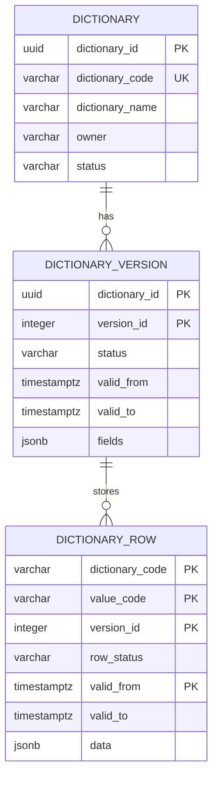

# Схема БД для API справочников

Пустая база поднимается скриптом [init.sql](db/init.sql): паспорт `dictionary`, версии `dictionary_version` и секционированная таблица `dictionary_row`. Секция справочника в скрипт не входит: её создаёт паспорт.

Все справочники хранят значения в `dictionary_row`. Состав колонок лежит в версии. У справочника одновременно не больше одной версии `draft` и одной `active`. История значения — соседняя опубликованная строка с другим периодом, а не копия всего справочника.

## ER-диаграмма

## Таблица `dictionary`

Реестр справочников. Хранит код, название, владельца и признак деактивации. Состав колонок хранит версия.

| Поле | Тип | Ограничения | Назначение |
| --- | --- | --- | --- |
| `dictionary_id` | `uuid` | `PK` | Внутренний идентификатор |
| `dictionary_code` | `varchar(63)` | `NOT NULL` | Код справочника, его передаёт клиент |
| `dictionary_name` | `varchar(200)` | `NOT NULL` | Название для человека |
| `owner` | `varchar(200)` | `NULL` | Предметный владелец |
| `status` | `varchar(16)` | `NOT NULL`, по умолчанию `active` | `active` — паспорт не выключен, `inactive` — деактивирован |

Индексы и ограничения:

+ `ux_dictionary_code` на `lower(dictionary_code)`
+ `dictionary_status_check`: `status` только `active` или `inactive`

Правила работы:

+ `POST /admin/dictionaries` вставляет строку со `status = active` и не создаёт активной версии
+ `PATCH /admin/dictionaries/{dictionary_code}` меняет только `dictionary_name` и `owner`
+ `POST /admin/dictionaries/{dictionary_code}/deactivate` ставит `inactive`. Версии и строки остаются

## Таблица `dictionary_version`

Версия состава колонок. Черновик не входит в актуальные и исторические запросы. После публикации его `valid_from` начинает период этой схемы.

| Поле | Тип | Ограничения | Назначение |
| --- | --- | --- | --- |
| `dictionary_id` | `uuid` | `PK`, `FK -> dictionary.dictionary_id` | Паспорт |
| `version_id` | `integer` | `PK` | Номер версии справочника, с 1 |
| `status` | `varchar(16)` | `NOT NULL` | `draft`, `active` или `closed` |
| `valid_from` | `timestamptz` | `NULL` | Начало действия схемы. Пусто у черновика |
| `valid_to` | `timestamptz` | `NULL` | Конец схемы, исключительно. Пусто у `draft` и `active` |
| `fields` | `jsonb` | `NOT NULL` | Колонки этой версии: `field_id`, `code`, `name`, `type`, `default`, `required` |

Индексы и ограничения:

+ первичный ключ `(dictionary_id, version_id)`
+ `dictionary_version_status_check`: `draft`, `active`, `closed`

Правила работы:

+ у справочника не больше одной версии `draft` и одной `active`
+ черновик версии создаётся только для метаданных: `POST /admin/dictionaries` — версия `1` со `status = draft` и пустым `valid_from`; `POST /admin/dictionaries/{dictionary_code}/versions` — следующая версия `draft` копией `fields` активной версии, чтобы менять атрибуты. Запись значений элементов черновик не открывает
+ второй черновик не создаётся. Без активной версии метод следующей версии черновик не открывает
+ `PATCH /admin/dictionaries/{dictionary_code}/versions/{version_id}` заменяет `fields` существующего черновика. Если изменились набор `field_id`, `code` или `type`, черновые строки этой версии удаляются
+ одна и та же колонка в разных версиях хранит один `field_id`. Новый `field_id` — новая колонка. Тот же `field_id` и другой `code` — переименование. Тот же `field_id` и другой `type` — смена типа. `field_id` нет в новой версии — колонка удалена
+ в `fields` версии ровно одна колонка с `"default": true`
+ `required` — `true` или `false`. При `true` значение этой колонки у элемента справочника непустое. При `false` значение можно не передавать или оставить пустым
+ `type` — одно из `string`, `integer`, `number`, `boolean`
+ `DELETE .../versions/{version_id}` удаляет версию `draft` и её черновые строки. Пока нет `active`, единственный черновик остаётся
+ `POST .../versions/{version_id}/publish` переводит этот `draft` в `active`, ставит `valid_from`, прежнюю `active` закрывает. Если состав атрибутов изменился, публикация ждёт перезаливку: у каждого действующего элемента есть черновая строка с заполненными обязательными атрибутами

## Таблица `dictionary_row`

Все значения всех справочников. Секция одна на `dictionary_code`: `PARTITION BY LIST (dictionary_code)`.

| Поле | Тип | Ограничения | Назначение |
| --- | --- | --- | --- |
| `dictionary_code` | `varchar(63)` | `NOT NULL`, входит в `PK` | Код справочника и ключ секции |
| `value_code` | `varchar(64)` | `NOT NULL`, входит в `PK` | Код значения |
| `version_id` | `integer` | `NOT NULL`, входит в `PK` | Версия, в которой строку записали |
| `row_status` | `varchar(16)` | `NOT NULL` | `draft` — ещё не опубликована, `published` — входит в периоды |
| `valid_from` | `timestamptz` | `NOT NULL`, входит в `PK` | Начало состояния, включительно. У черновой строки меняется при публикации |
| `valid_to` | `timestamptz` | `NULL` | Конец состояния, исключительно. Пусто у открытого опубликованного состояния |
| `data` | `jsonb` | `NOT NULL` | Поля значения. Ключ — `code` колонки в версии `version_id` |

Индексы и ограничения:

+ первичный ключ `(dictionary_code, value_code, version_id, valid_from)`
+ `ix_dictionary_row_code` на `(dictionary_code, value_code, valid_from)`
+ секция `dictionary_row_{dictionary_code}` для `FOR VALUES IN (dictionary_code)`
+ `dictionary_row_status_check`: `draft` или `published`
+ база не проверяет ключи и типы внутри `data`

Правила работы:

+ `POST /admin/dictionaries` создаёт пустую секцию
+ пока у справочника есть `draft`, `POST .../rows` пишет одну черновую строку этого элемента и не закрывает опубликованную. Обязательные атрибуты в `data` непустые. Необязательный атрибут может отсутствовать или быть пустым
+ смена состава, `code` или `type` колонок черновика удаляет его черновые строки. Опубликованные строки остаются
+ удаление черновика удаляет его черновые строки и не трогает опубликованные
+ `POST .../rows` не создаёт версию `draft`. Если черновика нет, метод закрывает опубликованную открытую строку и вставляет опубликованную
+ у одного `value_code` одна строка `draft` и одна опубликованная строка с пустым `valid_to`
+ чтение без момента и без `draft` берёт опубликованную строку с пустым `valid_to` и схему версии `active`
+ чтение с `draft` берёт черновые строки и схему версии `draft`. Опубликованный период не используется. После публикации версии `draft` нет, поэтому такой запрос отвечает `draft_not_found` и не отдаёт активные строки
+ чтение на момент `T` берёт опубликованную строку, где `valid_from <= T` и (`valid_to` пуст или `valid_to > T`), и версию `active` или `closed`, чей период покрывает `T`. Черновик в этот отбор не входит
+ публикация переводит черновые строки этого `version_id` в `published`, ставит им `valid_from` публикации и закрывает прежние открытые строки тех же кодов. При изменении состава атрибутов без перезаливки публикация не выполняется

## Связи между таблицами

+ `dictionary 1 -> N dictionary_version`
+ `dictionary_version 1 -> N dictionary_row` по `version_id` внутри секции `dictionary_code`, без внешнего ключа
