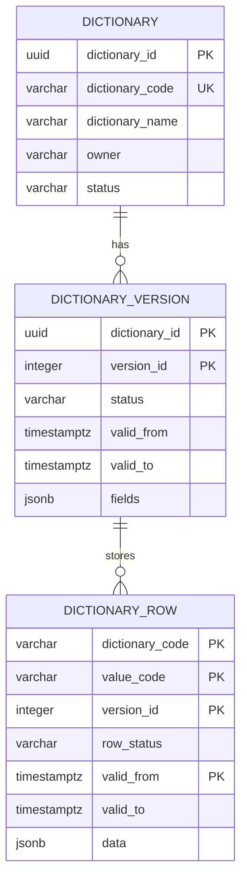

# Схема БД для API справочников

Пустая база поднимается скриптом [init.sql](db/init.sql): паспорт `dictionary`, версии `dictionary_version` и секционированная таблица `dictionary_row`. Секция справочника в скрипт не входит: её создаёт паспорт.

Все справочники хранят значения в `dictionary_row`. Состав колонок лежит в версии. У справочника одновременно не больше одной версии `draft` и одной `active`. История значения — соседняя опубликованная строка с другим периодом, а не копия всего справочника.

## ER-диаграмма

## Таблица `dictionary`

Реестр справочников. Хранит код, название, владельца и признак деактивации. Состав колонок хранит версия.

| Поле | Тип | Ограничения | Назначение |
| --- | --- | --- | --- |
| dictionary_id | uuid | PK | Внутренний идентификатор |
| dictionary_code | varchar(63) | NOT NULL | Код справочника, его передаёт клиент |
| dictionary_name | varchar(200) | NOT NULL | Название для человека |
| owner | varchar(200) | NULL | Предметный владелец |
| status | varchar(16) | NOT NULL, по умолчанию active | `active` — паспорт не выключен, `inactive` — деактивирован |

Индексы и ограничения:

+ `ux_dictionary_code` на `lower(dictionary_code)`
+ `dictionary_status_check`: `status` только `active` или `inactive`

## Таблица `dictionary_version`

Версия состава колонок. Период схемы — `valid_from` включительно и `valid_to` исключительно. У черновика оба поля пусты.

| Поле | Тип | Ограничения | Назначение |
| --- | --- | --- | --- |
| dictionary_id | uuid | PK, FK -> dictionary.dictionary_id | Паспорт |
| version_id | integer | PK | Номер версии справочника, с 1 |
| status | varchar(16) | NOT NULL | `draft`, `active` или `closed` |
| valid_from | timestamptz | NULL | Начало действия схемы. Пусто у черновика |
| valid_to | timestamptz | NULL | Конец схемы, исключительно. Пусто у `draft` и `active` |
| fields | jsonb | NOT NULL | Колонки этой версии: `field_id`, `code`, `name`, `type`, `default`, `required` |

Индексы и ограничения:

+ первичный ключ `(dictionary_id, version_id)`
+ `dictionary_version_status_check`: `draft`, `active`, `closed`

Правила работы:

+ у справочника не больше одной версии `draft` и одной `active`
+ одна и та же колонка в разных версиях хранит один `field_id`. Новый `field_id` — новая колонка. Тот же `field_id` и другой `code` — переименование. Тот же `field_id` и другой `type` — смена типа. `field_id` нет в новой версии — колонка удалена
+ в `fields` версии ровно одна колонка с `"default": true`
+ `type` — одно из `string`, `integer`, `number`, `boolean`

## Таблица `dictionary_row`

Все значения всех справочников. Секция одна на `dictionary_code`: `PARTITION BY LIST (dictionary_code)`.

| Поле | Тип | Ограничения | Назначение |
| --- | --- | --- | --- |
| dictionary_code | varchar(63) | NOT NULL, входит в PK | Код справочника и ключ секции |
| value_code | varchar(64) | NOT NULL, входит в PK | Код значения |
| version_id | integer | NOT NULL, входит в PK | Версия, в которой строку записали |
| row_status | varchar(16) | NOT NULL | `draft` — ещё не опубликована, `published` — входит в периоды |
| valid_from | timestamptz | NOT NULL, входит в PK | Начало состояния, включительно |
| valid_to | timestamptz | NULL | Конец состояния, исключительно. Пусто у открытого опубликованного состояния |
| data | jsonb | NOT NULL | Поля значения. Ключ — `code` колонки в версии `version_id` |

Индексы и ограничения:

+ первичный ключ `(dictionary_code, value_code, version_id, valid_from)`
+ `ix_dictionary_row_code` на `(dictionary_code, value_code, valid_from)`
+ секция `dictionary_row_{dictionary_code}` для `FOR VALUES IN (dictionary_code)`
+ `dictionary_row_status_check`: `draft` или `published`
+ база не проверяет ключи и типы внутри `data`

Правила работы:

+ у одного `value_code` одна строка `draft` и одна опубликованная строка с пустым `valid_to`
+ у черновой строки `valid_from` заполнен. Эта дата не закрывает опубликованную строку. При публикации начало строки становится моментом публикации, и этот момент строго позже `valid_from` закрываемой открытой строки

## Связи между таблицами

+ `dictionary 1 -> N dictionary_version`
+ `dictionary_version 1 -> N dictionary_row` по `version_id` внутри секции `dictionary_code`, без внешнего ключа
