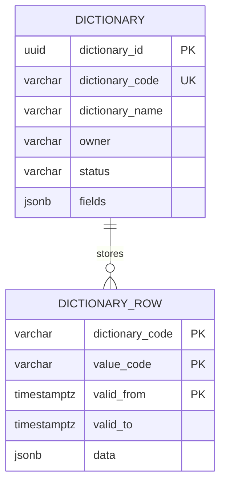

# Схема БД для API справочников

Пустая база поднимается скриптом [init.sql](db/init.sql): паспорт `dictionary` и секционированная таблица `dictionary_row`. Секция справочника в скрипт не входит: её создаёт паспорт.

Все справочники хранят значения в `dictionary_row`. Поля значения, в том числе код связанной записи, лежат в `data` и перечислены в `fields` наравне с остальными колонками. История значения — соседняя строка с другим периодом, а не копия всего справочника.

## ER-диаграмма

## Таблица `dictionary`

Реестр справочников. Хранит код, название, владельца, состояние и текущий состав колонок.

| Поле | Тип | Ограничения | Назначение |
| --- | --- | --- | --- |
| `dictionary_id` | `uuid` | `PK` | Внутренний идентификатор |
| `dictionary_code` | `varchar(63)` | `NOT NULL` | Код справочника, его передаёт клиент |
| `dictionary_name` | `varchar(200)` | `NOT NULL` | Название для человека |
| `owner` | `varchar(200)` | `NULL` | Предметный владелец |
| `status` | `varchar(16)` | `NOT NULL`, по умолчанию `active` | `active` или `inactive` |
| `fields` | `jsonb` | `NOT NULL` | Ревизии колонок: `field_id`, `code`, `name`, `type`, `default`, `valid_from`, `valid_to` |

Индексы и ограничения:

+ `ux_dictionary_code` на `lower(dictionary_code)`
+ `dictionary_status_check`: `status` только `active` или `inactive`

Правила работы:

+ `POST /admin/dictionaries` вставляет строку со `status = active`
+ `PATCH /admin/dictionaries/{dictionary_code}` меняет `dictionary_name`, `owner` и ревизии `fields`. Строки `dictionary_row` не меняет
+ одна и та же колонка во всех ревизиях хранит один `field_id`. Переименование и смена типа закрывают прежнюю ревизию и открывают новую с тем же `field_id`. Удаление только закрывает ревизию. Новая колонка получает новый `field_id`
+ у ревизии пустой `valid_to` — она открыта. Конец исключительный, как у строки значения
+ среди открытых ревизий ровно одна с `"default": true`
+ `type` — одно из `string`, `integer`, `number`, `boolean`
+ `POST /admin/dictionaries/{dictionary_code}/deactivate` ставит `inactive`. Строки значений остаются

## Таблица `dictionary_row`

Все значения всех справочников. Секция одна на `dictionary_code`: `PARTITION BY LIST (dictionary_code)`.

| Поле | Тип | Ограничения | Назначение |
| --- | --- | --- | --- |
| `dictionary_code` | `varchar(63)` | `NOT NULL`, входит в `PK` | Код справочника и ключ секции |
| `value_code` | `varchar(64)` | `NOT NULL`, входит в `PK` | Код значения |
| `valid_from` | `timestamptz` | `NOT NULL`, входит в `PK` | Начало состояния, включительно |
| `valid_to` | `timestamptz` | `NULL` | Конец состояния, исключительно. Пусто у открытого состояния |
| `data` | `jsonb` | `NOT NULL` | Поля значения. Ключ — `code` ревизии, которая была открыта в `valid_from` этой строки |

Индексы и ограничения:

+ первичный ключ `(dictionary_code, value_code, valid_from)`
+ `ix_dictionary_row_code` на `(dictionary_code, value_code, valid_from)`
+ секция `dictionary_row_{dictionary_code}` для `FOR VALUES IN (dictionary_code)`
+ база не проверяет ключи и типы внутри `data`

Правила работы:

+ `POST /admin/dictionaries` создаёт пустую секцию
+ `POST /admin/dictionaries/{dictionary_code}/rows` в одной транзакции закрывает прежнее открытое состояние этого кода (`valid_to` = новый `valid_from`) и вставляет строку с пустым `valid_to`
+ у одного `value_code` одно открытое состояние
+ чтение без момента берёт строку с пустым `valid_to`
+ чтение на момент `T` берёт строку, где `valid_from <= T` и (`valid_to` пуст или `valid_to > T`)
+ деактивация и правка паспорта строки не удаляют и не переписывают

## Связи между таблицами

+ `dictionary 1 -> N dictionary_row` по `dictionary_code`, без внешнего ключа: связь обеспечивает секция
