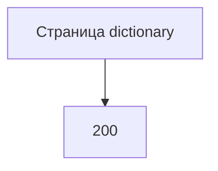

# [На главную](../../../API.md)

# Описание

GET **/admin/dictionaries**
Страница паспортов, включая деактивированные. Строк значений нет.

# Входные параметры

+ `limit`:
    + query
    + Не обязательно
    + Целое от 1 до 1000, по умолчанию 100
+ `cursor`:
    + query
    + Не обязательно
    + Непрозрачная строка предыдущего ответа

# Поля ответа

+ `items`:
    + Массив
    + `dictionary_code`
    + `dictionary_name`
    + `owner` — `null`, если не задан
    + `status`
+ `next_cursor` — пусто, если страниц больше нет

# Алгоритм работы

## Валидация

1. `limit`, если передан, — целое от 1 до 1000.
    + Иначе:
        + Код: `invalid_request`
        + Статус: `400`
2. `cursor`, если передан, разбирается как код последней отданной строки.
    + Не разбирается:
        + Код: `invalid_request`
        + Статус: `400`

## Бизнес-логика

1. Прочитать страницу `dictionary` в порядке `dictionary_code`, после курсора.
2. Если строк больше нет, `next_cursor` пустой. Иначе `next_cursor` — код последней строки страницы.
3. Вернуть статус `200`.

Состав колонок и состояния значений этот метод не читает.
