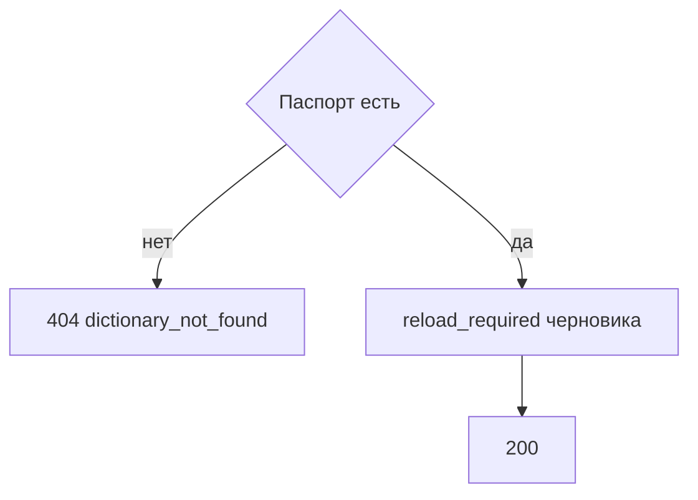

# [На главную](../../../API.md)

# Описание

GET **/admin/dictionaries/{dictionary_code}**
Паспорт и текущий состав колонок. Состояния значений не возвращаются. У черновика указано, ждёт ли публикация перезаливки.

# Входные параметры

+ `dictionary_code`:
    + path
    + Обязательно
    + `^[a-z][a-z0-9_]{0,62}$`

Тела нет.

# Поля ответа

+ `dictionary_id`
+ `dictionary_code`
+ `dictionary_name`
+ `owner` — `null`, если не задан
+ `status`
+ `versions`:
    + `version_id`
    + `status`
    + `valid_from` — пусто у черновика
    + `valid_to` — пусто у черновика и активной
    + `reload_required` — только у версии `draft`. `true`, если [публикация](../MetadataController/post_publish.md) этого черновика вернёт `409 reload_required`. Иначе `false`. У `active` и `closed` поля нет
    + `fields`:
        + `field_id`
        + `code`
        + `name`
        + `type`
        + `default`
        + `required`

# Алгоритм работы

## Валидация

1. Проверить `dictionary_code`.
    + Нарушение:
        + Код: `invalid_request`
        + Статус: `400`
2. Найти паспорт по коду без учёта регистра.
    + Нет:
        + Код: `dictionary_not_found`
        + Статус: `404`

## Бизнес-логика

1. Вернуть паспорт и все версии, включая `draft` и `closed`. Статус `200`. Деактивированный справочник тоже возвращается.
2. У версии `draft` выставить `reload_required` по тому же правилу, что `409 reload_required` в [post_publish.md](../MetadataController/post_publish.md):
    + нет версии `active` — `false`
    + набор `field_id`, `code` и `type` совпадает с активной версией, и ни один атрибут не стал обязательным — `false`
    + иначе смотреть открытые опубликованные строки, `valid_to` пуст. У каждого такого элемента есть черновая строка этого `version_id`, и в ней заполнен каждый атрибут с `required = true` — `false`
    + такой перезаливки нет — `true`

Строки значений в ответ не входят. `reload_required` считается по ним.
