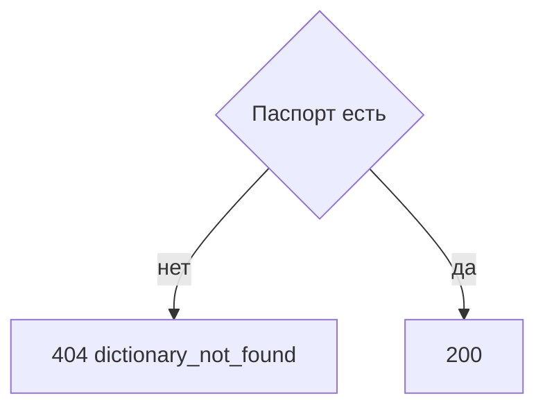

# [На главную](../../../API.md)

# Описание

GET **/admin/dictionaries/{dictionary_code}**
Паспорт и текущий состав колонок. Состояния значений не возвращаются.

# Входные параметры

+ `dictionary_code`:
    + path
    + Обязательно
    + `^[a-z][a-z0-9_]{0,62}$`

Тела нет.

# Поля ответа

+ `dictionary_id`
+ `dictionary_code`
+ `dictionary_name`
+ `owner`
+ `status`
+ `fields`:
    + `code`
    + `name`
    + `type`
    + `default`

# Алгоритм работы

## Валидация

1. Проверить `dictionary_code`.
    + Нарушение:
        + Код: `invalid_request`
        + Статус: `400`
2. Найти паспорт по коду без учёта регистра.
    + Нет:
        + Код: `dictionary_not_found`
        + Статус: `404`

## Бизнес-логика

1. Вернуть паспорт и `fields`. Статус `200`. Деактивированный справочник тоже возвращается.

Метод не смотрит в `dictionary_row`.
