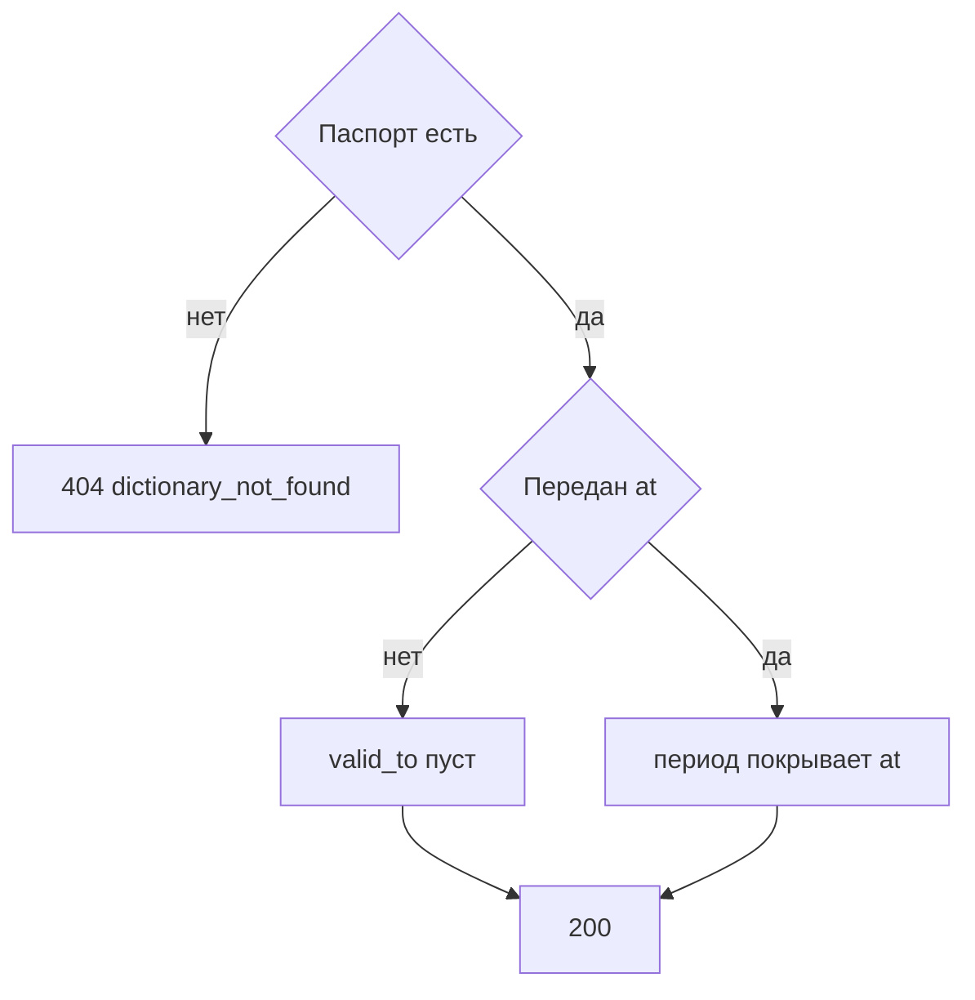

# [На главную](../../../API.md)

# Описание

GET **/admin/dictionaries/{dictionary_code}/rows**
Страница состояний одного справочника: открытые либо попавшие в переданный момент.

# Входные параметры

+ `dictionary_code`:
    + path
    + Обязательно
    + `^[a-z][a-z0-9_]{0,62}$`
+ `at`:
    + query
    + Не обязательно
    + Момент `YYYY-MM-DDTHH:mm:ssZ`
    + Нет параметра — только строки с пустым `valid_to`
+ `value_code`:
    + query
    + Не обязательно
    + До 64 символов `^[A-Za-z0-9_]{1,64}$`
+ `limit`:
    + query
    + Не обязательно
    + Целое от 1 до 1000, по умолчанию 100
+ `cursor`:
    + query
    + Не обязательно
    + Непрозрачная строка предыдущего ответа

# Поля ответа

+ `items`:
    + Массив
    + `value_code`
    + `parent_code` — может быть пустым
    + `valid_from`
    + `valid_to` — может быть пустым
    + `data`
+ `next_cursor` — пусто, если страниц больше нет

# Алгоритм работы

## Валидация

1. Проверить путь, формат `at`, `value_code`, `limit` и `cursor`.
    + Нарушение:
        + Код: `invalid_request`
        + Статус: `400`
2. Найти паспорт по коду без учёта регистра.
    + Нет:
        + Код: `dictionary_not_found`
        + Статус: `404`

## Бизнес-логика

1. Выбрать строки секции этого `dictionary_code`.
    + `at` не передан — `valid_to` пуст
    + `at` передан — `valid_from <= at` и (`valid_to` пуст или `valid_to > at`)
    + `value_code` передан — только этот код
2. Отдать страницу в порядке `value_code`, затем `valid_from`. `next_cursor` пустой, если продолжения нет.
3. Вернуть статус `200`. Деактивированный справочник тоже читается.

Состав колонок из паспорта на это чтение не накладывается: администратор видит `data` как оно хранится.
