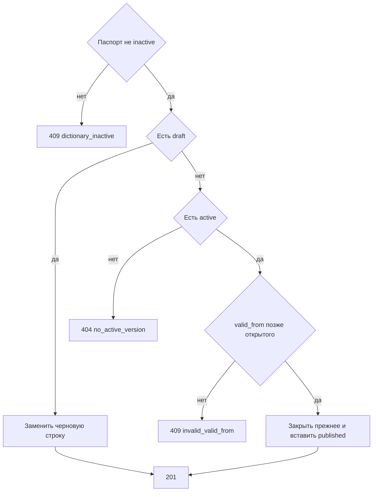

# [На главную](../../../API.md)

# Описание

POST **/admin/dictionaries/{dictionary_code}/rows**
Записать состояние кода. Пока есть черновик, строка остаётся черновой, содержит все колонки черновика и не закрывает опубликованную. Без черновика прежняя открытая строка закрывается моментом начала новой.

# Входные параметры

+ `dictionary_code`:
    + path
    + Обязательно
    + `^[a-z][a-z0-9_]{0,62}$`
+ `value_code`:
    + body
    + Обязательно
    + `^[A-Za-z0-9_]{1,64}$`
+ `valid_from`:
    + body
    + Обязательно
    + Момент `YYYY-MM-DDTHH:mm:ssZ`
+ `attributes`:
    + body
    + Обязательно
    + Объект
    + Есть черновик — ключи ровно `code` его колонок, каждое значение на месте
    + Черновика нет — ключи из колонок активной версии. Ключ, которого нет в объекте, в новое состояние не копируется

# Поля ответа

+ `value_code`
+ `version_id`
+ `row_status` — `draft` или `published`
+ `valid_from`
+ `valid_to` — пусто
+ `data`

# Алгоритм работы

## Валидация

1. Проверить путь и тело: шаблоны кодов, формат `valid_from`, объект `attributes`.
    + Нарушение:
        + Код: `invalid_request`
        + Статус: `400`
2. Найти паспорт по коду без учёта регистра.
    + Нет:
        + Код: `dictionary_not_found`
        + Статус: `404`
3. Сверить `attributes` с колонками черновика, а если черновика нет — с колонками активной версии. Значение соответствует `type`: `string` — строка до 4000 символов, `integer` — целое число, `number` — число, `boolean` — `true` или `false`. Пустое значение не передаётся.
    + Есть черновик, и набор ключей не совпал с его колонками:
        + Код: `invalid_request`
        + Статус: `400`
    + Ключа нет в этих колонках:
        + Код: `unknown_field`
        + Статус: `422`
    + Тип не совпал:
        + Код: `invalid_value`
        + Статус: `422`

## Бизнес-логика

1. Паспорт в `inactive`:
    + Код: `dictionary_inactive`
    + Статус: `409`
2. Если есть версия `draft`, заменить черновую строку этого `value_code` или вставить её: `row_status = draft`, `version_id` черновика, `valid_to` пуст, `data` = `attributes`. Опубликованную строку не закрывать. Вернуть статус `201`.
3. Иначе нужна версия `active`.
    + Её нет:
        + Код: `no_active_version`
        + Статус: `404`
4. Найти опубликованную открытую строку этого `value_code`.
    + Строка есть и новый `valid_from` не строго позже её `valid_from`:
        + Код: `invalid_valid_from`
        + Статус: `409`
5. Начать транзакцию. Если открытая строка есть, записать ей `valid_to` = новый `valid_from`. Вставить строку `published` с `version_id` активной версии и пустым `valid_to`.
6. Зафиксировать транзакцию. Вернуть статус `201`.

Черновая строка содержит все колонки черновика и не видна запросам без `draft`. После смены состава, кода или типа колонок такая строка нужна у каждого открытого кода, иначе [post_publish.md](../MetadataController/post_publish.md) возвращает отказ. Опубликованная строка закрывает прежнюю сразу. Код внутри атрибута в других строках не ищется.
