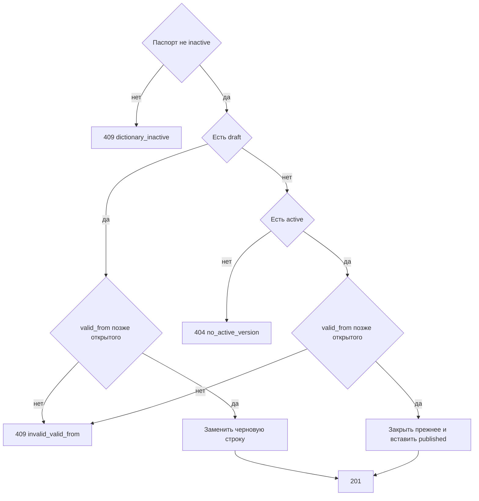

# [На главную](../../../API.md)

# Описание

POST **/admin/dictionaries/{dictionary_code}/rows**
Записать состояние элемента справочника. Метод не создаёт черновик. Пока черновик метаданных открыт, состояние пишется в него, и действующий справочник не меняется: опубликованную строку этот вызов не закрывает. Черновика нет — состояние сразу публикуется в действующий справочник и закрывает прежнюю открытую строку. В обоих случаях новое начало строго позже начала открытой строки этого кода, если она есть. Обязательные атрибуты заполнены. Пустое значение допустимо только у необязательного атрибута.

# Входные параметры

+ `dictionary_code`:
    + path
    + Обязательно
    + `^[a-z][a-z0-9_]{0,62}$`
+ `value_code`:
    + body
    + Обязательно
    + `^[A-Za-z0-9_]{1,64}$`
+ `valid_from`:
    + body
    + Обязательно
    + Момент `YYYY-MM-DDTHH:mm:ssZ`
+ `attributes`:
    + body
    + Обязательно
    + Объект
    + Ключи — `code` колонок черновика, а если черновика нет — активной версии
    + Колонка с `required = true` передаётся и не пустая
    + Колонка с `required = false` может отсутствовать или быть пустой

# Поля ответа

+ `value_code`
+ `version_id`
+ `row_status` — `draft` или `published`
+ `valid_from`
+ `valid_to` — пусто
+ `data`

# Алгоритм работы

## Валидация

1. Проверить путь и тело: шаблоны кодов, формат `valid_from`, объект `attributes`.
    + Нарушение:
        + Код: `invalid_request`
        + Статус: `400`
2. Найти паспорт по коду без учёта регистра.
    + Нет:
        + Код: `dictionary_not_found`
        + Статус: `404`
3. Сверить `attributes` с колонками черновика, а если черновика нет — с колонками активной версии. Непустое значение соответствует `type`: `string` — строка до 4000 символов, `integer` — целое число, `number` — число, `boolean` — `true` или `false`.
    + Ключа нет в этих колонках:
        + Код: `unknown_field`
        + Статус: `422`
    + Колонка с `required = true` отсутствует или её значение пустое:
        + Код: `invalid_value`
        + Статус: `422`
    + Непустое значение не совпало с `type`:
        + Код: `invalid_value`
        + Статус: `422`

## Бизнес-логика

1. Паспорт в `inactive`:
    + Код: `dictionary_inactive`
    + Статус: `409`
2. Если есть версия `draft`, найти опубликованную открытую строку этого `value_code`.
    + Строка есть и новый `valid_from` не строго позже её `valid_from`:
        + Код: `invalid_valid_from`
        + Статус: `409`
    + Иначе удалить прежнюю черновую строку этого `value_code`, если она есть, и вставить одну: `row_status = draft`, `version_id` черновика, `valid_from` из запроса, `valid_to` пуст, `data` = `attributes`. Опубликованную строку не закрывать. Вернуть статус `201`.
3. Иначе нужна версия `active`.
    + Её нет:
        + Код: `no_active_version`
        + Статус: `404`
4. Найти опубликованную открытую строку этого `value_code`.
    + Строка есть и новый `valid_from` не строго позже её `valid_from`:
        + Код: `invalid_valid_from`
        + Статус: `409`
5. Начать транзакцию. Если открытая строка есть, записать ей `valid_to` = новый `valid_from`. Вставить строку `published` с `version_id` активной версии, `valid_from` из запроса и пустым `valid_to`.
6. Зафиксировать транзакцию. Вернуть статус `201`.

Пока черновик открыт, править действующий справочник этим методом нельзя: новая строка остаётся черновой и не видна запросам без `draft`. Её `valid_from` всё равно строго позже начала открытой опубликованной строки того же кода, если такая строка есть. Это начало сохраняется и при публикации становится началом опубликованной строки, прежняя открытая закрывается им. Перезаливка после смены состава или после того, как атрибут стал обязательным, собирается такими строками: без них [post_publish.md](../MetadataController/post_publish.md) черновик не публикует. Если черновика нет, опубликованная строка закрывает прежнюю сразу. Код внутри атрибута в других строках не ищется.
