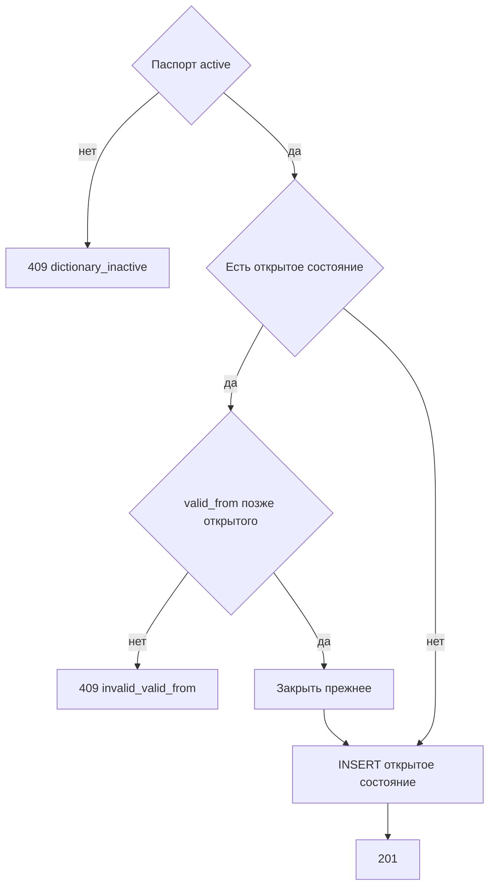

# [На главную](../../../API.md)

# Описание

POST **/admin/dictionaries/{dictionary_code}/rows**
Записать новое состояние кода. Прежнее открытое состояние этого кода закрывается моментом начала нового. Отдельной редакции справочника нет.

# Входные параметры

+ `dictionary_code`:
    + path
    + Обязательно
    + `^[a-z][a-z0-9_]{0,62}$`
+ `value_code`:
    + body
    + Обязательно
    + `^[A-Za-z0-9_]{1,64}$`
+ `valid_from`:
    + body
    + Обязательно
    + Момент `YYYY-MM-DDTHH:mm:ssZ`
+ `attributes`:
    + body
    + Обязательно
    + Объект
    + Ключи — `code` колонок текущего паспорта, других ключей нет
    + Ключ, которого нет в объекте, в новое состояние не копируется

# Поля ответа

+ `value_code`
+ `valid_from`
+ `valid_to` — пусто
+ `data`

# Алгоритм работы

## Валидация

1. Проверить путь и тело: шаблоны кодов, формат `valid_from`, объект `attributes`.
    + Нарушение:
        + Код: `invalid_request`
        + Статус: `400`
2. Найти паспорт по коду без учёта регистра.
    + Нет:
        + Код: `dictionary_not_found`
        + Статус: `404`
3. Каждый ключ `attributes` есть в `fields`. Значение соответствует `type`: `string` — строка до 4000 символов, `integer` — целое число, `number` — число, `boolean` — `true` или `false`. Пустое значение не передаётся.
    + Ключа нет в паспорте:
        + Код: `unknown_field`
        + Статус: `422`
    + Тип не совпал:
        + Код: `invalid_value`
        + Статус: `422`

## Бизнес-логика

1. Паспорт в `inactive`:
    + Код: `dictionary_inactive`
    + Статус: `409`
2. Найти открытую строку этого `value_code` (`valid_to` пуст).
    + Строка есть и новый `valid_from` не строго позже её `valid_from`:
        + Код: `invalid_valid_from`
        + Статус: `409`
3. Начать транзакцию.
4. Если открытая строка есть, записать ей `valid_to` = новый `valid_from`.
5. Вставить строку: `valid_to` пуст, `data` = `attributes`.
6. Зафиксировать транзакцию. Вернуть статус `201`.

Проверка типов выполняется до записи по открытым ревизиям. Ключи `attributes` — их текущие `code`. Уже лежащие документы не читаются и не исправляются. Этот же вызов записывает значение нового типа после смены колонки: пока его нет, актуальное чтение этой колонки возвращает `invalid_value`. Код внутри атрибута в других строках не ищется.
