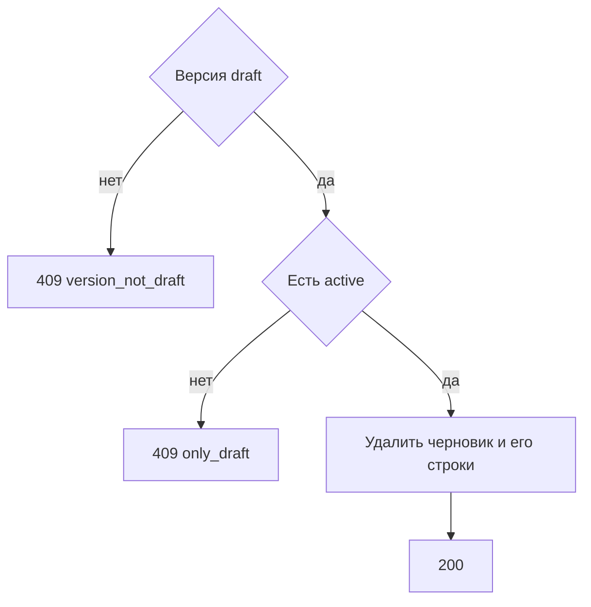

# [На главную](../../../API.md)

# Описание

DELETE **/admin/dictionaries/{dictionary_code}/versions/{version_id}**
Удалить черновик и его черновые строки. Активная версия и опубликованные строки остаются. Единственный черновик при отсутствии активной версии не удаляется.

# Входные параметры

+ `dictionary_code`:
    + path
    + Обязательно
    + `^[a-z][a-z0-9_]{0,62}$`
+ `version_id`:
    + path
    + Обязательно
    + Целое от 1

Тела нет.

# Поля ответа

+ `dictionary_code`
+ `version_id`

# Алгоритм работы

## Валидация

1. Проверить путь.
    + Нарушение:
        + Код: `invalid_request`
        + Статус: `400`
2. Найти паспорт по коду без учёта регистра.
    + Нет:
        + Код: `dictionary_not_found`
        + Статус: `404`
3. Найти версию с этим `version_id`.
    + Нет:
        + Код: `version_not_found`
        + Статус: `404`

## Бизнес-логика

1. Версия не `draft`:
    + Код: `version_not_draft`
    + Статус: `409`
2. Версии `active` нет:
    + Код: `only_draft`
    + Статус: `409`
3. Удалить строки `dictionary_row` с этим `version_id` и `row_status = draft`. Удалить строку `dictionary_version`. Опубликованные строки и версию `active` не менять.
4. Вернуть статус `200`.

Закрытые версии этим методом не удаляются. Деактивированный справочник черновик удалить может.
