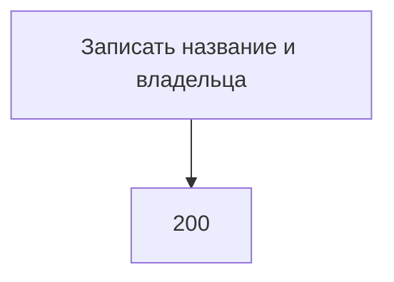

# [На главную](../../../API.md)

# Описание

PATCH **/admin/dictionaries/{dictionary_code}**
Записать название и владельца паспорта. Колонки, версии и строки значений не меняются.

# Входные параметры

+ `dictionary_code`:
    + path
    + Обязательно
    + `^[a-z][a-z0-9_]{0,62}$`
+ `dictionary_name`:
    + body
    + Не обязательно
    + От 1 до 200 символов
    + Нет в теле — название не меняется
+ `owner`:
    + body
    + Не обязательно
    + До 200 символов
    + Нет в теле — владелец не меняется
    + Пустая строка записывается как `NULL`

Тело содержит хотя бы одно из `dictionary_name`, `owner`.

# Поля ответа

+ `dictionary_id`
+ `dictionary_code`
+ `dictionary_name`
+ `owner`
+ `status`

# Алгоритм работы

## Валидация

1. Проверить путь и тело по ограничениям выше.
    + Нарушение:
        + Код: `invalid_request`
        + Статус: `400`
2. Найти паспорт по коду без учёта регистра.
    + Нет:
        + Код: `dictionary_not_found`
        + Статус: `404`

## Бизнес-логика

1. Записать переданные `dictionary_name` и `owner`. `status` и `dictionary_code` не менять. Вернуть статус `200`.

Черновик открывается в [post_version.md](post_version.md), его колонки меняются в [patch_version.md](patch_version.md). Деактивированный справочник этим методом изменяется.
