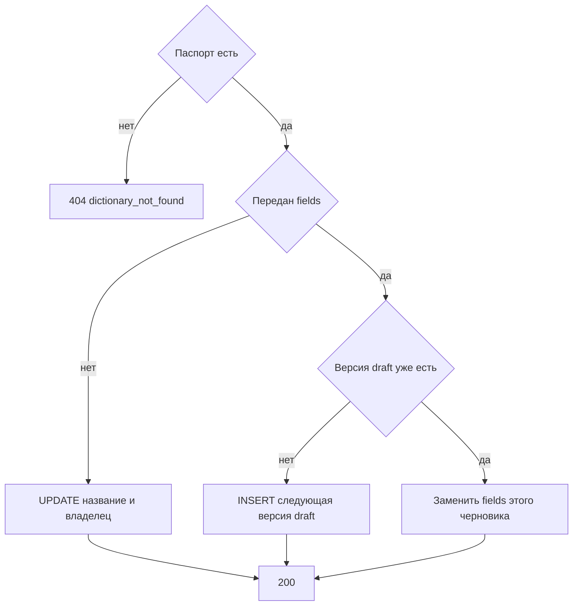

# [На главную](../../../API.md)

# Описание

PATCH **/admin/dictionaries/{dictionary_code}**
Записать название, владельца и состав колонок. Если передан `fields` и версии `draft` ещё нет, метод создаёт её. Если черновик уже есть, заменяет его колонки и вторую версию `draft` не открывает. Активная версия и опубликованные строки не меняются. Актуальные запросы продолжают читать прежнюю активную версию, пока черновик не опубликован.

# Входные параметры

+ `dictionary_code`:
    + path
    + Обязательно
    + `^[a-z][a-z0-9_]{0,62}$`
+ `dictionary_name`:
    + body
    + Не обязательно
    + От 1 до 200 символов
    + Нет в теле — название не меняется
+ `owner`:
    + body
    + Не обязательно
    + До 200 символов
    + Нет в теле — владелец не меняется
+ `fields`:
    + body
    + Не обязательно
    + Желаемый открытый состав, от 1 до 50 колонок
    + Ровно одна колонка с `default = true`
    + Нет в теле — состав колонок не меняется
+ `fields[].field_id`:
    + Не обязательно
    + Есть — это уже открытая колонка. Нет — новая колонка
+ `fields[].code`:
    + Обязательно, если `fields` передан
    + `^[a-z][a-z0-9_]{0,62}$`
    + Не `value_code`, `valid_from`, `valid_to`
    + Другой `code` при том же `field_id` — переименование
+ `fields[].name`:
    + Обязательно, если `fields` передан
    + От 1 до 200 символов
+ `fields[].type`:
    + Обязательно, если `fields` передан
    + `string`, `integer`, `number`, `boolean`
+ `fields[].default`:
    + Обязательно, если `fields` передан
    + `true` или `false`

Тело содержит хотя бы одно из `dictionary_name`, `owner`, `fields`.

# Поля ответа

+ `dictionary_id`
+ `dictionary_code`
+ `dictionary_name`
+ `owner`
+ `status`
+ `version_id` — черновик
+ `version_status` = `draft`
+ `fields` — колонки черновика:
    + `field_id`
    + `code`
    + `name`
    + `type`
    + `default`

# Алгоритм работы

## Валидация

1. Проверить путь и тело по ограничениям выше. В `fields` коды и `field_id` уникальны, ровно один `default = true`.
    + Нарушение:
        + Код: `invalid_request`
        + Статус: `400`
2. Найти паспорт по коду без учёта регистра.
    + Нет:
        + Код: `dictionary_not_found`
        + Статус: `404`

## Бизнес-логика

1. Записать переданные `dictionary_name` и `owner`. `status` и `dictionary_code` не менять.
2. Если `fields` не передан, вернуть статус `200`.
3. Собрать список колонок черновика.
    + База для `field_id` — колонки уже существующего `draft`. Если черновика нет — колонки версии `active`. Если нет и её, список пуст
    + `field_id` нет — новая колонка, назначить `field_id`
    + `field_id` не из этой базы:
        + Код: `invalid_request`
        + Статус: `400`
    + тот же `field_id` и другой `code` — переименование. Другой `type` — смена типа. `field_id` не пришёл — колонка в черновик не входит
4. Черновика нет — вставить следующую версию: `status = draft`, `valid_from` и `valid_to` пустые, `fields` — собранный список. Черновик уже есть — заменить `fields` этой версии. Вторую версию `draft` не создавать.
5. Версию `active` и строки `dictionary_row` не менять. Вернуть статус `200`, `version_id` черновика и его `fields`.

Активная схема меняется только в [post_publish.md](post_publish.md). До публикации актуальные запросы не видят новые колонки. Строки для новой схемы пишутся как черновые через [post_row.md](../DataController/post_row.md) и тоже ждут публикации. Деактивированный справочник этим методом изменяется.
