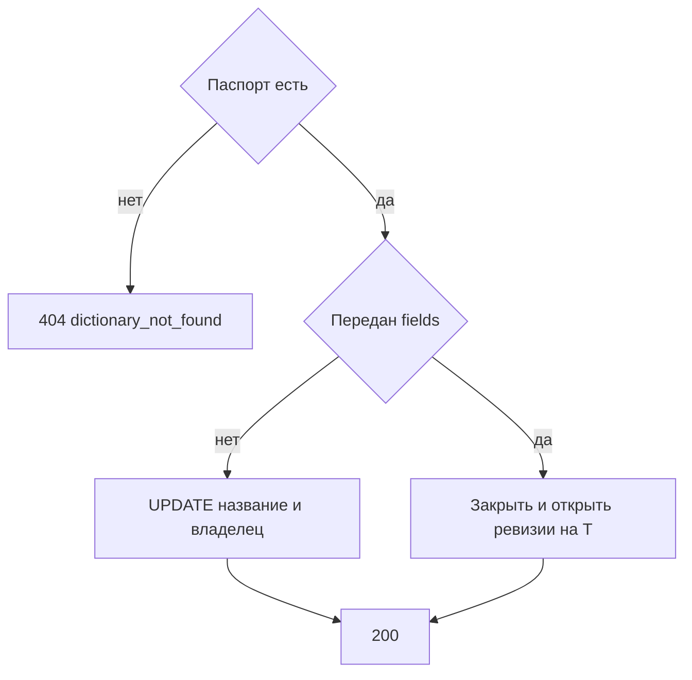

# [На главную](../../../API.md)

# Описание

PATCH **/admin/dictionaries/{dictionary_code}**
Изменить название, владельца и состав колонок. Уже записанные состояния не переписываются и заново не проверяются.

# Входные параметры

+ `dictionary_code`:
    + path
    + Обязательно
    + `^[a-z][a-z0-9_]{0,62}$`
+ `dictionary_name`:
    + body
    + Не обязательно
    + От 1 до 200 символов
    + Нет в теле — название не меняется
+ `owner`:
    + body
    + Не обязательно
    + До 200 символов
    + Нет в теле — владелец не меняется
+ `fields`:
    + body
    + Не обязательно
    + Желаемый открытый состав, от 1 до 50 колонок
    + Ровно одна колонка с `default = true`
    + Нет в теле — состав колонок не меняется
+ `fields[].field_id`:
    + Не обязательно
    + Есть — это уже открытая колонка. Нет — новая колонка
+ `fields[].code`:
    + Обязательно, если `fields` передан
    + `^[a-z][a-z0-9_]{0,62}$`
    + Не `value_code`, `valid_from`, `valid_to`
    + Другой `code` при том же `field_id` — переименование
+ `fields[].name`:
    + Обязательно, если `fields` передан
    + От 1 до 200 символов
+ `fields[].type`:
    + Обязательно, если `fields` передан
    + `string`, `integer`, `number`, `boolean`
+ `fields[].default`:
    + Обязательно, если `fields` передан
    + `true` или `false`

Тело содержит хотя бы одно из `dictionary_name`, `owner`, `fields`.

# Поля ответа

+ `dictionary_id`
+ `dictionary_code`
+ `dictionary_name`
+ `owner`
+ `status`
+ `fields` — открытые ревизии:
    + `field_id`
    + `code`
    + `name`
    + `type`
    + `default`

# Алгоритм работы

## Валидация

1. Проверить путь и тело по ограничениям выше. В `fields` коды и `field_id` уникальны, ровно один `default = true`.
    + Нарушение:
        + Код: `invalid_request`
        + Статус: `400`
2. Найти паспорт по коду без учёта регистра.
    + Нет:
        + Код: `dictionary_not_found`
        + Статус: `404`

## Бизнес-логика

1. Записать переданные `dictionary_name` и `owner`. `status` и `dictionary_code` не менять.
2. Если `fields` передан, каждый `field_id` должен быть среди открытых ревизий.
    + Нет:
        + Код: `invalid_request`
        + Статус: `400`
3. Взять момент `T` — время этого запроса.
    + `field_id` нет — новая колонка: новая ревизия, новый `field_id`, `valid_from = T`, `valid_to` пуст
    + `field_id` есть и `code`, `name`, `type` или `default` отличаются от открытой ревизии — закрыть открытую ревизию (`valid_to = T`) и вставить новую с тем же `field_id`, новыми полями, `valid_from = T`, пустым `valid_to`. Смена только `code` — переименование. Смена `type` — смена типа. Оба изменения сразу тоже закрывают одну ревизию и открывают одну
    + `field_id` есть и поля те же — ревизию не трогать
    + открытая ревизия, чей `field_id` не пришёл в теле, — удаление: `valid_to = T`, новой ревизии нет
4. Строки `dictionary_row` не читать и не менять.
5. Вернуть статус `200` и открытые ревизии.

Документы в `data` остаются с прежними ключами. Новая колонка в старой строке не появляется. Переименование не переписывает ключ. Смена типа не преобразует значение: актуальное чтение этой колонки вернёт `invalid_value`, пока для кода не записано новое состояние через [post_row.md](../DataController/post_row.md). Отдельной перезаливки справочника нет. Деактивированный справочник этим методом тоже изменяется.
