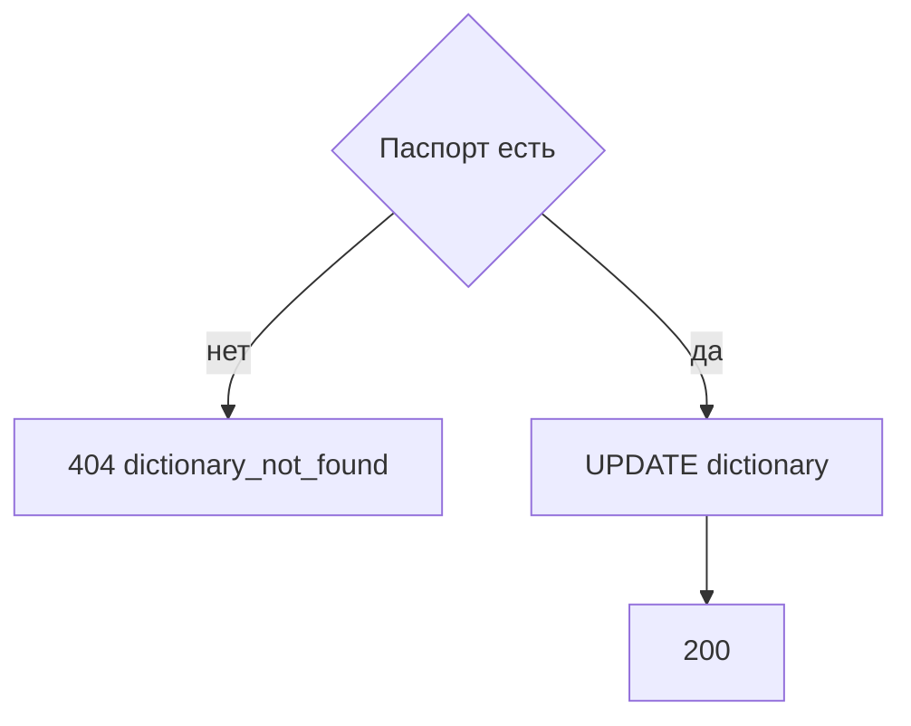

# [На главную](../../../API.md)

# Описание

PATCH **/admin/dictionaries/{dictionary_code}**
Изменить название, владельца и состав колонок. Уже записанные состояния не переписываются и заново не проверяются.

# Входные параметры

+ `dictionary_code`:
    + path
    + Обязательно
    + `^[a-z][a-z0-9_]{0,62}$`
+ `dictionary_name`:
    + body
    + Не обязательно
    + От 1 до 200 символов
    + Нет в теле — название не меняется
+ `owner`:
    + body
    + Не обязательно
    + До 200 символов
    + Нет в теле — владелец не меняется
+ `fields`:
    + body
    + Не обязательно
    + От 1 до 50 колонок
    + Ровно одна колонка с `default = true`
    + Нет в теле — состав колонок не меняется
+ `fields[].code`:
    + Обязательно, если `fields` передан
    + `^[a-z][a-z0-9_]{0,62}$`
    + Не `value_code`, `valid_from`, `valid_to`
+ `fields[].name`:
    + Обязательно, если `fields` передан
    + От 1 до 200 символов
+ `fields[].type`:
    + Обязательно, если `fields` передан
    + `string`, `integer`, `number`, `boolean`
+ `fields[].default`:
    + Обязательно, если `fields` передан
    + `true` или `false`

Тело содержит хотя бы одно из `dictionary_name`, `owner`, `fields`.

# Поля ответа

+ `dictionary_id`
+ `dictionary_code`
+ `dictionary_name`
+ `owner`
+ `status`
+ `fields`

# Алгоритм работы

## Валидация

1. Проверить путь и тело по ограничениям выше. В `fields` коды уникальны и ровно один `default = true`.
    + Нарушение:
        + Код: `invalid_request`
        + Статус: `400`
2. Найти паспорт по коду без учёта регистра.
    + Нет:
        + Код: `dictionary_not_found`
        + Статус: `404`

## Бизнес-логика

1. Записать переданные `dictionary_name`, `owner` и `fields`. `status`, `dictionary_code` и `dictionary_row` не менять.
2. Вернуть статус `200`.

Новая колонка появляется в паспорте сразу. В старых `data` её ключа нет, пока не записано новое состояние. Смена `type` хранимые значения не преобразует. Деактивированный справочник этим методом тоже изменяется.
