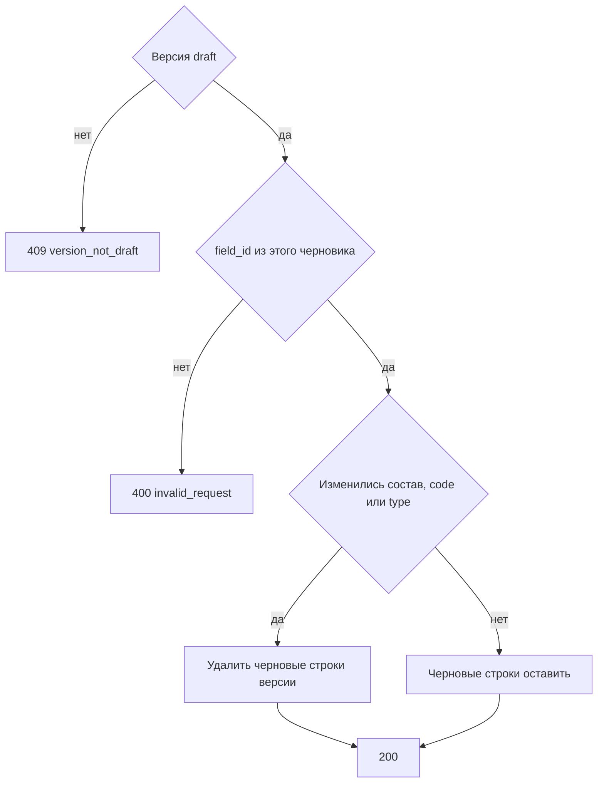

# [На главную](../../../API.md)

# Описание

PATCH **/admin/dictionaries/{dictionary_code}/versions/{version_id}**
Заменить колонки существующего черновика. Если изменились состав, `code` или `type`, черновые строки этой версии удаляются: перед публикацией их нужно записать заново.

# Входные параметры

+ `dictionary_code`:
    + path
    + Обязательно
    + `^[a-z][a-z0-9_]{0,62}$`
+ `version_id`:
    + path
    + Обязательно
    + Целое от 1
+ `fields`:
    + body
    + Обязательно
    + Желаемый состав, от 1 до 50 колонок
    + Ровно одна колонка с `default = true`
    + Одинаковые `code` и одинаковые `field_id` нельзя
+ `fields[].field_id`:
    + Не обязательно
    + Есть — колонка этого черновика. Нет — новая колонка
+ `fields[].code`:
    + Обязательно
    + `^[a-z][a-z0-9_]{0,62}$`
    + Не `value_code`, `valid_from`, `valid_to`
    + Другой `code` при том же `field_id` — переименование
+ `fields[].name`:
    + Обязательно
    + От 1 до 200 символов
+ `fields[].type`:
    + Обязательно
    + `string`, `integer`, `number`, `boolean`
+ `fields[].default`:
    + Обязательно
    + `true` или `false`

# Поля ответа

+ `dictionary_code`
+ `version_id`
+ `status` = `draft`
+ `rows_cleared` — `true`, если черновые строки этой версии удалены
+ `fields`:
    + `field_id`
    + `code`
    + `name`
    + `type`
    + `default`

# Алгоритм работы

## Валидация

1. Проверить путь и тело: состав `fields`, шаблон `code`, запрещённые имена, уникальность `code` и `field_id`, ровно один `default = true`, не больше 50 колонок.
    + Нарушение:
        + Код: `invalid_request`
        + Статус: `400`
2. Найти паспорт по коду без учёта регистра.
    + Нет:
        + Код: `dictionary_not_found`
        + Статус: `404`
3. Найти версию с этим `version_id`.
    + Нет:
        + Код: `version_not_found`
        + Статус: `404`

## Бизнес-логика

1. Версия не `draft`:
    + Код: `version_not_draft`
    + Статус: `409`
2. Собрать новый список колонок. База для `field_id` — колонки этого черновика.
    + `field_id` нет — новая колонка, назначить `field_id`
    + `field_id` не из колонок этого черновика:
        + Код: `invalid_request`
        + Статус: `400`
    + тот же `field_id` и другой `code` — переименование. Другой `type` — смена типа. `field_id` не пришёл — колонка в черновик не входит
3. Сравнить новый список с прежним `fields` черновика по `field_id`, `code` и `type`.
    + Список отличается — удалить строки `dictionary_row` с этим `version_id` и `row_status = draft`. Опубликованные строки не трогать. `rows_cleared = true`
    + Совпадает набор, коды и типы, изменились только `name` или `default` — черновые строки оставить. `rows_cleared = false`
4. Заменить `fields` черновика. Версию `active` не менять. Вернуть статус `200`.

Активная схема от этой записи не меняется. После очистки строк каждый открытый код записывается заново через [post_row.md](../DataController/post_row.md). Без этих строк [post_publish.md](post_publish.md) черновик с изменёнными колонками не публикует. Колонка, убранная из черновика, возвращается только как новая, с новым `field_id`.
