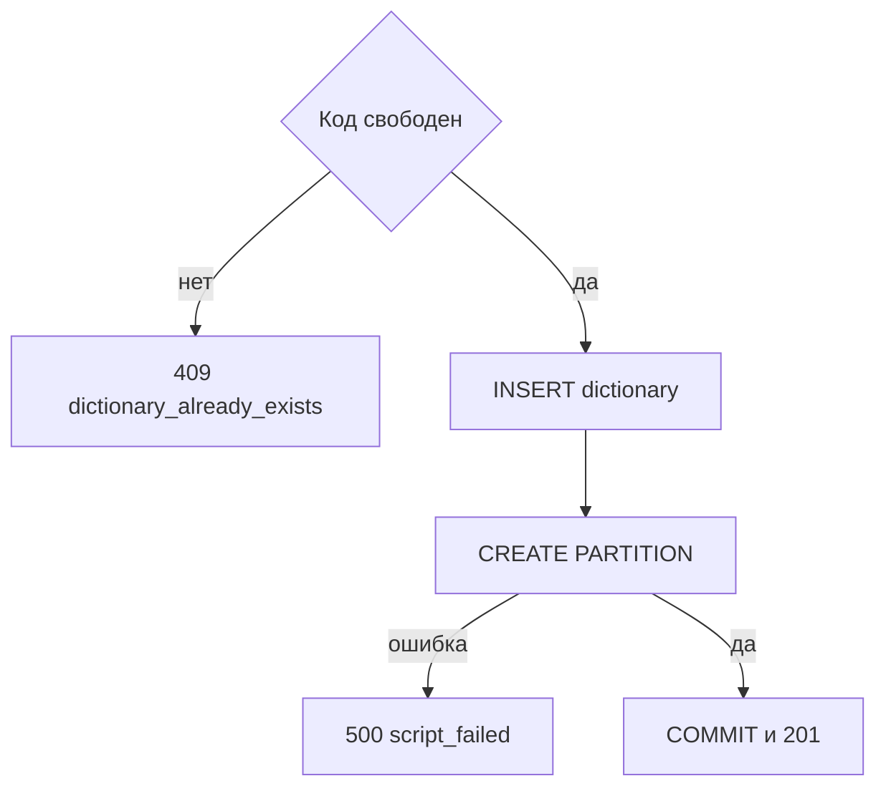

# [На главную](../../../API.md)

# Описание

POST **/admin/dictionaries**
Создать паспорт и пустую секцию общей таблицы. Строки значений не создаются.

# Входные параметры

+ `dictionary_code`:
    + body
    + Обязательно
    + `^[a-z][a-z0-9_]{0,62}$`
    + Уникален без учёта регистра
    + После создания не меняется
+ `dictionary_name`:
    + body
    + Обязательно
    + От 1 до 200 символов
+ `owner`:
    + body
    + Не обязательно
    + До 200 символов, по умолчанию пусто
+ `fields`:
    + body
    + Обязательно
    + От 1 до 50 колонок
    + Ровно одна колонка с `default = true`
    + Одинаковые `code` нельзя
+ `fields[].code`:
    + Обязательно
    + `^[a-z][a-z0-9_]{0,62}$`
    + Не `value_code`, `valid_from`, `valid_to`
+ `fields[].name`:
    + Обязательно
    + От 1 до 200 символов
+ `fields[].type`:
    + Обязательно
    + `string`, `integer`, `number`, `boolean`
+ `fields[].default`:
    + Обязательно
    + `true` или `false`

# Поля ответа

+ `dictionary_id`
+ `dictionary_code`
+ `dictionary_name`
+ `owner`
+ `status` = `active`
+ `fields`

# Алгоритм работы

## Валидация

1. Проверить тело: шаблон `dictionary_code`, длины, состав `fields`, шаблон `code`, запрещённые имена, уникальность `code`, ровно один `default = true`, не больше 50 колонок, неизвестных полей нет.
    + Нарушение:
        + Код: `invalid_request`
        + Статус: `400`

## Бизнес-логика

1. Проверить уникальность `dictionary_code` без учёта регистра.
    + Код занят:
        + Код: `dictionary_already_exists`
        + Статус: `409`
2. Начать транзакцию.
3. Вставить строку в `dictionary`: новый `dictionary_id`, `status = active`. Каждой колонке назначить `field_id`, `valid_from` — время запроса, `valid_to` пуст.
4. Создать секцию `dictionary_row_{dictionary_code}` для `FOR VALUES IN (dictionary_code)`.
    + Ошибка выполнения:
        + Код: `script_failed`
        + Статус: `500`
        + Транзакция откатывается
5. Зафиксировать транзакцию. Вернуть статус `201`.

Секция создаётся пустой. Колонки значения в таблицу не добавляются: они описаны в `fields` и пишутся в `data`.
