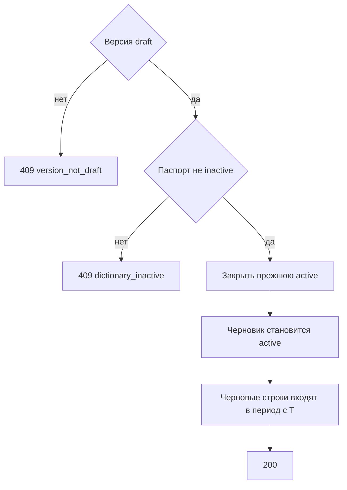

# [На главную](../../../API.md)

# Описание

POST **/admin/dictionaries/{dictionary_code}/versions/{version_id}/publish**
Перевести черновик в активную версию. Прежняя активная версия закрывается. С этого момента запросы без `draft` читают эту версию.

# Входные параметры

+ `dictionary_code`:
    + path
    + Обязательно
    + `^[a-z][a-z0-9_]{0,62}$`
+ `version_id`:
    + path
    + Обязательно
    + Целое от 1

Тела нет.

# Поля ответа

+ `dictionary_code`
+ `version_id`
+ `status` = `active`
+ `valid_from`
+ `valid_to` — пусто

# Алгоритм работы

## Валидация

1. Проверить путь.
    + Нарушение:
        + Код: `invalid_request`
        + Статус: `400`
2. Найти паспорт по коду без учёта регистра.
    + Нет:
        + Код: `dictionary_not_found`
        + Статус: `404`
3. Найти версию с этим `version_id`.
    + Нет:
        + Код: `version_not_found`
        + Статус: `404`

## Бизнес-логика

1. Версия не `draft`:
    + Код: `version_not_draft`
    + Статус: `409`
2. Паспорт `inactive`:
    + Код: `dictionary_inactive`
    + Статус: `409`
3. Взять момент `T` — время этого запроса. Начать транзакцию.
4. Если есть версия `active`, поставить ей `closed` и `valid_to = T`.
5. Черновику поставить `active` и `valid_from = T`. `valid_to` оставить пустым.
6. Для каждой строки `dictionary_row` с `row_status = draft` и `version_id` этого черновика:
    + у опубликованной открытой строки того же `value_code` записать `valid_to = T`, если она есть
    + черновой строке поставить `row_status = published`, `valid_from = T`, `valid_to` пуст
7. Зафиксировать транзакцию. Вернуть статус `200`.

До этой команды строки черновика не видны запросам без `draft`. Колонки черновика становятся колонками актуального чтения только здесь: их период начинается с `T`.
