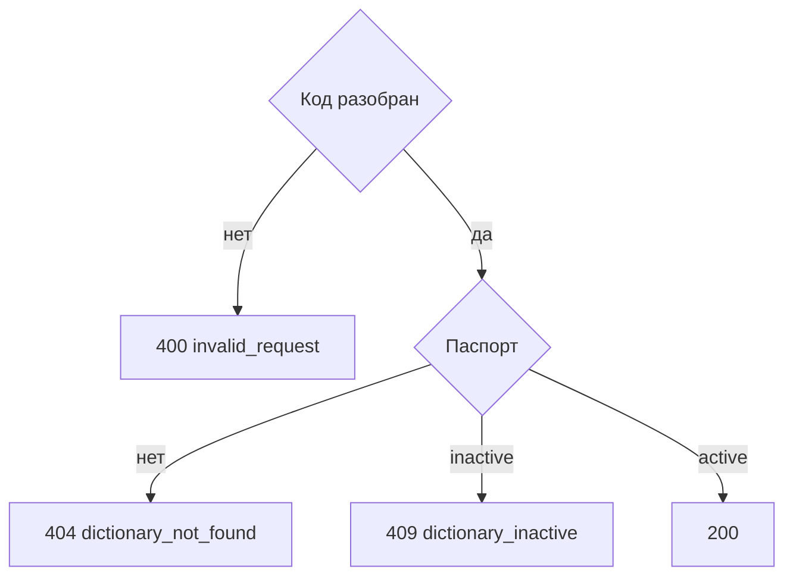

# [На главную](../../../API.md)

# Описание

GET **/dictionaries/{dictionary_code}/columns**
Названия и типы колонок активного справочника. По этим `code` клиент собирает параметр `attribute` чтения значения.

# Входные параметры

+ `dictionary_code`:
    + path
    + Обязательно
    + `^[a-z][a-z0-9_]{0,62}$`

Тела нет.

# Поля ответа

+ `dictionary_code`
+ `columns`:
    + Массив в порядке паспорта
    + `code`
    + `name`
    + `type`
    + `default`

# Алгоритм работы

1. Проверить `dictionary_code`.
    + Нарушение:
        + Код: `invalid_request`
        + Статус: `400`
2. Найти паспорт по коду без учёта регистра.
    + Нет:
        + Код: `dictionary_not_found`
        + Статус: `404`
    + `status = inactive`:
        + Код: `dictionary_inactive`
        + Статус: `409`
3. Вернуть `fields` как `columns`. Статус `200`.

Метод не читает `dictionary_row` и не показывает, какие ключи уже лежат в `data`.
