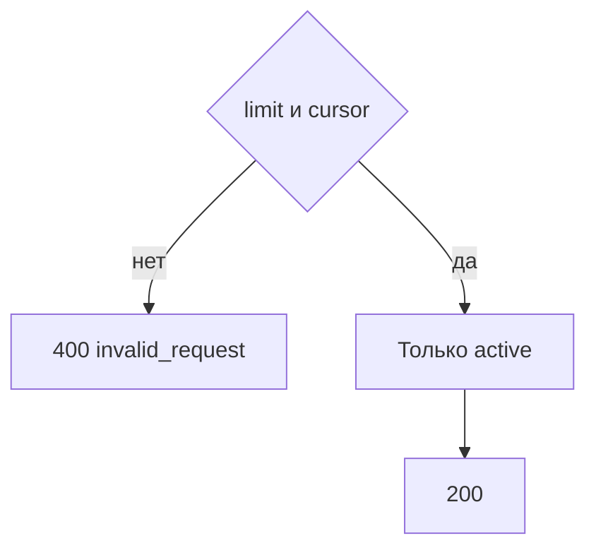

# [На главную](../../../API.md)

# Описание

GET **/dictionaries**
Страница активных справочников: код и название. Колонки и значения не возвращаются.

# Входные параметры

+ `limit`:
    + query
    + Не обязательно
    + Целое от 1 до 1000, по умолчанию 100
+ `cursor`:
    + query
    + Не обязательно
    + Непрозрачная строка предыдущего ответа

# Поля ответа

+ `items`:
    + Массив
    + `dictionary_code`
    + `dictionary_name`
+ `next_cursor` — пусто, если страниц больше нет

# Алгоритм работы

1. Проверить `limit` и `cursor`.
    + Нарушение:
        + Код: `invalid_request`
        + Статус: `400`
2. Прочитать страницу `dictionary` со `status = active` в порядке `dictionary_code`, после курсора.
3. Вернуть статус `200`. Если продолжения нет, `next_cursor` пустой.

Деактивированные паспорта в эту страницу не входят. Состав колонок запрашивается отдельно по коду.
