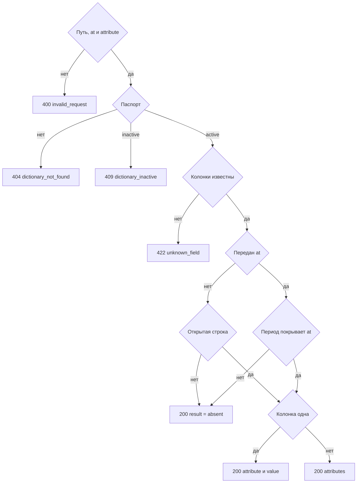

# [На главную](../../../API.md)

# Описание

GET **/dictionaries/{dictionary_code}/values/{value_code}**
Одно состояние кода. Клиент передаёт код справочника, код записи и при необходимости имена колонок и момент. Таблицу, секцию и период он не выбирает.

# Входные параметры

+ `dictionary_code`:
    + path
    + Обязательно
    + `^[a-z][a-z0-9_]{0,62}$`
+ `value_code`:
    + path
    + Обязательно
    + `^[A-Za-z0-9_]{1,64}$`
+ `attribute`:
    + query
    + Не обязательно
    + Повторяемый
    + Нет параметра — колонка с `default = true`
    + Одно значение, кроме `*` — эта колонка
    + Несколько значений — эти колонки
    + Единственное значение `*` — все колонки паспорта
    + `*` вместе с другими именами нельзя
+ `at`:
    + query
    + Не обязательно
    + Момент `YYYY-MM-DDTHH:mm:ssZ`
    + Нет параметра — открытое состояние, `valid_to` пуст

# Поля ответа

+ `dictionary_code`
+ `value_code`
+ `result`:
    + `present` — состояние есть
    + `absent` — состояния нет
+ `valid_from` — пусто при `absent`
+ `valid_to` — пусто при `absent` и у открытого состояния

Ветка «одно значение», когда атрибут не передан или передана одна колонка:

+ `attribute`
+ `value` — пусто, если ключа нет в `data` или `result = absent`

Ветка «словарь», когда передано несколько колонок или `*`:

+ `attributes` — объект `code` → значение. Пустой объект при `result = absent`

`absent` возвращается со статусом `200`.

# Алгоритм работы

1. Проверить путь, формат `at` и список `attribute`. `*` стоит рядом с другим именем:
    + Код: `invalid_request`
    + Статус: `400`
2. Найти паспорт по коду без учёта регистра.
    + Нет:
        + Код: `dictionary_not_found`
        + Статус: `404`
    + `inactive`:
        + Код: `dictionary_inactive`
        + Статус: `409`
3. Собрать список колонок ответа.
    + `attribute` не передан — колонка с `default = true`
    + Переданы имена — каждое имя есть в `fields`
        + Имени нет:
            + Код: `unknown_field`
            + Статус: `422`
    + Передан `*` — все колонки `fields` по порядку паспорта
4. Найти строку в секции справочника.
    + `at` не передан — `value_code` и пустой `valid_to`
    + `at` передан — `value_code`, `valid_from <= at` и (`valid_to` пуст или `valid_to > at`)
    + Строки нет — статус `200`, `result = absent`, значения пустые
5. Иначе `result = present`. Для каждой колонки ответа взять `data[code]`. Ключа в `data` нет — значение пустое.
    + Колонка одна — заполнить `attribute` и `value`
    + Колонок несколько — заполнить `attributes`
6. Вернуть статус `200`.

Набор колонок всегда берётся из текущего паспорта. Момент `at` выбирает строку и не подменяет состав полей. `parent_code` в ответ не входит.
