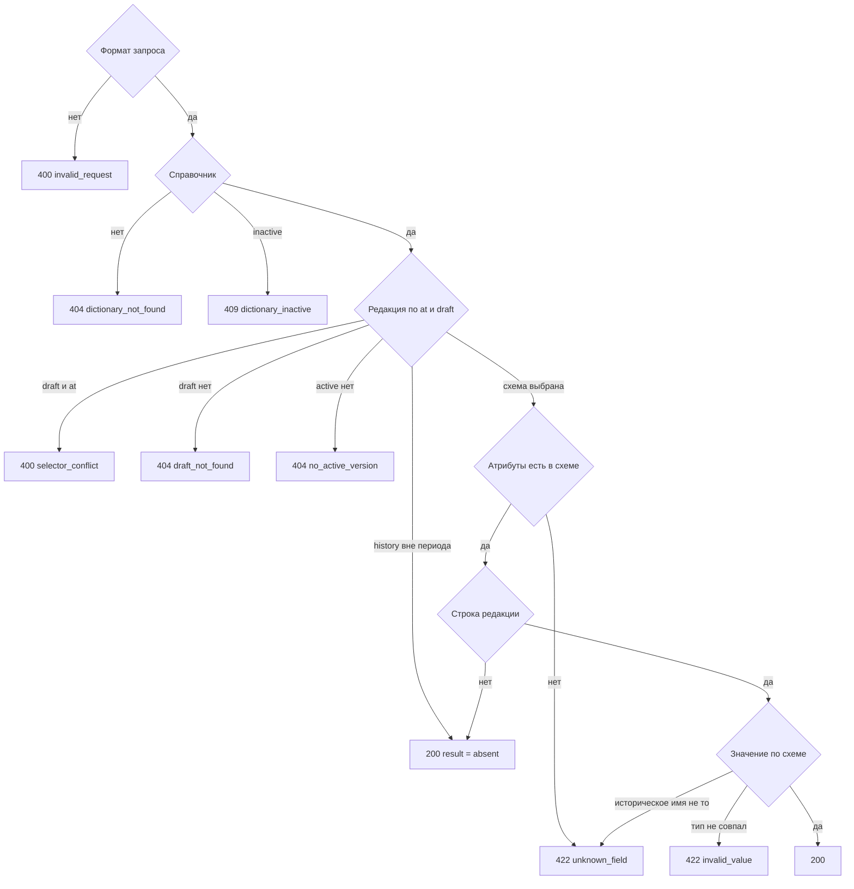

# [На главную](../../../API.md)

# Описание

GET **/dictionaries/{dictionary_code}/values/{value_code}**
Одно состояние кода. Клиент передаёт код справочника, код записи и при необходимости имена колонок и момент. Таблицу, секцию и период он не выбирает.

# Входные параметры

+ `dictionary_code`:
    + path
    + Обязательно
    + `^[a-z][a-z0-9_]{0,62}$`
+ `value_code`:
    + path
    + Обязательно
    + `^[A-Za-z0-9_]{1,64}$`
+ `attribute`:
    + query
    + Не обязательно
    + Повторяемый
    + Нет параметра — колонка с `default = true` у выбранной схемы
    + Одно значение — эта колонка
    + Несколько значений — эти колонки
    + Вместе с `attributes_all=true` нельзя
+ `attributes_all`:
    + query
    + Не обязательно
    + `true` — все колонки выбранной схемы
    + Вместе с `attribute` нельзя
+ `at`:
    + query
    + Не обязательно
    + Момент `YYYY-MM-DDTHH:mm:ssZ`
    + Нет параметра и нет `draft` — открытое опубликованное состояние
    + Вместе с `draft` нельзя
+ `draft`:
    + query
    + Не обязательно
    + `true` — схема и строки версии `draft`
    + После публикации такой версии нет: ответ `draft_not_found`, активные данные не подставляются
    + Без этого параметра черновик не читается

# Поля ответа

+ `dictionary_code`
+ `value_code`
+ `result`:
    + `present` — состояние есть
    + `absent` — состояния нет
+ `valid_from` — пусто при `absent`
+ `valid_to` — пусто при `absent` и у открытого состояния

Ветка «одно значение», когда атрибут не передан или передана одна колонка:

+ `attribute`
+ `value` — пусто, если ключа нет в `data` или `result = absent`

Ветка «словарь», когда передано несколько колонок или `attributes_all=true`:

+ `attributes` — объект `code` → значение. Пустой объект при `result = absent`

`absent` возвращается со статусом `200`.

# Алгоритм работы

1. По `dictionary_code` найти справочник.
    + Путь, формат `at` или список `attribute` неверен, либо `attributes_all=true` передан вместе с `attribute`:
        + Код: `invalid_request`
        + Статус: `400`
    + Паспорта нет:
        + Код: `dictionary_not_found`
        + Статус: `404`
    + Паспорт `inactive`:
        + Код: `dictionary_inactive`
        + Статус: `409`
2. По `at` и `draft` выбрать редакцию и её схему. Схема — `fields` этой версии.
    + `draft=true` вместе с `at`:
        + Код: `selector_conflict`
        + Статус: `400`
    + `draft=true` — редакция `draft`. Версии `draft` нет, в том числе после публикации:
        + Код: `draft_not_found`
        + Статус: `404`
        + Активная схема в этот ответ не подставляется
    + `at` не передан и `draft` не передан — редакция `active`. Версии `active` нет:
        + Код: `no_active_version`
        + Статус: `404`
    + `at` передан — редакция `history`. Схема — опубликованная версия, у которой `valid_from <= at` и (`valid_to` пуст или `valid_to > at`). Активной версии ещё не было:
        + Код: `no_active_version`
        + Статус: `404`
    + `at` передан, версии публиковались, но ни одна не покрывает `at` — статус `200`, `result = absent`, значения пустые. Состав атрибутов не проверяется
3. Проверить атрибутивный состав запроса по выбранной схеме.
    + `attribute` не передан — в запрос входит колонка схемы с `default = true`
    + Переданы имена — каждое имя есть в `code` выбранной схемы. Иначе:
        + Код: `unknown_field`
        + Статус: `422`
    + `attributes_all=true` — в запрос входят все колонки выбранной схемы
4. Собрать ответ по запрошенным атрибутам и выбранной схеме.
    + Найти строку этого `value_code` в редакции:
        + `draft` — `row_status = draft` этой версии. Опубликованная строка не подставляется
        + `active` — `row_status = published` и пустой `valid_to`
        + `history` — `row_status = published`, `valid_from <= at` и (`valid_to` пуст или `valid_to > at`). Строки `draft` не участвуют
    + Строки нет — статус `200`, `result = absent`, значения пустые
    + Ключ в `data` — `code` того же `field_id` в версии, которой записана строка
    + Редакции `draft` и `active`: значение берётся по этому `field_id`, даже если ключ в строке старый. Атрибут с `required = false` и пустое или отсутствующее значение отдаётся пустым. Атрибут с `required = true` пуст или отсутствует, либо непустое значение не совпадает с `type` выбранной схемы:
        + Код: `invalid_value`
        + Статус: `422`
    + Редакция `history`: ключа этого `field_id` в строке нет — значение пустое, имя в ответе берётся из схемы на `at`. Ключ есть, но не равен запрошенному `code`:
        + Код: `unknown_field`
        + Статус: `422`
    + Ключ истории совпал — отдать лежащее значение, тип не проверять. Если `attribute` не передавался, в ответе `attribute` — ключ из `data`
    + Для `attributes_all` в редакции `history` имя колонки в ответе — ключ из `data`, если он есть. Ключа нет — имя из схемы на `at` и пустое значение
    + `result = present`. Одна колонка — `attribute` и `value`. Несколько колонок или `attributes_all` — `attributes`. Статус `200`

Запрос с `draft` после публикации получает `draft_not_found` и не читает активные строки; историческое чтение не проверяет тип и берёт имя из ключа строки, а атрибут с кодом другой записи отдаётся строкой, как остальные колонки.
