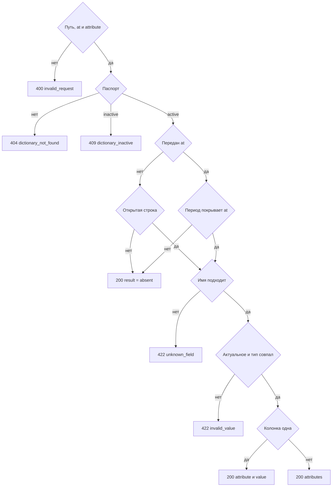

# [На главную](../../../API.md)

# Описание

GET **/dictionaries/{dictionary_code}/values/{value_code}**
Одно состояние кода. Клиент передаёт код справочника, код записи и при необходимости имена колонок и момент. Таблицу, секцию и период он не выбирает.

# Входные параметры

+ `dictionary_code`:
    + path
    + Обязательно
    + `^[a-z][a-z0-9_]{0,62}$`
+ `value_code`:
    + path
    + Обязательно
    + `^[A-Za-z0-9_]{1,64}$`
+ `attribute`:
    + query
    + Не обязательно
    + Повторяемый
    + Нет параметра — колонка с `default = true`
    + Одно значение, кроме `*` — эта колонка
    + Несколько значений — эти колонки
    + Единственное значение `*` — все колонки паспорта
    + `*` вместе с другими именами нельзя
+ `at`:
    + query
    + Не обязательно
    + Момент `YYYY-MM-DDTHH:mm:ssZ`
    + Нет параметра — открытое состояние, `valid_to` пуст

# Поля ответа

+ `dictionary_code`
+ `value_code`
+ `result`:
    + `present` — состояние есть
    + `absent` — состояния нет
+ `valid_from` — пусто при `absent`
+ `valid_to` — пусто при `absent` и у открытого состояния

Ветка «одно значение», когда атрибут не передан или передана одна колонка:

+ `attribute`
+ `value` — пусто, если ключа нет в `data` или `result = absent`

Ветка «словарь», когда передано несколько колонок или `*`:

+ `attributes` — объект `code` → значение. Пустой объект при `result = absent`

`absent` возвращается со статусом `200`.

# Алгоритм работы

1. Проверить путь, формат `at` и список `attribute`. `*` стоит рядом с другим именем:
    + Код: `invalid_request`
    + Статус: `400`
2. Найти паспорт по коду без учёта регистра.
    + Нет:
        + Код: `dictionary_not_found`
        + Статус: `404`
    + `inactive`:
        + Код: `dictionary_inactive`
        + Статус: `409`
3. Найти строку в секции справочника.
    + `at` не передан — `value_code` и пустой `valid_to`. Состав колонок — открытые ревизии
    + `at` передан — `value_code`, `valid_from <= at` и (`valid_to` пуст или `valid_to > at`)
    + Строки нет — статус `200`, `result = absent`, значения пустые
4. Собрать колонки ответа. Ключ в `data` — `code` ревизии того же `field_id`, которая была открыта в `valid_from` найденной строки.
    + `attribute` не передан и `at` не передан — открытая колонка с `default = true`. Значение берётся по ключу в `data`. Ключа нет — значение пустое
    + `attribute` не передан и `at` передан — колонка с `default = true`, чья ревизия покрывает `at`. В ответе `attribute` — ключ из `data`. Ключа нет — значение пустое
    + Переданы имена и `at` не передан — каждое имя есть среди открытых ревизий. Иначе:
        + Код: `unknown_field`
        + Статус: `422`
    + Переданы имена и `at` передан — у колонки в этой строке нет ревизии на `valid_from` строки: значение пустое. Ревизия есть, но запрошенный `code` не равен ключу в `data`:
        + Код: `unknown_field`
        + Статус: `422`
    + Передан `*` и `at` не передан — все открытые ревизии по текущим `code`
    + Передан `*` и `at` передан — ревизии, которые покрывают `at`. Имя в ответе — ключ из `data`, если он есть. Ключа нет — имя ревизии на `at` и пустое значение
5. Для актуального чтения, если ключ в `data` есть и значение не совпадает с `type` открытой ревизии:
    + Код: `invalid_value`
    + Статус: `422`
    + Чтение с `at` тип не проверяет и отдаёт значение как оно лежит
6. `result = present`. Одна колонка — `attribute` и `value`. Несколько — `attributes`. Вернуть статус `200`.

Без `at` имя — только из открытой ревизии, значение читается по старому ключу того же `field_id`. С `at` имя должно совпадать с ключом в найденной строке, кроме ещё не заполненной новой колонки: её значение пустое. Актуальное чтение сверяет значение с текущим типом. Атрибут с кодом другой записи отдаётся строкой, как остальные колонки.
