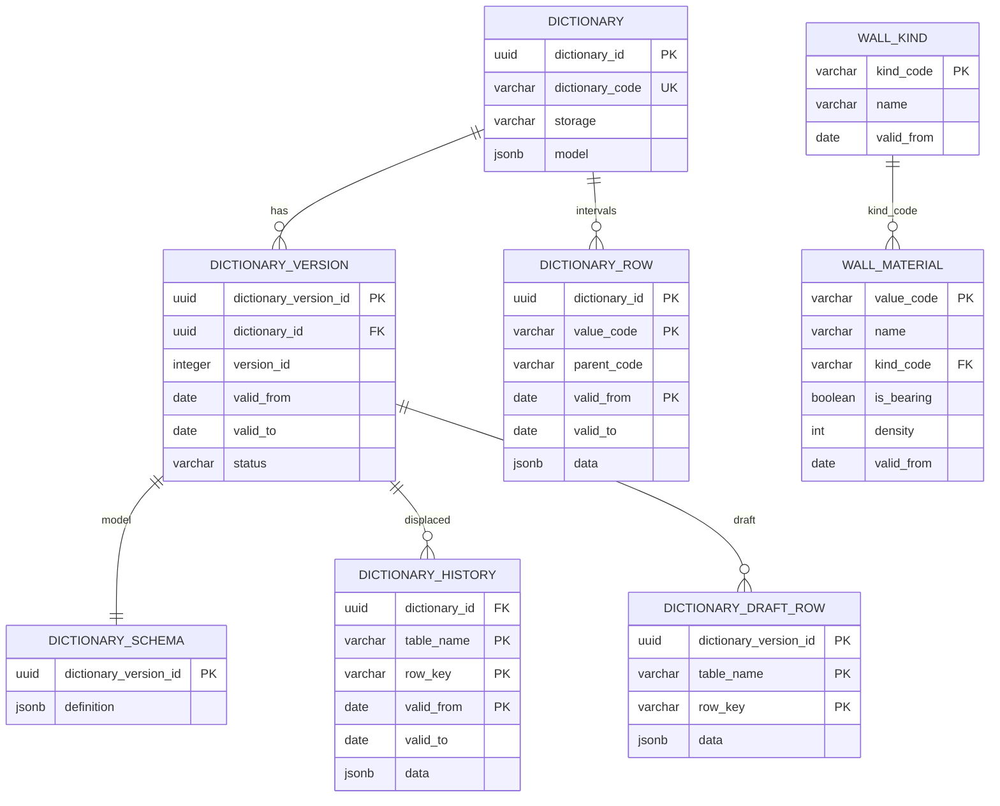

# Схема БД для API справочников

Пустая база поднимается скриптом [init.sql](db/init.sql): каталог, редакции, модель редакции, история вытесненных строк, строки черновика и общая таблица хранения `row`. Живые таблицы хранения `tables` в этот скрипт не входят.

У справочника одно хранение, оно задаётся при создании и дальше не меняется.

+ `row` — все такие справочники лежат в `dictionary_row`. Поля значения — документ `data`. Срок — интервал строки. Связи в базе нет: родитель ищется по `parent_code` и дате. Секция отделяет справочники друг от друга. Создание справочника и смена списка полей не меняют колонки.
+ `tables` — у справочника свои живые таблицы с типизированными колонками и внешними ключами последней модели. Редакция хранит полный документ модели. В `dictionary_history` попадает строка, которую заменили или удалили. Строка, которая не менялась, лежит один раз в живой таблице.

## ER-диаграмма



`WALL_KIND` и `WALL_MATERIAL` — пример живых таблиц паспорта `WallMaterial`. У другого справочника имена другие. Связь `kind_code` есть в живых таблицах, пока она есть в последней опубликованной модели.

## Таблица `dictionary`

Реестр справочников. Хранит код, название, владельца, хранение и текущую модель.

| Поле | Тип | Ограничения | Назначение |
| --- | --- | --- | --- |
| dictionary_id | uuid | PK | Внутренний идентификатор |
| dictionary_code | varchar(63) | NOT NULL | Устойчивый код. После создания не меняется |
| dictionary_name | varchar(200) | NOT NULL | Название для человека |
| owner | varchar(200) | NULL | Предметный владелец |
| status | varchar(16) | NOT NULL, по умолчанию `active` | `active` принимает изменения, `inactive` нет |
| storage | varchar(16) | NOT NULL | `row` или `tables` |
| model | jsonb | NOT NULL | Текущая модель. Для `row` — список полей. Для `tables` — таблицы, колонки и связи последней применённой формы |

Индексы и ограничения:

+ `ux_dictionary_code` на `lower(dictionary_code)`
+ `dictionary_status_check`: `active` или `inactive`
+ `dictionary_storage_check`: `row` или `tables`

Правила работы:

+ `POST /admin/passports` вставляет строку. Для `tables` в той же транзакции создаёт пустые живые таблицы
+ `PATCH /admin/passports/{dictionary_code}` меняет название и владельца. Для `row` может заменить список полей в `model`. Колонки `dictionary_row` при этом не меняются
+ для `tables` структуру меняет публикация черновика, она же переписывает `model`

Документ `model` хранения `tables`:

```json
{
  "tables": {
    "wall_material": {
      "columns": [
        {"name": "value_code", "column": "value_code", "type": "string", "nullable": false, "length": 64}
      ],
      "primary_key": ["value_code"]
    }
  },
  "foreign_keys": [
    {"from_table": "wall_material", "columns": ["kind_code"], "ref_table": "wall_kind", "ref_columns": ["kind_code"]}
  ]
}
```

`name` — имя поля в ответе API. `column` — колонка живой таблицы. Пока имя не меняли, они совпадают. Составной ключ — один элемент `foreign_keys` со списками колонок.

Документ `model` хранения `row` — список полей `{"fields":[{"code":"density","name":"Плотность","type":"integer"}]}`. База состав `data` по этому списку не проверяет.

## Таблица `dictionary_version`

Редакции хранения `tables`. У хранения `row` строк нет.

| Поле | Тип | Ограничения | Назначение |
| --- | --- | --- | --- |
| dictionary_version_id | uuid | PK | Внутренний идентификатор редакции |
| dictionary_id | uuid | NOT NULL, FK -> dictionary.dictionary_id | Паспорт |
| version_id | integer | NOT NULL | Номер внутри справочника, с 1 |
| valid_from | date | NOT NULL | Начало действия |
| valid_to | date | NULL | Конец. Пусто у `draft` и `active` |
| status | varchar(16) | NOT NULL | `draft`, `active` или `closed` |

Индексы и ограничения:

+ `dictionary_version_pk` на `(dictionary_id, version_id)`
+ `ux_dictionary_version_active` на `dictionary_id`, где `status = active`
+ `ux_dictionary_version_draft` на `dictionary_id`, где `status = draft`
+ `dictionary_version_status_check`: `draft`, `active`, `closed`
+ у `draft` и `active` поле `valid_to` пусто
+ у `closed` поле `valid_to` заполнено

Правила работы:

+ у справочника не больше одной редакции `active` и не больше одной `draft`
+ `POST /admin/dictionaries/{dictionary_code}/versions` создаёт `draft`, документ схемы и строки `dictionary_draft_row`. Живые таблицы и история не меняются
+ `PATCH` со `status = active` публикует черновик: применяет отличие к живым таблицам, пишет вытесненные строки в историю, закрывает прежнюю `active`
+ `DELETE` черновика удаляет его строки, документ схемы и строку редакции
+ `DELETE` самой ранней `closed` удаляет её документ схемы и историю, чей период закончился раньше `valid_from` следующей оставшейся редакции. Живые таблицы не меняются. Даты удалённой редакции больше не читаются

## Таблица `dictionary_schema`

Один документ модели на редакцию: все таблицы, колонки, первичные ключи и внешние ключи этой редакции.

| Поле | Тип | Ограничения | Назначение |
| --- | --- | --- | --- |
| dictionary_version_id | uuid | PK, FK -> dictionary_version.dictionary_version_id | Редакция |
| definition | jsonb | NOT NULL | Полная модель редакции, той же формы, что `dictionary.model` |

Индексы и ограничения:

+ первичный ключ `dictionary_version_id`

Правила работы:

+ строка создаётся вместе с редакцией, в том числе с черновиком
+ публикация оставляет документ черновика документом опубликованной редакции и записывает ту же модель в `dictionary.model`
+ удаление редакции удаляет её документ
+ неизменённая таблица повторяется в документе каждой редакции

## Таблица `dictionary_history`

Вытесненные состояния хранения `tables`. Строка, которую не меняли и не удаляли, сюда не пишется.

| Поле | Тип | Ограничения | Назначение |
| --- | --- | --- | --- |
| dictionary_id | uuid | NOT NULL, FK -> dictionary.dictionary_id, входит в PK | Паспорт |
| dictionary_version_id | uuid | NOT NULL, FK -> dictionary_version.dictionary_version_id | Редакция, которой принадлежало закрытое состояние |
| table_name | varchar(63) | NOT NULL, входит в PK | Имя таблицы в модели той редакции |
| row_key | varchar(512) | NOT NULL, входит в PK | Значения `primary_key` по порядку через `\|` |
| valid_from | date | NOT NULL, входит в PK | Начало закрытого состояния |
| valid_to | date | NOT NULL | Конец закрытого состояния |
| data | jsonb | NOT NULL | Поля строки на тот период, ключи — `name` колонок той модели |

Индексы и ограничения:

+ первичный ключ `(dictionary_id, table_name, row_key, valid_from)`
+ `ix_dictionary_history_period` на `(dictionary_id, table_name, valid_from, valid_to)`
+ `dictionary_history_period_check`: `valid_to >= valid_from`
+ внешнего ключа на живую таблицу нет

Правила работы:

+ публикация пишет строку, когда живое состояние заменили или удалили, когда удалили колонку или сменили тип так, что прежнее значение из живой строки уже не прочитать, и когда таблицу удалили: тогда закрывается каждая её живая строка
+ новая колонка, новый внешний ключ и переименование колонки строку истории не создают
+ `DELETE` самой ранней закрытой редакции удаляет историю с `valid_to` раньше `valid_from` следующей оставшейся редакции

## Таблица `dictionary_draft_row`

Полный желаемый состав таблиц черновика. Это не отличие и не живые данные.

| Поле | Тип | Ограничения | Назначение |
| --- | --- | --- | --- |
| dictionary_version_id | uuid | NOT NULL, FK -> dictionary_version.dictionary_version_id, входит в PK | Черновик |
| table_name | varchar(63) | NOT NULL, входит в PK | Таблица модели черновика |
| row_key | varchar(512) | NOT NULL, входит в PK | Ключ строки |
| data | jsonb | NOT NULL | Поля строки, ключи — `name` колонок модели черновика |

Индексы и ограничения:

+ первичный ключ `(dictionary_version_id, table_name, row_key)`

Правила работы:

+ `POST /admin/dictionaries/{dictionary_code}/versions` заполняет таблицу
+ таблица, которой нет в файле, при публикации считается неизменённой
+ пустой массив таблицы в файле удаляет все её строки при публикации
+ публикация и удаление черновика удаляют эти строки

## Таблица `dictionary_row`

Все справочники хранения `row`. Секция — один `dictionary_id`.

| Поле | Тип | Ограничения | Назначение |
| --- | --- | --- | --- |
| dictionary_id | uuid | NOT NULL, FK -> dictionary.dictionary_id, входит в PK | Паспорт и значение секции |
| value_code | varchar(64) | NOT NULL, входит в PK | Код значения |
| parent_code | varchar(64) | NULL | Код родителя в этой же таблице. Проверки ссылки нет |
| valid_from | date | NOT NULL, входит в PK | Начало состояния |
| valid_to | date | NULL | Конец. Пусто у открытого состояния |
| data | jsonb | NOT NULL | Поля значения. Состав сверяется со списком полей только как JSON-объект |

Индексы и ограничения:

+ первичный ключ `(dictionary_id, value_code, valid_from)`
+ `PARTITION BY LIST (dictionary_id)`, без секции `DEFAULT`
+ `dictionary_row_period_check`: `valid_to` пусто или `valid_to >= valid_from`
+ внешнего ключа по `parent_code` нет

Правила работы:

+ `POST /admin/passports` при `storage = row` создаёт секцию `dictionary_row_{dictionary_id без дефисов}` для `FOR VALUES IN (dictionary_id)`. Отдельной таблицы справочника нет
+ `POST /admin/dictionaries/{dictionary_code}/rows` закрывает открытое состояние этого кода днём раньше новой даты и вставляет открытую строку
+ на один код приходится одно открытое состояние. Это проверяет запись, отдельного уникального индекса с условием на секциях нет
+ чтение на дату берёт строку, у которой `valid_from <= дата` и (`valid_to` пуст или `valid_to >= дата`)
+ родитель на дату — строка `dictionary_row` с `value_code = parent_code` и интервалом, который покрывает ту же дату. Метод чтения само значение родителя не подставляет

## Живые таблицы хранения `tables`

Имена берутся из ключей `model.tables`, например `wall_kind` и `wall_material`. В `init.sql` их нет.

| Поле | Тип | Ограничения | Назначение |
| --- | --- | --- | --- |
| колонки модели | по типу поля | NULL или NOT NULL | Поля последней применённой модели. Физическое имя — `column` |
| valid_from | date | NOT NULL | День, с которого действует это состояние. В документ модели не входит |

Индексы и ограничения:

+ первичный ключ — колонки `primary_key` модели
+ внешние ключи — элементы `foreign_keys` последней применённой модели
+ на `dictionary_version` внешнего ключа нет

Правила работы:

+ `string` хранится как `varchar(length)`, `integer` как `integer`, `bigint` как `bigint`, `date` как `date`, `uuid` как `uuid`, `boolean` как `boolean`
+ создание паспорта создаёт пустые таблицы. Публикация применяет отличие модели: новая таблица, удаление таблицы, колонка, переименование, смена типа, внешний ключ
+ переименование записывается в `column` и делает `ALTER TABLE ... RENAME COLUMN`. Строка истории из-за переименования не пишется
+ удаление колонки и смена типа, при которой прежнее значение не прочитать, сначала пишут прежний документ строки в историю
+ новый внешний ключ ставится, когда колонки уже заполнены

Публикация, которая заменяет справочник целиком, не применяется. Это выпуск, где одновременно удаляемых таблиц больше половины таблиц текущей модели и у каждой оставшейся таблицы другой первичный ключ или другой набор имён колонок. Такой черновик остаётся черновиком, ответ публикации — `schema_replaced`.

## Чтение на дату для `tables`

Дата попадает в редакцию, у которой `valid_from <= дата` и (`valid_to` пуст или `valid_to >= дата`). Черновик в период не входит. Дальше для запрошенной таблицы:

1. Взять `dictionary_schema` этой редакции. Таблицы нет в `definition.tables` — на эту дату таблицы не было.
2. Поля ответа — `definition.tables[имя].columns`.
3. Из `dictionary_history` взять строки этой таблицы, у которых `valid_from <= дата` и `valid_to >= дата`. Значение поля берётся из `data` по `name`.
4. Если живая таблица ещё есть, взять строки с `valid_from <= дата`, чей ключ не попал в шаг 3. Значение берётся из колонки `column`. Колонки, которой нет в списке полей, в ответ не входят. Живой таблицы уже нет — в ответе только шаг 3.
5. Сосед ищется этим же чтением на ту же дату, когда в `definition.foreign_keys` есть связь с `from_table`, равным этой таблице. Методы чтения запись соседа в ответ не вкладывают: её берут отдельным вызовом по коду и той же дате.

Без даты читается действующая редакция: то же чтение с датой `valid_from` этой редакции. Удалённый код остаётся в истории, пока дата внутри его интервала. Код с более поздним `valid_from` в ответ не входит.

## Связи между таблицами

+ `dictionary 1 -> N dictionary_version` для хранения `tables`
+ `dictionary_version 1 -> 1 dictionary_schema`
+ `dictionary_version 1 -> N dictionary_history`
+ `dictionary_version 1 -> N dictionary_draft_row`
+ `dictionary 1 -> N dictionary_row` для хранения `row`, строки лежат в секции справочника
+ живая таблица 1 -> N живая таблица по внешнему ключу последней модели
