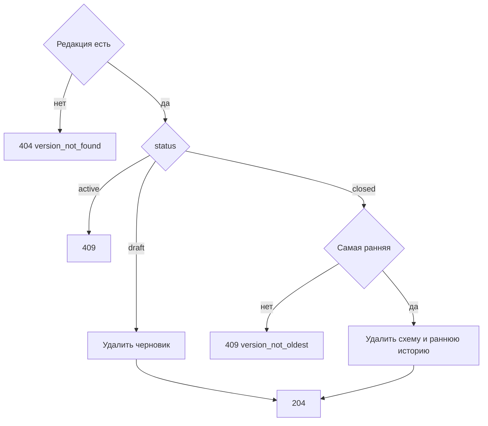

# [На главную](../../../API.md)

# Описание

DELETE **/admin/dictionaries/{dictionary_code}/versions/{version_id}**
Удалить черновик либо самую раннюю закрытую редакцию хранения `tables`. Действующая редакция и живые таблицы этим вызовом не меняются.

# Входные параметры

+ `dictionary_code`:
    + path
    + Обязательно
+ `version_id`:
    + path
    + Обязательно

Тела нет.

# Поля ответа

Тела нет.

# Алгоритм работы

## Валидация

1. Найти паспорт и редакцию.
    + Нет паспорта:
        + Код: `dictionary_not_found`
        + Статус: `404`
    + Нет редакции:
        + Код: `version_not_found`
        + Статус: `404`

## Бизнес-логика

1. Начать транзакцию. Заблокировать паспорт.
2. `storage` не `tables`:
    + Код: `storage_mismatch`
    + Статус: `409`
3. Редакция `active`:
    + Статус: `409`
4. Редакция `draft`: удалить `dictionary_draft_row`, `dictionary_schema` и строку редакции.
5. Редакция `closed`. Есть редакция этого справочника с меньшим `version_id`:
    + Код: `version_not_oldest`
    + Статус: `409`
6. Редакция `closed` и она самая ранняя. Удалить `dictionary_history` этого справочника с `valid_to` раньше `valid_from` следующей оставшейся редакции, затем `dictionary_schema` и строку редакции.
7. Зафиксировать транзакцию. Вернуть статус `204`.

После удаления закрытой редакции даты её периода не читаются. Живые строки и их `valid_from` остаются.
