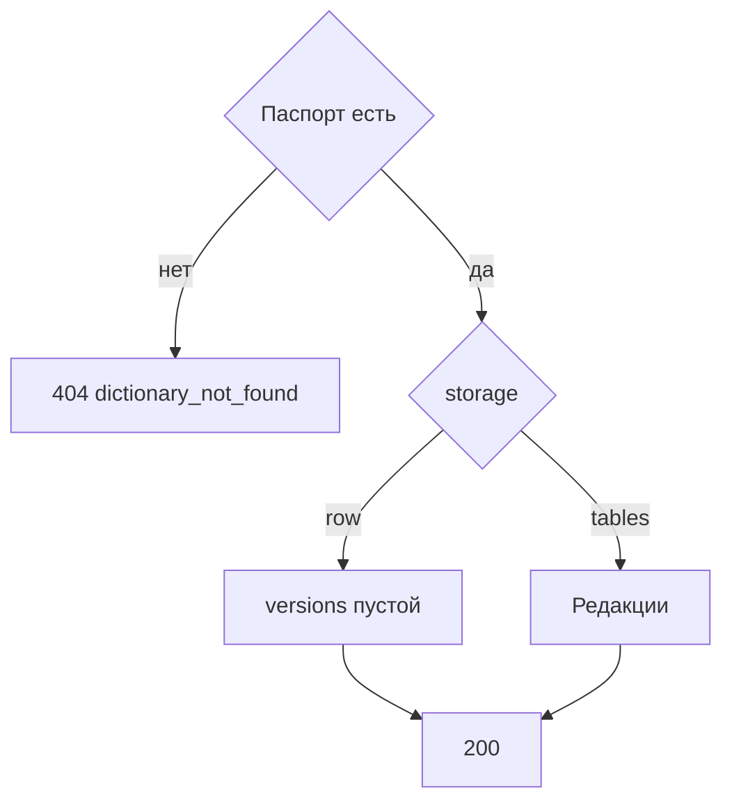

# [На главную](../../../API.md)

# Описание

GET **/admin/passports/{dictionary_code}**
Паспорт, модель и редакции. Строк значений нет.

# Входные параметры

+ `dictionary_code`:
    + path
    + Обязательно

Тела нет.

# Поля ответа

+ `dictionary_id`
+ `dictionary_code`
+ `dictionary_name`
+ `owner`
+ `status`
+ `storage`
+ `model`
+ `versions`:
    + Массив, у `row` пустой
    + Порядок по `version_id` по убыванию
    + `version_id`
    + `status`
    + `valid_from`
    + `valid_to`

# Алгоритм работы

## Валидация

1. Найти `dictionary` по коду без учёта регистра.
    + Нет строки:
        + Код: `dictionary_not_found`
        + Статус: `404`

## Бизнес-логика

1. Для `tables` прочитать редакции. Для `row` вернуть пустой `versions`.
2. Вернуть статус `200`.

Документ модели черновика в этот ответ не входит: в `model` лежит последняя применённая форма. Модель черновика читается вместе со строками редакции.
