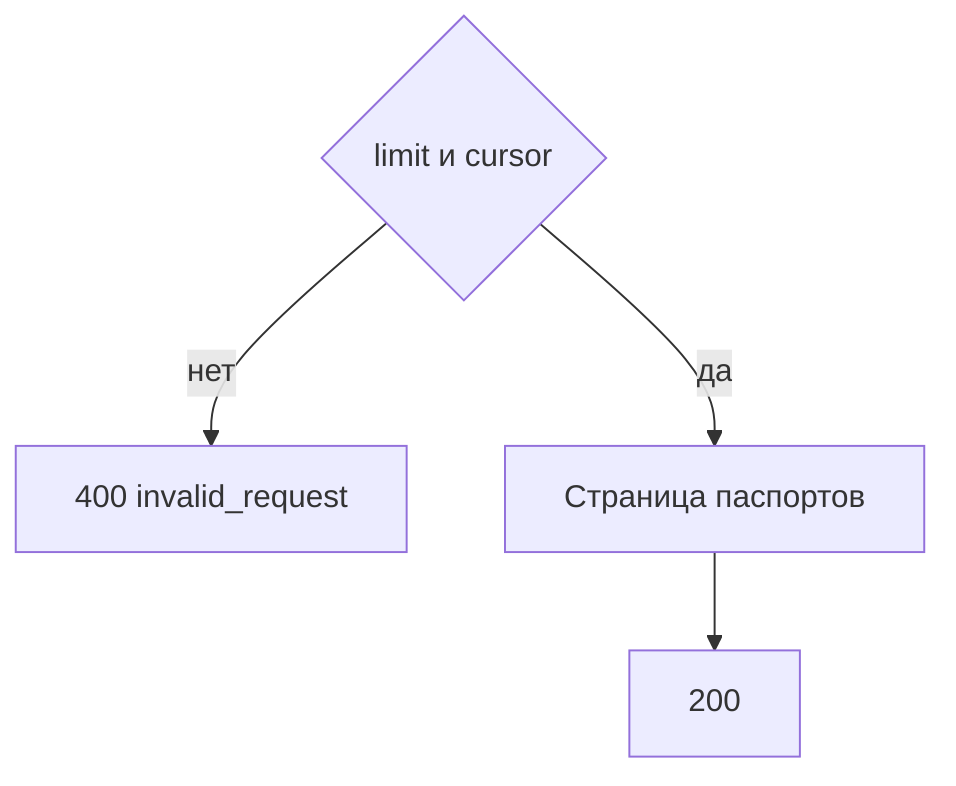

# [На главную](../../../API.md)

# Описание

GET **/admin/passports**
Страница паспортов. Строк значений нет.

# Входные параметры

+ `limit`:
    + query
    + Не обязательно
    + integer, от 1 до 1000, по умолчанию 100
+ `cursor`:
    + query
    + Не обязательно
    + Непрозрачная строка предыдущего ответа

# Поля ответа

+ `items`:
    + Массив, порядок по `dictionary_code`
    + `dictionary_id`
    + `dictionary_code`
    + `dictionary_name`
    + `owner` — может быть пустым
    + `status`
    + `storage` — `row` или `tables`
    + `active_version_id` — номер редакции `active` или пусто. У `row` всегда пусто
+ `next_cursor` — пусто, если страниц больше нет

# Алгоритм работы

## Валидация

1. Проверить `limit` и `cursor`.
    + Нарушение:
        + Код: `invalid_request`
        + Статус: `400`

## Бизнес-логика

1. Прочитать страницу `dictionary` и для `tables` номер редакции `active`.
2. Вернуть статус `200`.

Метод ничего не записывает и не читает живые таблицы и `dictionary_row`.
