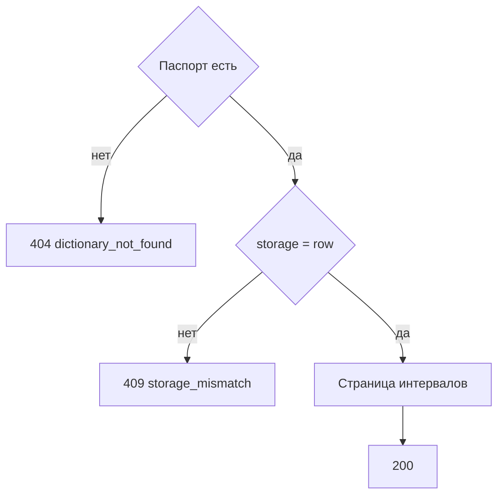

# [На главную](../../../API.md)

# Описание

GET **/admin/dictionaries/{dictionary_code}/rows**
Страница состояний хранения `row` на дату или всех открытых состояний. Тот же отбор, что у чтения сервиса: интервал строки.

# Входные параметры

+ `dictionary_code`:
    + path
    + Обязательно
+ `on_date`:
    + query
    + Не обязательно
    + Дата `YYYY-MM-DD`
    + Нет даты — только открытые состояния, `valid_to` пуст
+ `query`:
    + query
    + Не обязательно
    + Подстрока без учёта регистра по `value_code`
+ `limit`:
    + query
    + Не обязательно
    + integer, от 1 до 1000, по умолчанию 100
+ `cursor`:
    + query
    + Не обязательно
    + Последний `value_code` предыдущей страницы

# Поля ответа

+ `dictionary_code`
+ `on_date` — пусто, если дата не передана
+ `items`:
    + Массив, порядок по `value_code`
    + `value_code`
    + `parent_code`
    + `valid_from`
    + `valid_to`
    + `data`
+ `next_cursor`

# Алгоритм работы

## Валидация

1. Проверить дату, `limit` и `cursor`.
    + Нарушение:
        + Код: `invalid_request`
        + Статус: `400`
2. Найти паспорт.
    + Нет строки:
        + Код: `dictionary_not_found`
        + Статус: `404`

## Бизнес-логика

1. `storage` не `row`:
    + Код: `storage_mismatch`
    + Статус: `409`
2. С датой взять строки, у которых `valid_from <= дата` и (`valid_to` пуст или `valid_to >= дата`). Без даты взять открытые строки.
3. Вернуть статус `200`.

Имя родителя метод не подставляет. Чтение действующего и прошлого состояния идёт по одному правилу интервала.
