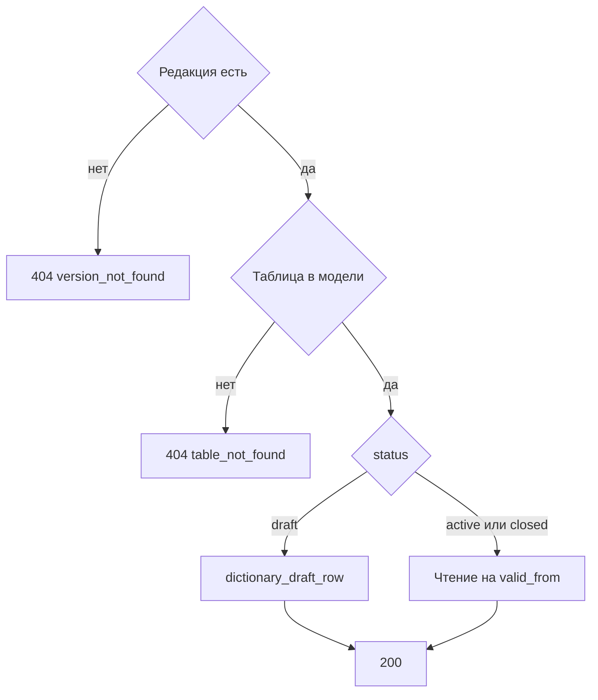

# [На главную](../../../API.md)

# Описание

GET **/admin/dictionaries/{dictionary_code}/versions/{version_id}**
Страница строк одной таблицы редакции. Черновик читается из `dictionary_draft_row`. Действующая и закрытая редакции собираются на дату `valid_from` этой редакции по правилам чтения из [DB.md](../../../DB.md).

# Входные параметры

+ `dictionary_code`:
    + path
    + Обязательно
+ `version_id`:
    + path
    + Обязательно
+ `table_name`:
    + query
    + Обязательно
    + Имя таблицы модели этой редакции
+ `query`:
    + query
    + Не обязательно
    + Подстрока без учёта регистра по ключу строки и по полю `name`, если оно есть
+ `limit`:
    + query
    + Не обязательно
    + integer, от 1 до 1000, по умолчанию 100
+ `cursor`:
    + query
    + Не обязательно
    + Последний `row_key` предыдущей страницы

# Поля ответа

+ `dictionary_code`
+ `version_id`
+ `version_status`
+ `valid_from`
+ `valid_to`
+ `table_name`
+ `items`:
    + Массив, порядок по `row_key`
    + `row_key`
    + `fields` — поля модели этой редакции
+ `next_cursor`

# Алгоритм работы

## Валидация

1. Проверить `table_name`, `limit` и `cursor`.
    + Нарушение:
        + Код: `invalid_request`
        + Статус: `400`
2. Найти паспорт и редакцию.
    + Нет паспорта:
        + Код: `dictionary_not_found`
        + Статус: `404`
    + Нет редакции:
        + Код: `version_not_found`
        + Статус: `404`

## Бизнес-логика

1. `storage` не `tables`:
    + Код: `storage_mismatch`
    + Статус: `409`
2. Взять `dictionary_schema` этой редакции. `table_name` нет в `definition.tables`:
    + Код: `table_not_found`
    + Статус: `404`
3. Редакция `draft`: прочитать `dictionary_draft_row` этой таблицы. Таблицы нет в черновике — страница пустая, таблица считается неизменённой.
4. Редакция `active` или `closed`: собрать строки на дату `valid_from` по правилам чтения [DB.md](../../../DB.md).
5. Оставить строки, подходящие под `query`, и страницу после `cursor`. Вернуть статус `200`.

Черновик не смешивается с живыми строками. Запись связанной таблицы в `fields` не вкладывается.
