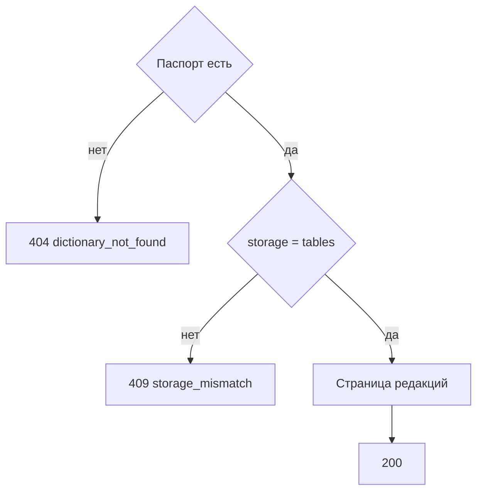

# [На главную](../../../API.md)

# Описание

GET **/admin/dictionaries/{dictionary_code}/versions**
Список редакций хранения `tables`. Строк значений нет.

# Входные параметры

+ `dictionary_code`:
    + path
    + Обязательно
+ `status`:
    + query
    + Не обязательно
    + `draft`, `active` или `closed`
+ `limit`:
    + query
    + Не обязательно
    + integer, от 1 до 1000, по умолчанию 100
+ `cursor`:
    + query
    + Не обязательно
    + Последний `version_id` предыдущей страницы

# Поля ответа

+ `dictionary_code`
+ `storage`
+ `items`:
    + Массив, порядок по `version_id` по убыванию
    + `version_id`
    + `status`
    + `valid_from`
    + `valid_to`
+ `next_cursor` — пусто, если страниц больше нет

# Алгоритм работы

## Валидация

1. Проверить `status`, `limit` и `cursor`.
    + Нарушение:
        + Код: `invalid_request`
        + Статус: `400`
2. Найти паспорт по коду.
    + Нет строки:
        + Код: `dictionary_not_found`
        + Статус: `404`

## Бизнес-логика

1. `storage` не `tables`:
    + Код: `storage_mismatch`
    + Статус: `409`
2. Прочитать страницу `dictionary_version`. Вернуть статус `200`.

Метод не читает живые таблицы и историю.
