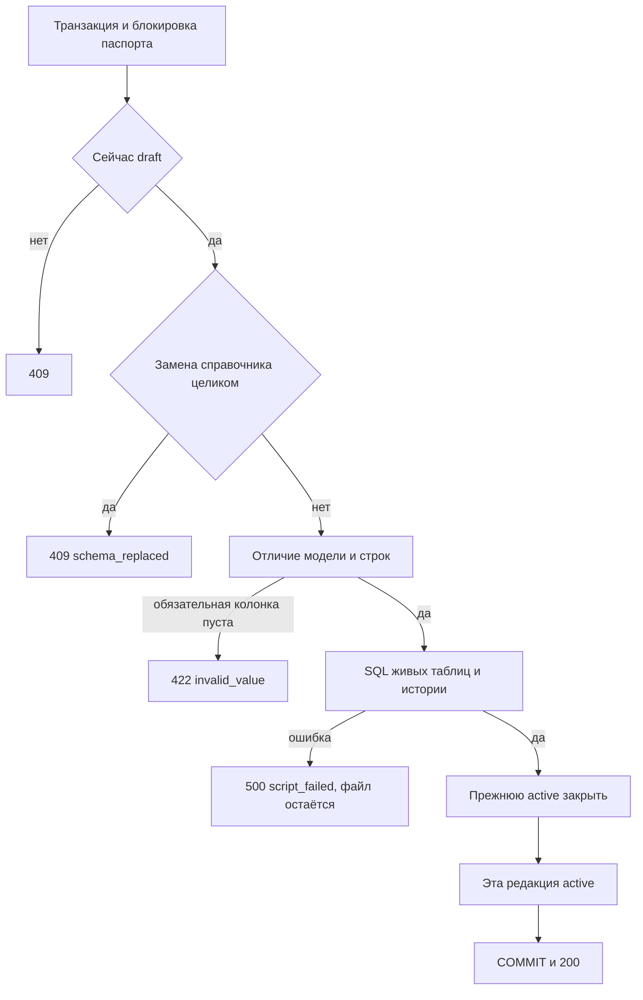

# [На главную](../../../API.md)

# Описание

PATCH **/admin/dictionaries/{dictionary_code}/versions/{version_id}**
Опубликовать черновик хранения `tables`. В одной транзакции черновик становится `active`, прежняя действующая редакция закрывается, к живым таблицам применяется отличие модели и строк. В историю попадает только вытесненное состояние.

# Входные параметры

+ `dictionary_code`:
    + path
    + Обязательно
+ `version_id`:
    + path
    + Обязательно
+ `status`:
    + body
    + Обязательно
    + Только `active`

# Поля ответа

+ `version_id`
+ `status` = `active`
+ `valid_from`
+ `valid_to` — пусто
+ `closed_version_id` — пусто, если закрывать было нечего
+ `closed_valid_to` — пусто, если закрывать было нечего

# Алгоритм работы

## Валидация

1. Проверить тело. `status` не `active` или есть лишнее поле:
    + Код: `invalid_request`
    + Статус: `400`
2. Найти паспорт и редакцию.
    + Нет паспорта:
        + Код: `dictionary_not_found`
        + Статус: `404`
    + Нет редакции:
        + Код: `version_not_found`
        + Статус: `404`

## Бизнес-логика

1. Начать транзакцию. Заблокировать паспорт.
2. `storage` не `tables`:
    + Код: `storage_mismatch`
    + Статус: `409`
3. Паспорт не `active`:
    + Код: `dictionary_inactive`
    + Статус: `409`
4. Редакция не `draft`:
    + Статус: `409`
5. Сравнить модель черновика с `dictionary.model`. Отклонить публикацию, когда одновременно:
    + таблиц, которых нет в модели черновика, больше половины таблиц текущей модели
    + у каждой оставшейся таблицы другой `primary_key` или другой набор имён колонок
    + Код: `schema_replaced`
    + Статус: `409`
    + Черновик не удаляется
6. Сравнить строки черновика с живыми таблицами. Таблица, которой нет в файле черновика, не меняет строки. Пустой массив удаляет все строки таблицы.
    + Новая колонка `nullable = false` не заполнена у остающейся строки:
        + Код: `invalid_value`
        + Статус: `422`
7. Записать SQL в `db/sql-schema/{локальное время до секунды} - {dictionary_code}-v{version_id}.sql` и выполнить его в этой транзакции.
    + Новая таблица создаётся пустой, её строки получают `valid_from` черновика
    + Удаляемая таблица: каждая живая строка закрывается в `dictionary_history` по день перед `valid_from` черновика, затем таблица удаляется
    + Новые колонка и внешний ключ добавляются в живую таблицу. Прежняя модель их не показывает, строки из-за этого не копируются. Ключ ставится после заполнения колонок
    + Удаление колонки и смена типа, при которой прежнее значение не прочитать: прежний документ строки пишется в историю, затем меняется таблица
    + Переименование меняет `column` и выполняет `RENAME COLUMN`
    + Удаление внешнего ключа без удаления колонки снимает ограничение
    + Заменённая строка: прежнее состояние пишется в историю, живая строка обновляется, `valid_from` становится датой черновика
    + Новая строка вставляется с `valid_from` черновика
    + Удалённая строка переносится в историю и удаляется из живой таблицы
    + Строка с тем же ключом и теми же значениями не копируется и сохраняет свой `valid_from`
    + Ошибка выполнения:
        + Код: `script_failed`
        + Статус: `500`
        + Транзакция откатывается, SQL-файл остаётся
8. Если есть `active`, поставить ей `closed` и `valid_to` на день раньше `valid_from` черновика.
9. Поставить черновику `active`. Записать его модель в `dictionary.model`. Удалить `dictionary_draft_row` этой редакции.
10. Зафиксировать транзакцию. Вернуть статус `200`.

Черновик до этой транзакции в живых таблицах не виден. Дату конца прежней редакции считает сервер. Повторная публикация уже действующей редакции — `409` без кода.
