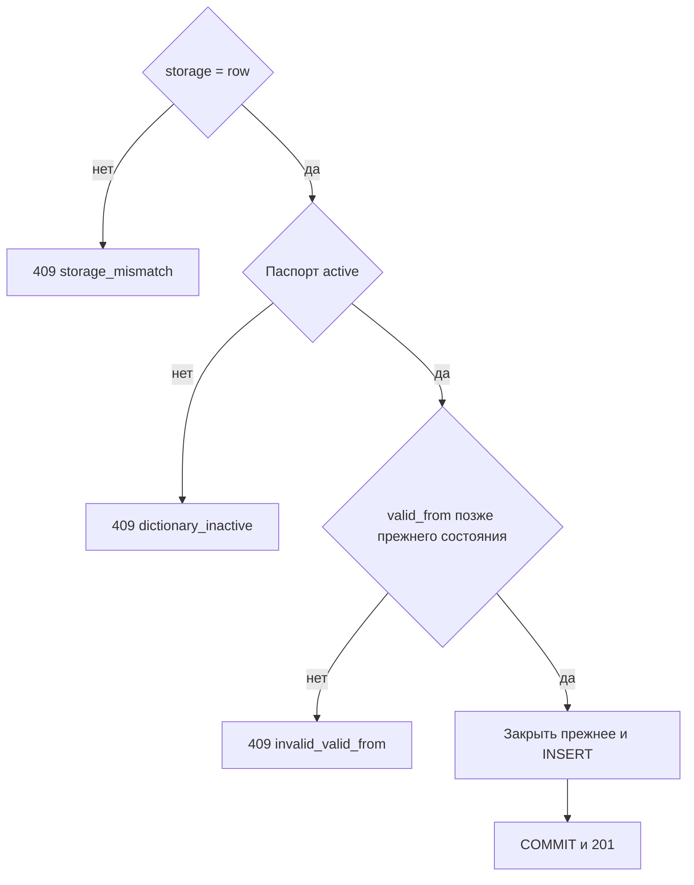

# [На главную](../../../API.md)

# Описание

POST **/admin/dictionaries/{dictionary_code}/rows**
Открыть новое состояние одного кода в хранении `row`. Прежнее открытое состояние закрывается днём раньше новой даты. Редакция не создаётся. Состав `data` со списком полей паспорта не сверяется.

# Входные параметры

+ `dictionary_code`:
    + path
    + Обязательно
+ `value_code`:
    + body
    + Обязательно
    + От 1 до 64 символов
+ `parent_code`:
    + body
    + Не обязательно
    + До 64 символов
    + Ссылка не проверяется
+ `valid_from`:
    + body
    + Обязательно
    + Дата `YYYY-MM-DD`
+ `data`:
    + body
    + Обязательно
    + JSON-объект

# Поля ответа

+ `dictionary_code`
+ `value_code`
+ `parent_code`
+ `valid_from`
+ `valid_to` — пусто
+ `data`
+ `closed_valid_to` — дата закрытия прежнего состояния или пусто, если его не было

# Алгоритм работы

## Валидация

1. Проверить тело: длины кодов, дата `YYYY-MM-DD`, `data` — объект.
    + Нарушение:
        + Код: `invalid_request`
        + Статус: `400`
2. Найти паспорт по коду.
    + Нет строки:
        + Код: `dictionary_not_found`
        + Статус: `404`

## Бизнес-логика

1. Начать транзакцию. Заблокировать паспорт.
2. `storage` не `row`:
    + Код: `storage_mismatch`
    + Статус: `409`
3. Паспорт не `active`:
    + Код: `dictionary_inactive`
    + Статус: `409`
4. Найти открытую строку этого `value_code` (`valid_to` пуст).
    + Она есть, и новая дата не строго позже её `valid_from`:
        + Код: `invalid_valid_from`
        + Статус: `409`
    + Её нет, но есть закрытые состояния, и новая дата не строго позже максимального `valid_to`:
        + Код: `invalid_valid_from`
        + Статус: `409`
5. Закрыть открытую строку: `valid_to` — день раньше новой даты. Вставить строку с пустым `valid_to`.
6. Зафиксировать транзакцию. Вернуть статус `201`.

Поля внутри `data` не проверяются по типу и списку `model.fields`. `parent_code` может указывать на код другого справочника в `dictionary_row` и может не найтись.
