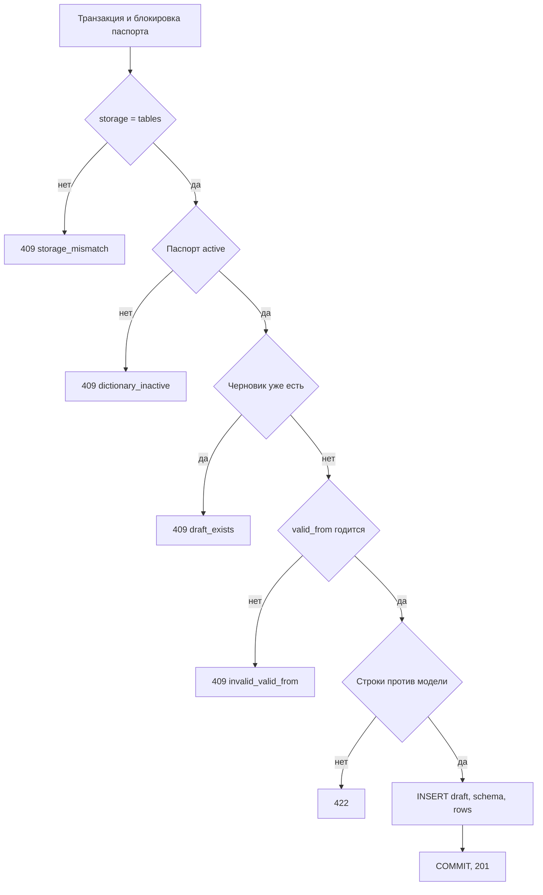

# [На главную](../../../API.md)

# Описание

POST **/admin/dictionaries/{dictionary_code}/versions**
Принять полную модель и строки черновика хранения `tables`. Живые таблицы и история не меняются. Пока черновик есть, повторный вызов — `409`. Замена — [удалить](delete_version.md) черновик и вызвать создание снова. Публикация — [смена статуса](patch_version.md).

# Входные параметры

+ `dictionary_code`:
    + path
    + Обязательно
+ `file`:
    + form
    + Обязательно
    + JSON, не больше 100 МБ
    + Объект с полями `model` и `tables`
+ `valid_from`:
    + form
    + Обязательно
    + Дата `YYYY-MM-DD`
+ `file.model`:
    + Не обязательно
    + Нет поля — модель черновика равна текущей `dictionary.model`
    + Есть поле — полная модель той же формы, что при создании паспорта. `name` и `column` могут различаться, если колонка переименована
+ `file.tables`:
    + Объект. Ключ — имя таблицы модели черновика, значение — массив строк
    + Таблица модели, которой нет среди ключей, при публикации считается неизменённой
    + Пустой массив удаляет все строки этой таблицы при публикации
    + В строке есть все колонки `primary_key`

# Поля ответа

+ `dictionary_version_id`
+ `version_id`
+ `status` = `draft`
+ `valid_from`
+ `valid_to` — пусто
+ `row_count`

# Алгоритм работы

## Валидация

1. Проверить дату и файл.
    + Нет `valid_from` или дата не `YYYY-MM-DD`:
        + Код: `invalid_request`
        + Статус: `400`
    + Файл больше 100 МБ:
        + Код: `file_too_large`
        + Статус: `413`
    + Не JSON:
        + Код: `unsupported_media_type`
        + Статус: `415`
    + Файл пуст или не объект с `tables`:
        + Код: `empty_file` или `invalid_file`
        + Статус: `422`
2. Найти паспорт по коду.
    + Нет строки:
        + Код: `dictionary_not_found`
        + Статус: `404`

## Бизнес-логика

1. Начать транзакцию. Заблокировать строку `dictionary`.
2. `storage` не `tables`:
    + Код: `storage_mismatch`
    + Статус: `409`
3. Паспорт не `active`:
    + Код: `dictionary_inactive`
    + Статус: `409`
4. Редакция `draft` уже есть:
    + Код: `draft_exists`
    + Статус: `409`
5. `version_id = max(version_id) + 1`. Редакций нет — номер 1.
6. Проверить `valid_from`.
    + Есть `active`: новая дата строго позже её `valid_from`
    + Действующей нет, но есть `closed`: новая дата строго позже максимального `valid_to`
    + Иначе:
        + Код: `invalid_valid_from`
        + Статус: `409`
7. Собрать модель черновика. Проверить её так же, как модель при создании паспорта.
    + Нарушение:
        + Код: `invalid_request`
        + Статус: `400`
8. Сверить строки с моделью черновика.
    + Ключ таблицы не из модели:
        + Код: `unknown_field`
        + Статус: `422`
    + Нет колонки первичного ключа или повтор ключа внутри таблицы:
        + Код: `missing_field` или `duplicate_value_code`
        + Статус: `422`
    + Тип, `nullable` или обязательная колонка пуста:
        + Код: `invalid_value`
        + Статус: `422`
9. Вставить `dictionary_version` со `status = draft` и `dictionary_schema` с моделью черновика. Вставить `dictionary_draft_row`. Прежняя `active` не меняется.
10. Зафиксировать транзакцию. Вернуть статус `201`.

Живые таблицы, `dictionary.model` и `dictionary_history` в этом вызове не меняются. Замена справочника целиком проверяется при публикации, не здесь.
