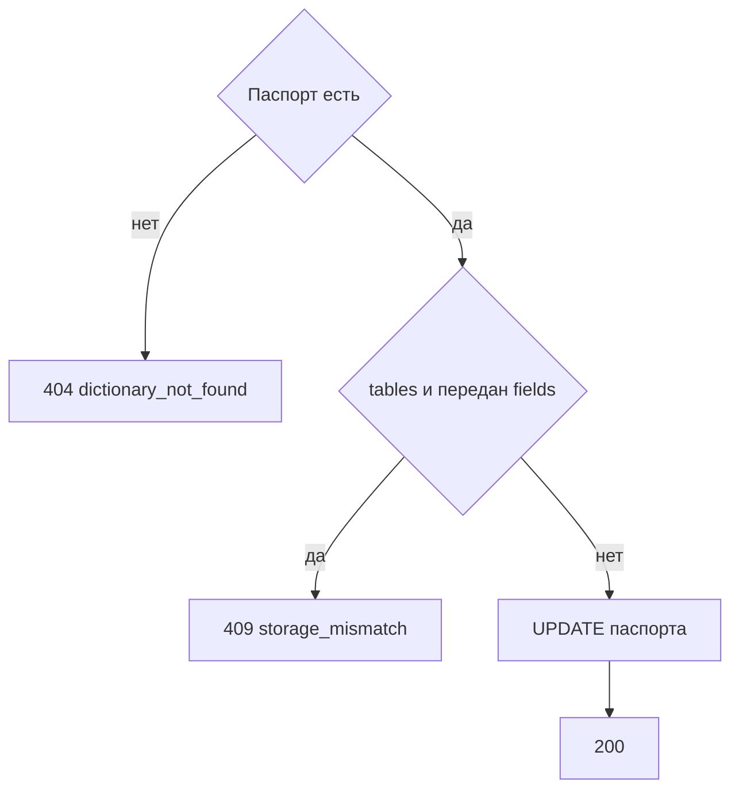

# [На главную](../../../API.md)

# Описание

PATCH **/admin/passports/{dictionary_code}**
Изменить название и владельца. Для `row` можно заменить список полей: колонки базы при этом не меняются, уже записанный `data` не проверяется. Для `tables` модель этим методом не меняется.

# Входные параметры

+ `dictionary_code`:
    + path
    + Обязательно
+ `dictionary_name`:
    + body
    + Обязательно
    + От 1 до 200 символов
+ `owner`:
    + body
    + Не обязательно
    + До 200 символов. Пустое значение очищает владельца
+ `fields`:
    + body
    + Не обязательно
    + Только для `storage = row`
    + Те же правила элементов, что у [создания паспорта](post_passports.md)
    + Переданный список заменяет прежний целиком

# Поля ответа

+ `dictionary_id`
+ `dictionary_code`
+ `dictionary_name`
+ `owner`
+ `status`
+ `storage`
+ `model`

# Алгоритм работы

## Валидация

1. Проверить тело: `dictionary_name` от 1 до 200, `owner` не длиннее 200, у `fields` те же ограничения, что при создании. Неизвестных полей нет.
    + Нарушение:
        + Код: `invalid_request`
        + Статус: `400`
2. Найти `dictionary` по коду без учёта регистра.
    + Нет строки:
        + Код: `dictionary_not_found`
        + Статус: `404`

## Бизнес-логика

1. `storage = tables` и в теле есть `fields`:
    + Код: `storage_mismatch`
    + Статус: `409`
2. Записать название, владельца и для `row` новый `model.fields`. Таблицы и строки не трогать.
3. Вернуть статус `200`.

Код и `storage` не меняются. Для `tables` смена колонок, таблиц и связей приходит черновиком редакции.
