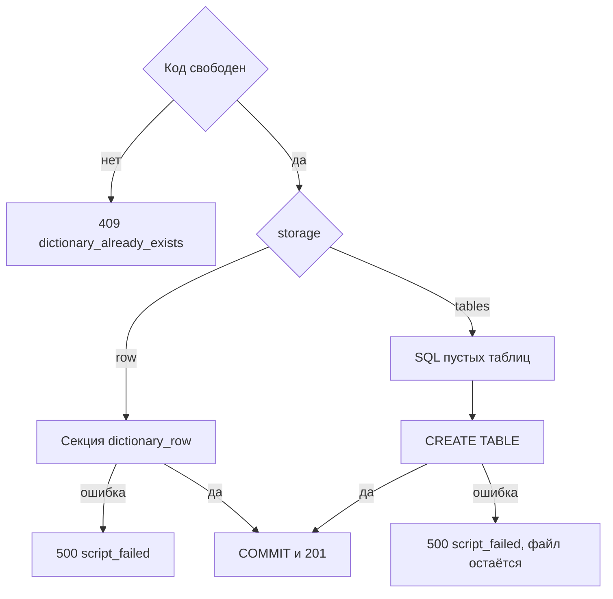

# [На главную](../../../API.md)

# Описание

POST **/admin/passports**
Создать паспорт. Версия не создаётся. Для `tables` в той же транзакции создаются пустые живые таблицы. Для `row` создаётся секция общей таблицы `dictionary_row`, отдельной таблицы справочника нет.

# Входные параметры

+ `dictionary_code`:
    + body
    + Обязательно
    + `^[A-Za-z][A-Za-z0-9_]{0,62}$`
    + Уникален без учёта регистра
    + После создания не меняется
+ `dictionary_name`:
    + body
    + Обязательно
    + От 1 до 200 символов
+ `owner`:
    + body
    + Не обязательно
    + До 200 символов, по умолчанию пусто
+ `storage`:
    + body
    + Обязательно
    + `row` или `tables`
+ `fields`:
    + body
    + Только для `storage = row`
    + Не обязательно
    + До 50 элементов, одинаковые `code` нельзя
+ `fields[].code`:
    + Обязательно, если элемент передан
    + `^[a-z][a-z0-9_]{0,62}$`
    + Не `value_code`, `parent_code`, `valid_from`, `valid_to`
+ `fields[].name`:
    + Обязательно, если элемент передан
    + От 1 до 200 символов
+ `fields[].type`:
    + Обязательно, если элемент передан
    + `string`, `integer`, `bigint`, `date`, `uuid`, `boolean`
+ `model`:
    + body
    + Обязательно для `storage = tables`
    + Для `row` не передаётся
    + Хотя бы одна таблица, не больше 30
    + Имя таблицы: `^[a-z][a-z0-9_]{0,62}$`
    + Имена `dictionary`, `dictionary_version`, `dictionary_schema`, `dictionary_history`, `dictionary_draft_row`, `dictionary_row` нельзя
+ `model.tables[имя].columns[]`:
    + `name` и `column`: `^[a-z][a-z0-9_]{0,62}$`
    + При создании `name` и `column` совпадают
    + `type`: `string`, `integer`, `bigint`, `date`, `uuid`, `boolean`
    + `nullable`: по умолчанию `true`
    + `length` обязателен для `string`, от 1 до 4000, по умолчанию 500
    + Не `valid_from`
+ `model.tables[имя].primary_key`:
    + Обязательно
    + Непустой список имён колонок этой таблицы
+ `model.foreign_keys[]`:
    + Не обязательно
    + `from_table`, `columns`, `ref_table`, `ref_columns`
    + `columns` и `ref_columns` одной длины, от 1 до 8
    + `ref_columns` совпадает с `primary_key` таблицы `ref_table`

# Поля ответа

+ `dictionary_id`
+ `dictionary_code`
+ `dictionary_name`
+ `owner`
+ `status` = `active`
+ `storage`
+ `model`
+ `versions` — пустой массив
+ `metadata_sql_path` — пусто при `storage = row`

# Алгоритм работы

## Валидация

1. Проверить тело: шаблон и длины, `storage` из двух значений, для `row` нет `model`, для `tables` есть `model` и нет `fields`.
    + Нарушение:
        + Код: `invalid_request`
        + Статус: `400`
2. Для `tables` проверить имена таблиц и колонок, типы, первичные ключи и внешние ключи по правилам тела.
    + Нарушение:
        + Код: `invalid_request`
        + Статус: `400`

## Бизнес-логика

1. Проверить уникальность `dictionary_code` без учёта регистра.
    + Код занят:
        + Код: `dictionary_already_exists`
        + Статус: `409`
2. Начать транзакцию.
3. Вставить `dictionary`. Новый `dictionary_id`, `status = active`. Для `row` в `model` записать `{"fields": ...}`. Для `tables` записать переданный `model`.
4. Для `row` создать секцию `dictionary_row_{dictionary_id без дефисов}` как `PARTITION OF dictionary_row FOR VALUES IN (dictionary_id)`. SQL-файл не писать.
    + Ошибка:
        + Код: `script_failed`
        + Статус: `500`
        + Транзакция откатывается
5. Для `tables` записать SQL в `db/sql-schema/{локальное время до секунды} - {dictionary_code}.sql`.
    + UTF-8 без BOM. Если имя занято, добавить `-2`, `-3` и далее
    + На каждую таблицу модели: `CREATE TABLE` без строк
    + Колонки модели, затем `valid_from date NOT NULL`
    + `string` → `varchar(length)`, остальные типы — одноимённый тип SQL
    + Первичный ключ — `primary_key`
    + Затем внешние ключи модели
    + Имена в двойных кавычках
6. Выполнить этот файл в той же транзакции.
    + Ошибка выполнения:
        + Код: `script_failed`
        + Статус: `500`
        + Транзакция откатывается, уже записанный SQL-файл остаётся
7. Зафиксировать транзакцию. Вернуть статус `201`.

Версия не создаётся. Для `row` колонки под поля справочника не появляются: значения пишутся в `data`. Для `tables` таблицы пустые, связей редакции ещё нет.
