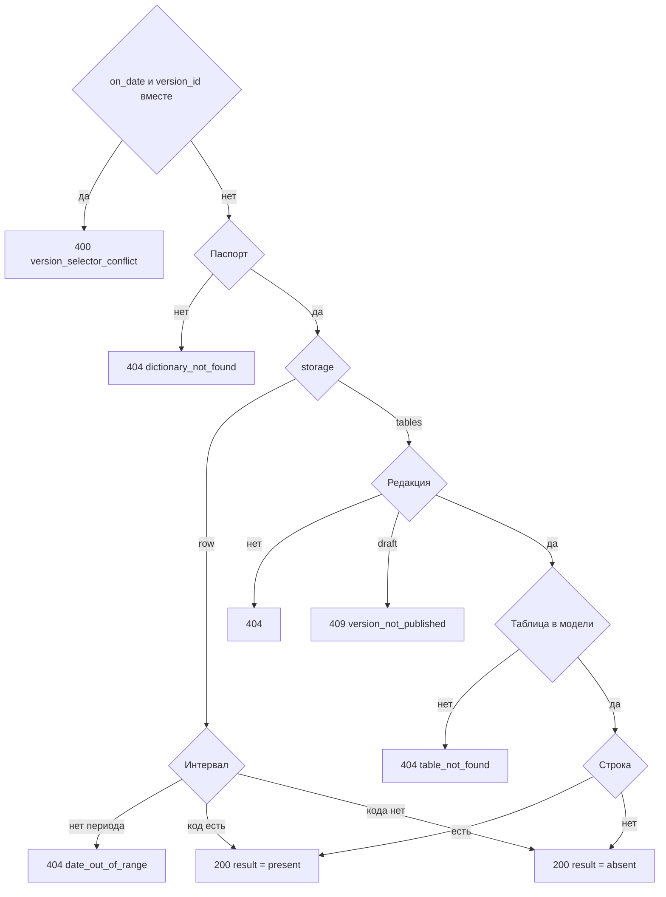

# [На главную](../../../API.md)

# Описание

GET **/dictionaries/{dictionary_code}/values/{value_code}**
Одно значение. Для `row` это интервал в `dictionary_row`. Для `tables` это строка таблицы на дату редакции по правилам [DB.md](../../../DB.md).

# Входные параметры

+ `dictionary_code`:
    + path
    + Обязательно
+ `value_code`:
    + path
    + Обязательно
    + Для `tables` это `row_key`: значения `primary_key` по порядку через `|`
+ `table_name`:
    + query
    + Обязательно для `tables`
    + Для `row` не передаётся
+ `on_date`:
    + query
    + Не обязательно
    + Дата `YYYY-MM-DD`
    + Вместе с `version_id` нельзя
+ `version_id`:
    + query
    + Не обязательно
    + Только для `tables`
    + Вместе с `on_date` нельзя

# Поля ответа

Ветка `storage = row`:

+ `dictionary_code`
+ `storage` = `row`
+ `result` — `present` или `absent`
+ `value_code`
+ `parent_code` — пусто при `absent`
+ `valid_from`
+ `valid_to`
+ `data` — пустой объект при `absent`

Ветка `storage = tables`:

+ `dictionary_code`
+ `storage` = `tables`
+ `table_name`
+ `version_id`
+ `version_status`
+ `valid_from` редакции
+ `valid_to` редакции
+ `result` — `present` или `absent`
+ `row_key`
+ `fields` — пустой объект при `absent`

`absent` возвращается со статусом `200`.

# Алгоритм работы

1. Проверить селектор и `table_name`.
    + Переданы и `on_date`, и `version_id`:
        + Код: `version_selector_conflict`
        + Статус: `400`
    + Дата не `YYYY-MM-DD`:
        + Код: `invalid_request`
        + Статус: `400`
2. Найти паспорт. `inactive` чтению не мешает.
    + Нет:
        + Код: `dictionary_not_found`
        + Статус: `404`
3. `storage = row` и передан `version_id` или `table_name`:
    + Код: `storage_mismatch`
    + Статус: `409`
4. Для `row` выбрать интервал.
    + Без даты — открытая строка этого кода. Нет строки — `result = absent`, статус `200`
    + С датой, если ни одна строка справочника не покрывает дату:
        + Код: `date_out_of_range`
        + Статус: `404`
    + С датой, если период справочника есть, — строка этого кода, у которой `valid_from <= дата` и (`valid_to` пуст или `valid_to >= дата`). Нет такой строки — `result = absent`, статус `200`
5. Для `tables` выбрать редакцию.
    + Без селектора — редакция `active`. Нет такой:
        + Код: `no_active_version`
        + Статус: `404`
    + `on_date` — редакция, где `valid_from <= дата` и (`valid_to` пуст или `valid_to >= дата`). Черновик не берётся. Нет периода:
        + Код: `date_out_of_range`
        + Статус: `404`
    + `version_id` — эта редакция. Нет строки:
        + Код: `version_not_found`
        + Статус: `404`
    + Редакция `draft`:
        + Код: `version_not_published`
        + Статус: `409`
6. Для `tables` взять модель редакции. `table_name` нет в `definition.tables`:
    + Код: `table_not_found`
    + Статус: `404`
7. Собрать строку на `valid_from` выбранной редакции, а если передан `on_date` — на эту дату. Правило — чтение на дату в [DB.md](../../../DB.md).
    + Строка есть — `result = present`
    + Строки нет — `result = absent`
8. Вернуть статус `200`.

Для `row` чтение открытого состояния и состояния на дату — один отбор по интервалу. Для `tables` поля, которых не было в модели выбранной редакции, в `fields` не входят. Запись по внешнему ключу читается повторным вызовом.
