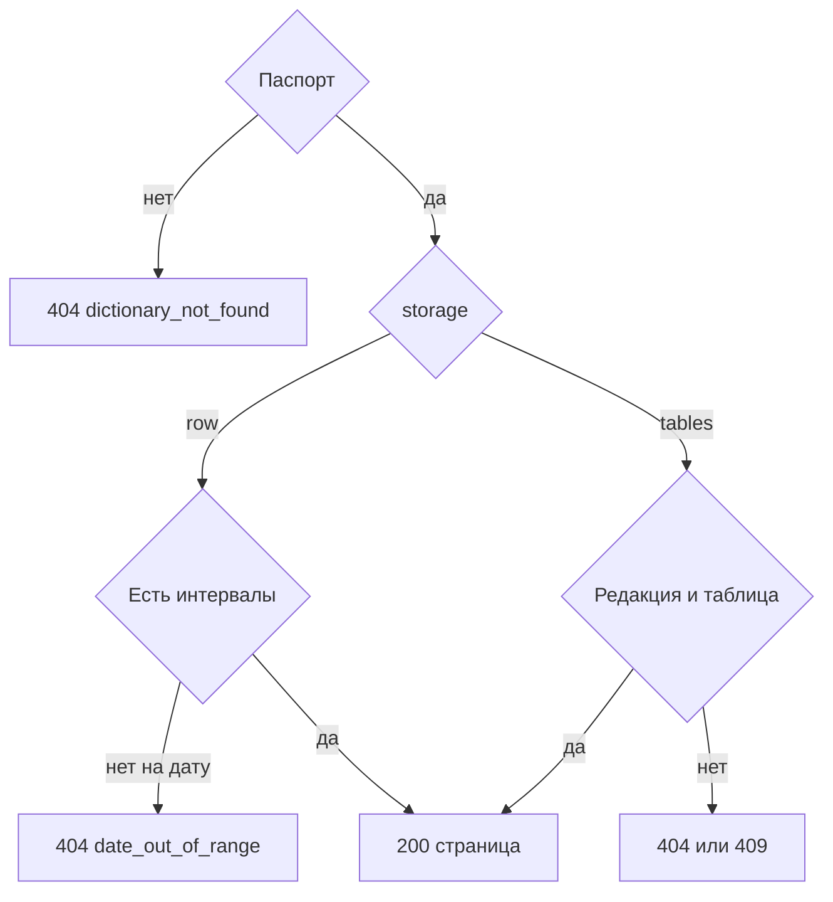

# [На главную](../../../API.md)

# Описание

GET **/dictionaries/{dictionary_code}/values**
Страница значений той же редакции или того же интервала, что у [одного значения](get_value.md). Порядок по коду строки.

# Входные параметры

+ `dictionary_code`:
    + path
    + Обязательно
+ `table_name`:
    + query
    + Обязательно для `tables`, для `row` не передаётся
+ `on_date`:
    + query
    + Не обязательно
    + Дата `YYYY-MM-DD`
    + Вместе с `version_id` нельзя
+ `version_id`:
    + query
    + Не обязательно
    + Только для `tables`
    + Вместе с `on_date` нельзя
+ `limit`:
    + query
    + Не обязательно
    + integer, от 1 до 1000, по умолчанию 100
+ `cursor`:
    + query
    + Не обязательно
    + Последний код предыдущей страницы
    + С курсором передаётся тот же выбор даты, редакции и таблицы

# Поля ответа

Ветка `storage = row`:

+ `dictionary_code`
+ `storage` = `row`
+ `items`:
    + `value_code`
    + `parent_code`
    + `valid_from`
    + `valid_to`
    + `data`
+ `next_cursor`

Ветка `storage = tables`:

+ `dictionary_code`
+ `storage` = `tables`
+ `table_name`
+ `version_id`
+ `version_status`
+ `valid_from`
+ `valid_to`
+ `items`:
    + `row_key`
    + `fields`
+ `next_cursor`

Пустая страница — `items` пустой, статус `200`.

# Алгоритм работы

1. Проверить селектор, `table_name`, `limit` и `cursor` так же, как у [одного значения](get_value.md).
    + Те же коды `invalid_request` и `version_selector_conflict`
2. Найти паспорт.
    + Нет:
        + Код: `dictionary_not_found`
        + Статус: `404`
3. Для `row` отвергнуть `version_id` и `table_name` кодом `storage_mismatch`, статус `409`. Выбрать интервалы на дату или открытые состояния. Нет ни одного интервала справочника на дату:
    + Код: `date_out_of_range`
    + Статус: `404`
4. Для `tables` выбрать редакцию теми же ветками, что у одного значения: `no_active_version`, `date_out_of_range`, `version_not_found`, `version_not_published`.
5. Для `tables` проверить `table_name` в модели редакции.
    + Нет таблицы:
        + Код: `table_not_found`
        + Статус: `404`
6. Собрать строки тем же правилом, что одно значение, оставить страницу после `cursor`. Вернуть статус `200`.

Страница не вкладывает запись по внешнему ключу. Курсор — код последней строки страницы.
