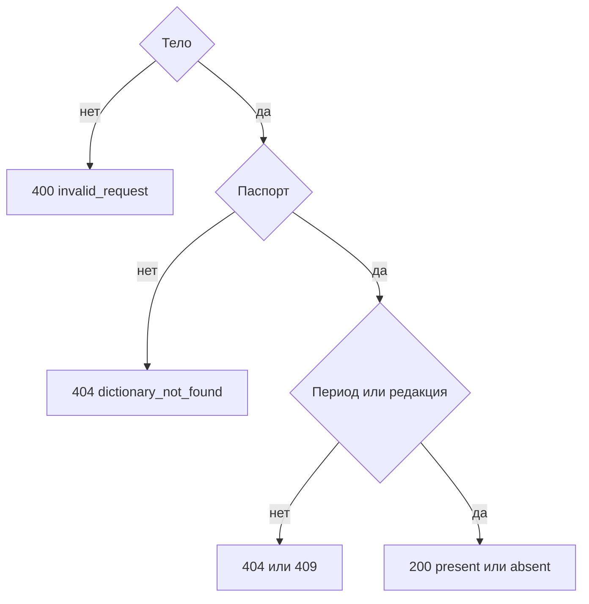

# [На главную](../../../API.md)

# Описание

POST **/dictionaries/{dictionary_code}/values/check**
Проверить набор кодов в том же отборе, что у [одного значения](get_value.md). Ничего не записывает.

# Входные параметры

+ `dictionary_code`:
    + path
    + Обязательно
+ `table_name`:
    + body
    + Обязательно для `tables`
    + Для `row` не передаётся
+ `on_date`:
    + body
    + Не обязательно
    + Дата `YYYY-MM-DD`
    + Вместе с `version_id` нельзя
+ `version_id`:
    + body
    + Не обязательно
    + Только для `tables`
    + Вместе с `on_date` нельзя
+ `value_codes`:
    + body
    + Обязательно
    + От 1 до 1000 кодов
    + Повтор в запросе в ответе один раз
    + Для `tables` код — это `row_key`

# Поля ответа

+ `dictionary_code`
+ `storage`
+ `table_name` — пусто у `row`
+ `version_id` — пусто у `row`
+ `version_status` — пусто у `row`
+ `valid_from` — пусто у `row` без даты и у `tables`, пока редакция не выбрана
+ `valid_to`
+ `items`:
    + Массив в порядке запрошенных кодов
    + `value_code`
    + `result` — `present` или `absent`
    + `name` — поле `name` или пусто

# Алгоритм работы

1. Проверить тело: список кодов, дата, взаимоисключение `on_date` и `version_id`.
    + Нарушение:
        + Код: `invalid_request`
        + Статус: `400`
    + Оба селектора:
        + Код: `version_selector_conflict`
        + Статус: `400`
2. Найти паспорт.
    + Нет:
        + Код: `dictionary_not_found`
        + Статус: `404`
3. Для `row` отвергнуть `version_id` и `table_name`:
    + Код: `storage_mismatch`
    + Статус: `409`
4. Выбрать период или редакцию теми же ветками, что у [одного значения](get_value.md): `date_out_of_range`, `no_active_version`, `version_not_found`, `version_not_published`, `table_not_found`.
5. Для каждого кода решить `present` или `absent` тем же чтением. Вернуть статус `200`.

Отсутствующий код внутри найденного периода — `absent` и общий статус `200`. Метод не создаёт интервал и не публикует редакцию.
