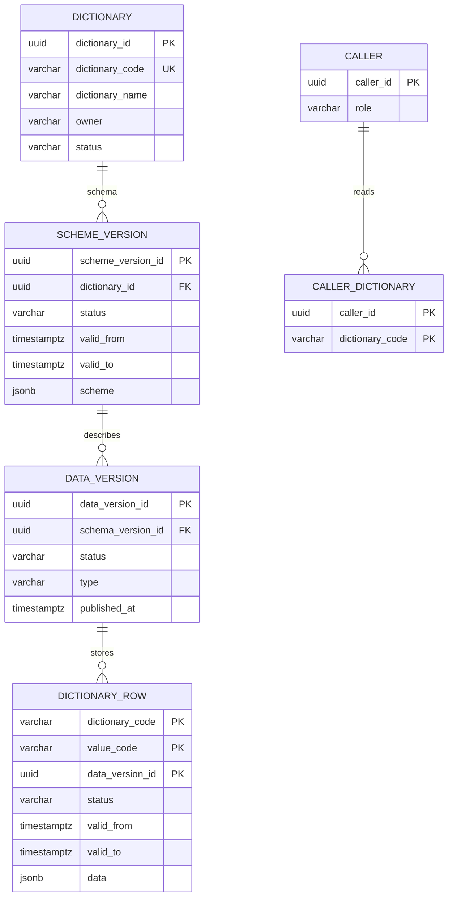

# Схема БД для API справочников

Пустая база поднимается скриптом [init.sql](db/init.sql): паспорт `dictionary`, версии схемы `scheme_version`, версии данных `data_version`, секционированная таблица `dictionary_row`, вызывающие `caller` и их наборы `caller_dictionary`. Секция справочника в скрипт не входит: её создаёт паспорт.

Все справочники хранят значения в `dictionary_row`. Полная схема лежит в `scheme` версии схемы. Строка помнит версию данных, а версия данных — схему, в которой её записали. Правка значений открывает новую версию данных и не открывает новую схему. У справочника одновременно не больше одной схемы `draft` и одной `active`, и не больше одной версии данных `draft`. История значения — соседняя опубликованная строка с другим периодом, а не копия всего справочника.

## ER-диаграмма

## Таблица `dictionary`

Реестр справочников. Хранит код, название, владельца и признак деактивации. Схему хранит `scheme` версии схемы.

| Поле | Тип | Ограничения | Назначение |
| --- | --- | --- | --- |
| dictionary_id | uuid | PK | Внутренний идентификатор |
| dictionary_code | varchar(63) | NOT NULL | Код справочника, его передаёт клиент |
| dictionary_name | varchar(200) | NOT NULL | Название для человека |
| owner | varchar(200) | NULL | Предметный владелец |
| status | varchar(16) | NOT NULL, по умолчанию active | `active` — паспорт не выключен, `inactive` — деактивирован |

Индексы и ограничения:

+ `ux_dictionary_code` на `lower(dictionary_code)`
+ `dictionary_status_check`: `status` только `active` или `inactive`

## Таблица `scheme_version`

Версия схемы. Период схемы — `valid_from` включительно и `valid_to` исключительно. У черновика оба поля пусты.

| Поле | Тип | Ограничения | Назначение |
| --- | --- | --- | --- |
| scheme_version_id | uuid | PK | Идентификатор версии схемы |
| dictionary_id | uuid | NOT NULL, FK -> dictionary.dictionary_id | Паспорт |
| status | varchar(16) | NOT NULL | `draft`, `active` или `closed` |
| valid_from | timestamptz | NULL | Начало действия схемы. Пусто у черновика |
| valid_to | timestamptz | NULL | Конец схемы, исключительно. Пусто у `draft` и `active` |
| scheme | jsonb | NOT NULL | Полная схема этой версии. Для каждой колонки: `field_id`, код (`code`), наименование (`name`), тип (`type`), обязательность (`required`), признак по умолчанию (`default`). У колонки `reference` ещё код справочника (`dictionary_code`) |

Индексы и ограничения:

+ первичный ключ `scheme_version_id`
+ `scheme_version_status_check`: `draft`, `active`, `closed`

Правила работы:

+ у справочника не больше одной версии `draft` и одной `active`
+ одна и та же колонка в разных версиях хранит один `field_id`. Новый `field_id` — новая колонка. Тот же `field_id` и другой `code` — переименование. Тот же `field_id` и другой `type` — смена типа. Тот же `field_id` и другой `dictionary_code` у `reference` — смена справочника ссылки. `field_id` нет в новой версии — колонка удалена
+ в `scheme` каждой версии есть колонка `code = name`. У неё `type = string`, `required = true`, `"default": true`. Другой колонки с `"default": true` нет. Её `field_id` не меняется, колонка не удаляется, `code`, `type` и `required` не меняются. Меняется только подпись
+ `type` — одно из `string`, `integer`, `number`, `boolean`, `reference`. `reference` — ссылка на элемент справочника. Код этого справочника лежит в схеме колонки: `dictionary_code`, `^[a-z][a-z0-9_]{0,62}$`. В `data` значение — код записи, `^[A-Za-z0-9_]{1,64}$`
+ новая строка схемы появляется при создании справочника и при открытии черновика схемы. Запись значения схему не создаёт

## Таблица `data_version`

Публикация значений. Ссылается на схему, в которой записаны её строки. Справочник версии данных — справочник этой схемы. У одной схемы таких публикаций несколько. Период элемента лежит на строке, не на этом заголовке.

| Поле | Тип | Ограничения | Назначение |
| --- | --- | --- | --- |
| data_version_id | uuid | PK | Идентификатор версии данных |
| schema_version_id | uuid | NOT NULL, FK -> scheme_version.scheme_version_id | Схема этой публикации |
| status | varchar(16) | NOT NULL | `draft` или `published` |
| type | varchar(8) | NOT NULL | `delta` — только изменённые строки. `full` — новый набор: при публикации закрываются все открытые строки |
| published_at | timestamptz | NULL | Момент публикации. Пусто у черновика |

Индексы и ограничения:

+ первичный ключ `data_version_id`
+ `data_version_status_check`: `draft` или `published`
+ `data_version_type_check`: `delta` или `full`

Правила работы:

+ у справочника не больше одной версии данных `draft`
+ `delta` ссылается на активную схему, если черновика схемы нет. Иначе — на черновик схемы
+ `full` выбирают при публикации. Смена состава или установка обязательности тоже открывает `full` на черновик схемы. Пока активной схемы нет, первая запись значений открывает `full`
+ публикация `delta` закрывает открытую строку только у кода, для которого есть черновая строка, моментом `valid_from` черновой строки. Этот момент строго позже начала открытой строки. Схему публикация не закрывает
+ публикация `full` закрывает каждую ранее открытую строку справочника моментом запроса и открывает строки этой версии. Схему может не менять: целиком справочник попадает в черновик загрузкой csv
+ загрузка csv заменяет черновые строки версии данных строками файла. Выгрузка csv отдаёт строки открытого режима, черновика или момента

## Таблица `dictionary_row`

Все значения всех справочников. Секция одна на `dictionary_code`: `PARTITION BY LIST (dictionary_code)`.

| Поле | Тип | Ограничения | Назначение |
| --- | --- | --- | --- |
| dictionary_code | varchar(63) | NOT NULL, входит в PK | Код справочника и ключ секции |
| value_code | varchar(64) | NOT NULL, входит в PK | Код значения |
| data_version_id | uuid | NOT NULL, входит в PK | Версия данных, в которой строку записали |
| status | varchar(16) | NOT NULL | `draft` — ещё не опубликована, `published` — входит в периоды |
| valid_from | timestamptz | NOT NULL | Начало состояния, включительно |
| valid_to | timestamptz | NULL | Конец состояния, исключительно. Пусто у открытого опубликованного состояния |
| data | jsonb | NOT NULL | Поля значения. Ключ — `code` колонки в версии `scheme_version_id`. У колонки `reference` значение — код записи справочника из схемы этой колонки |

Индексы и ограничения:

+ первичный ключ `(dictionary_code, value_code, data_version_id)`
+ `ix_dictionary_row_code` на `(dictionary_code, value_code, valid_from)`
+ секция `dictionary_row_{dictionary_code}` для `FOR VALUES IN (dictionary_code)`
+ `dictionary_row_status_check`: `draft` или `published`
+ база не проверяет ключи и типы внутри `data`

Правила работы:

+ у одного `value_code` одна строка `draft` и одна опубликованная строка с пустым `valid_to`
+ у черновой строки `valid_from` заполнен. Пока версия данных не опубликована, эта дата открытую строку не закрывает
+ ключ в `data` — `code` колонки схемы, на которую ссылается версия данных. Чтение находит значение по `field_id`

## Таблица `caller`

Вызывающий и его роль. Идентификатор приходит в заголовке `X-Caller-Id`.

| Поле | Тип | Ограничения | Назначение |
| --- | --- | --- | --- |
| caller_id | uuid | PK | Идентификатор вызывающего |
| role | varchar(16) | NOT NULL | `admin` — все методы и все справочники. `system` — только чтение, все справочники. `user` — только чтение, справочники из `caller_dictionary` |

Индексы и ограничения:

+ первичный ключ `caller_id`
+ `caller_role_check`: `admin`, `system` или `user`

Правила работы:

+ строку `admin` или `system` вносят при развёртывании
+ строку `user` создаёт [put_dictionaries.md](api/management.api/CallerController/put_dictionaries.md), если этого `caller_id` ещё нет
+ набор в `caller_dictionary` хранится у роли `user`

## Таблица `caller_dictionary`

Набор справочников одного обычного пользователя.

| Поле | Тип | Ограничения | Назначение |
| --- | --- | --- | --- |
| caller_id | uuid | PK, FK -> caller.caller_id | Обычный пользователь |
| dictionary_code | varchar(63) | PK | Код справочника из `dictionary.dictionary_code` |

Индексы и ограничения:

+ первичный ключ `(caller_id, dictionary_code)`

Правила работы:

+ запись набора заменяет все строки этого `caller_id`
+ код сверяется с паспортом при записи. Внешнего ключа нет: уникальность кода паспорта — индекс по `lower(dictionary_code)`

## Связи между таблицами

+ `dictionary 1 -> N scheme_version`
+ `scheme_version 1 -> N data_version`
+ `data_version 1 -> N dictionary_row` по `data_version_id` внутри секции `dictionary_code`, без внешнего ключа
+ `caller 1 -> N caller_dictionary`
