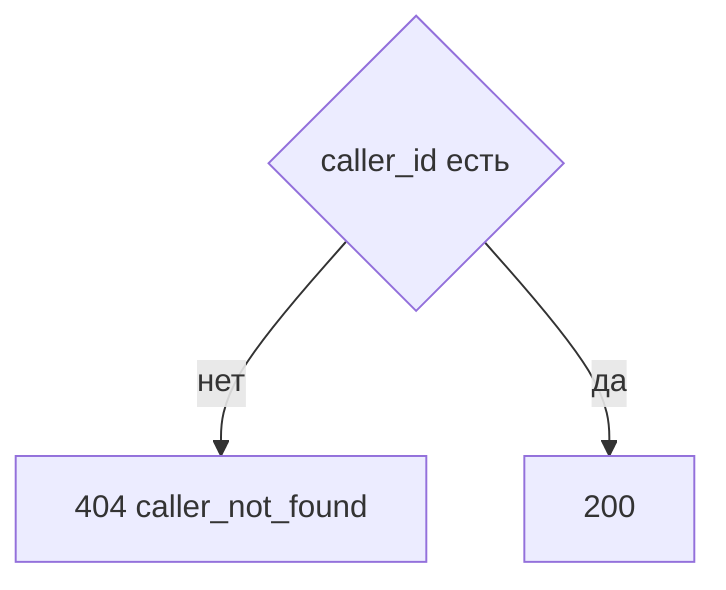

# [На главную](../../../API.md)

# Описание

GET **/admin/callers/{caller_id}**
Роль вызывающего и набор справочников. У роли `user` набор — строки `caller_dictionary`. У роли `admin` и `system` набор пуст: им доступны все справочники.

# Входные параметры

+ `X-Caller-Id`:
    + header
    + Обязательно
    + uuid
+ `caller_id`:
    + path
    + Обязательно
    + uuid

Тела нет.

# Поля ответа

+ `caller_id`
+ `role` — `admin`, `system` или `user`
+ `dictionary_codes` — коды справочников. Пустой список у роли `admin` и `system`

# Алгоритм работы

## Валидация

1. Прочитать заголовок `X-Caller-Id`: uuid. Нет заголовка или значение не uuid:
    + Код: `invalid_request`
    + Статус: `400`
2. Найти `caller` по этому идентификатору. Строки нет либо роль не `admin`:
    + Код: `forbidden`
    + Статус: `403`
3. Проверить `caller_id`: uuid.
    + Нарушение:
        + Код: `invalid_request`
        + Статус: `400`
4. Найти `caller` по `caller_id`.
    + Нет:
        + Код: `caller_not_found`
        + Статус: `404`

## Бизнес-логика

1. Вернуть роль и коды из `caller_dictionary` этого `caller_id`. Статус `200`.

Список кодов отсортирован по `dictionary_code`.
